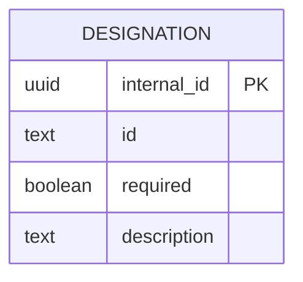

# Designation

> [Home](../../README.md) › [Metadata](../README.md) › [Entities](README.md) › Designation

| Version | Date | Status | Change |
| --- | --- | --- | --- |
| 1 | 2026-11-22 | Draft | Creation of the file |

| Tag | Value |
| --- | --- |
| File | `designations.json` |

A designation is what identifies the equipment a placed symbol stands for, such as its tag or its location. Metadata defines it once, by its `id` (`tag`, `location`); its text is written on each placed symbol: `P-101` for the tag of a pump, `Hall B` for where it stands. Designations belong to no type.

## The entity



```json
{
  "$schema": "https://json-schema.org/draft/2020-12/schema",
  "$id": "designation.schema.json",
  "title": "Synoptic Studio designation",
  "type": "object",
  "required": ["internal_id", "id", "required", "description"],
  "additionalProperties": false,
  "properties": {
    "internal_id": {
      "description": "Primary key.",
      "type": "string",
      "pattern": "^[0-9a-f]{8}-[0-9a-f]{4}-7[0-9a-f]{3}-[89ab][0-9a-f]{3}-[0-9a-f]{12}$",
      "readOnly": true
    },
    "id": {
      "description": "The key of the designation, such as tag or location.",
      "type": "string",
      "minLength": 1
    },
    "required": {
      "description": "Whether its text must be filled on every placed symbol.",
      "type": "boolean",
      "default": false
    },
    "description": {
      "description": "What the designation is, for people.",
      "type": ["string", "null"],
      "minLength": 1
    }
  }
}
```

## The file

```json
{
  "$schema": "https://json-schema.org/draft/2020-12/schema",
  "$id": "designations.schema.json",
  "title": "Synoptic Studio designations file",
  "type": "object",
  "required": ["format_version", "designations"],
  "additionalProperties": false,
  "properties": {
    "format_version": {
      "const": 1
    },
    "designations": {
      "description": "Every designation, in the order chosen by the user.",
      "type": "array",
      "items": { "$ref": "designation.schema.json" }
    }
  }
}
```
