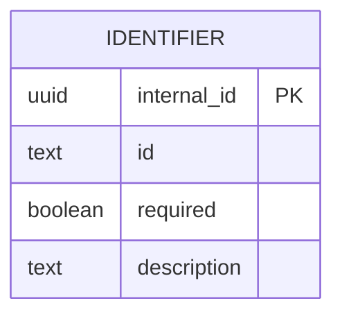

# Identifier

> [Home](../../README.md) › [Metadata](../README.md) › [Entities](README.md) › Identifier

| Version | Date | Status | Change |
| --- | --- | --- | --- |
| 1 | 2026-11-21 | Draft | Creation of the file |

| Tag | Value |
| --- | --- |
| File | Its own: one file for all the identifiers |

An identifier is a named key that each placed symbol fills with its own text, in the synoptic: the tag of a pump, for example `P-101`. Metadata only makes the key, never the text. Identifiers are global: they belong to no type, every type can use them, and they are all kept in one file.

## The entity



| Field | Required | Default | What it is | Rules |
| --- | --- | --- | --- | --- |
| `internal_id` |  |  | The UUID set by the software, version 7 (see [Rules of the schema](../data-model-notes.md#rules-of-the-schema)) | Never changes, never leaves the application. Every link to the identifier goes through it, so a changed `id` breaks nothing. |
| `id` | ✓ |  | The key | Written by the user. The public identifier, as for every entity of Metadata. Shown wherever the identifier is picked or filled. |
| `required` | ✓ | `false` | Whether its text must be filled | `true`: the text is asked on every placed symbol, whether or not its faceplate shows the identifier; left empty, the field is marked and the placed symbol is listed in the faults as a warning, and the synoptic is saved anyway. `false`: the text may stay empty. |
| `description` |  |  | What the identifier is | Plain text, for people. Empty: `null`. |

## The file

```json
{
  "$schema": "https://json-schema.org/draft/2020-12/schema",
  "title": "Synoptic Studio identifiers file",
  "type": "object",
  "required": ["format", "identifiers"],
  "additionalProperties": false,
  "properties": {
    "format": {
      "description": "Version of the file format.",
      "const": 1
    },
    "identifiers": {
      "description": "Every identifier, in the order chosen by the user.",
      "type": "array",
      "items": { "$ref": "#/$defs/identifier" }
    }
  },
  "$defs": {
    "identifier": {
      "type": "object",
      "required": ["internal_id", "id", "required", "description"],
      "additionalProperties": false,
      "properties": {
        "internal_id": {
          "description": "UUID version 7 (RFC 9562) set by the software, lower case, never changes.",
          "type": "string",
          "pattern": "^[0-9a-f]{8}-[0-9a-f]{4}-7[0-9a-f]{3}-[89ab][0-9a-f]{3}-[0-9a-f]{12}$"
        },
        "id": {
          "description": "The key, written by the user.",
          "type": "string"
        },
        "required": {
          "description": "true: its text must be filled on every placed symbol; empty, a warning, never a block.",
          "type": "boolean"
        },
        "description": {
          "description": "What the identifier is, plain text; null when empty.",
          "type": ["string", "null"]
        }
      }
    }
  }
}
```

## Open questions

- The name of the concept and of the page (still "Identifiers").
- The words `id` and `internal_id`: research T5.
- The name and the place of the file (`identifiers.json` at the root of Metadata: proposal).
- Must an `id` be unique on the page? May it be empty?
- Are the configuration files of a synoptic made while a required text is empty (proposal: yes, with the warning, since nothing blocks)?
- The other open questions of the page stay in the [whole draft](../draft.md#open-questions-8).
