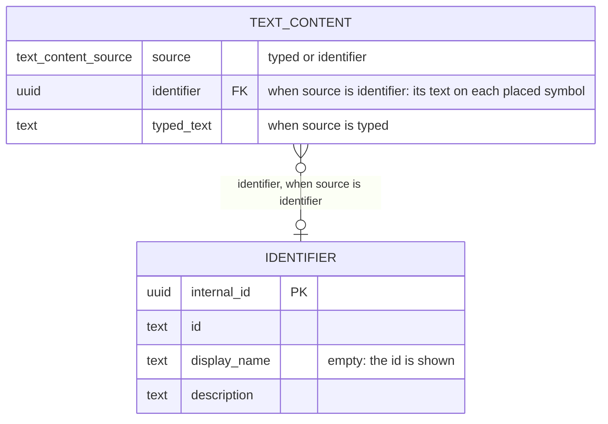

# Identifier

> [Home](../../README.md) › [Metadata](../README.md) › [Entities](README.md) › Identifier

Status: draft, written on 2026-11-21 at the Product Owner's request, from the page Identifiers of the [whole draft](../draft.md#identifiers) (decision 0048) and the [Data model](../data-model.md). Not validated. "Identifier" is still a working name.

An identifier is a named key that each placed symbol fills with its own text, in the synoptic: the tag of a pump, for example `P-101`. Metadata only makes the key, never the text. Identifiers are global: they belong to no type, every type can use them, and they are all kept in one file.

## The entity

An identifier has its internal ID and three fields, nothing else. A title or a description of a faceplate points to it.



| Field | What it is | Rule |
| --- | --- | --- |
| `internal_id` | The UUID set by the software, version 7 (see [Rules of the schema](../data-model-notes.md#rules-of-the-schema)) | Never changes, never leaves the application. A faceplate points to the identifier through it, so a changed `id` breaks nothing. |
| `id` | The key | Written by the user. The public identifier, as for every entity of Metadata. |
| `display_name` | The name people read | Shown in place of the `id`. Empty (`null`): the `id` is shown. |
| `description` | What the identifier is | Plain text, for people. Empty: `null`. |

- No value and no default value: the text in front of the key is filled on each placed symbol, in the synoptic (part 3).
- The order of the list is the order chosen by the user on the page Identifiers, with the handles.

## The file

All the identifiers are kept in one file, since they are global and their order is the order on the screen. Its name and its place are a proposal: `identifiers.json`, at the root of the Metadata folder, beside `types/` and `enums/`.

- `"format"` first, the version of the file format, as in every file (see [Files](../draft.md#files)).
- Then `identifiers`, the ordered list, named after the box in the plural.
- Each identifier keeps the field order of the schema: `internal_id`, `id`, then the texts.

### Example

Two made-up identifiers. The internal IDs are made up too; `…800` is the one the title of the [type example](../data-model.md#a-type) points to.

```json
{
  "format": 1,
  "identifiers": [
    {
      "internal_id": "01a1f800-0000-7000-8000-000000000800",
      "id": "tag",
      "display_name": "Tag",
      "description": "The tag of the equipment, as on the plant drawings."
    },
    {
      "internal_id": "01a1f800-0000-7000-8000-000000000801",
      "id": "location",
      "display_name": null,
      "description": null
    }
  ]
}
```

### JSON Schema

The rules of the file, in JSON Schema (draft 2020-12), so that a file can be checked by a program. It says only what the specification settles: nothing on how an `id` is written, nor on its uniqueness, both still open.

```json
{
  "$schema": "https://json-schema.org/draft/2020-12/schema",
  "title": "Synoptic Studio identifiers file",
  "type": "object",
  "required": ["format", "identifiers"],
  "additionalProperties": false,
  "properties": {
    "format": {
      "description": "Version of the file format.",
      "const": 1
    },
    "identifiers": {
      "description": "Every identifier, in the order chosen by the user.",
      "type": "array",
      "items": { "$ref": "#/$defs/identifier" }
    }
  },
  "$defs": {
    "identifier": {
      "type": "object",
      "required": ["internal_id", "id", "display_name", "description"],
      "additionalProperties": false,
      "properties": {
        "internal_id": {
          "description": "UUID version 7 (RFC 9562) set by the software, lower case, never changes.",
          "type": "string",
          "pattern": "^[0-9a-f]{8}-[0-9a-f]{4}-7[0-9a-f]{3}-[89ab][0-9a-f]{3}-[0-9a-f]{12}$"
        },
        "id": {
          "description": "The key, written by the user.",
          "type": "string"
        },
        "display_name": {
          "description": "The name people read; null: the id is shown.",
          "type": ["string", "null"]
        },
        "description": {
          "description": "What the identifier is, plain text; null when empty.",
          "type": ["string", "null"]
        }
      }
    }
  }
}
```

## Where it is used

| Thing | Created and changed in | Used in | In a symbol | In a synoptic |
| --- | --- | --- | --- | --- |
| Identifier (`id`, `display_name`, `description`), its order | Page Identifiers of Metadata | `TEXT_CONTENT` of a title or description element of a faceplate | No | Its text, filled on each placed symbol |
| File `identifiers.json` | The software, at each change on the page Identifiers | Read when Metadata opens | No | No |

## Open questions

- The name of the concept and of the page (still "Identifiers").
- The words `id` and `internal_id`: research T5.
- The name and the place of the file (`identifiers.json` at the root of Metadata: proposal).
- Must an `id` be unique on the page? May it be empty?
- The other open questions of the page stay in the [whole draft](../draft.md#open-questions-8).
