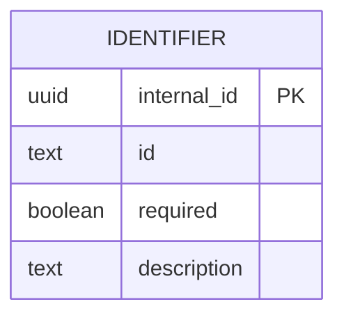

# Identifier

> [Home](../../README.md) › [Metadata](../README.md) › [Entities](README.md) › Identifier

| Version | Date | Status | Change |
| --- | --- | --- | --- |
| 1 | 2026-11-21 | Draft | Creation of the file |

| Tag | Value |
| --- | --- |
| File | `identifiers.json` |

An identifier is a named key that each placed symbol fills with its own text, in the synoptic: the tag of a pump, for example `P-101`. Metadata only makes the key, never the text. Identifiers are global: they belong to no type, every type can use them, and they are all kept in one file.

## The entity



| Field | Required | Default | What it is |
| --- | --- | --- | --- |
| `internal_id` | ✓ |  | The unique identifier inside the software, set by it. |
| `id` | ✓ |  | The key the user gives, never empty. It is the name shown in the software and the one written in the configuration files it makes, where `internal_id` never appears. |
| `required` | ✓ | `false` | Whether its text must be filled on every placed symbol. |
| `description` |  |  | What the identifier is, in plain text for people. |

```json
{
  "$schema": "https://json-schema.org/draft/2020-12/schema",
  "$id": "identifier.schema.json",
  "title": "Synoptic Studio identifier",
  "type": "object",
  "required": ["internal_id", "id", "required", "description"],
  "additionalProperties": false,
  "properties": {
    "internal_id": {
      "description": "Primary key, unique. UUID version 7 (RFC 9562), lower case, set by the software.",
      "type": "string",
      "pattern": "^[0-9a-f]{8}-[0-9a-f]{4}-7[0-9a-f]{3}-[89ab][0-9a-f]{3}-[0-9a-f]{12}$",
      "readOnly": true
    },
    "id": {
      "description": "The key the user gives; written in the configuration files in place of internal_id.",
      "type": "string",
      "minLength": 1
    },
    "required": {
      "description": "Whether its text must be filled on every placed symbol.",
      "type": "boolean",
      "default": false
    },
    "description": {
      "description": "What the identifier is, plain text for people.",
      "type": ["string", "null"],
      "minLength": 1
    }
  }
}
```

## The file

```json
{
  "$schema": "https://json-schema.org/draft/2020-12/schema",
  "$id": "identifiers.schema.json",
  "title": "Synoptic Studio identifiers file",
  "type": "object",
  "required": ["format", "identifiers"],
  "additionalProperties": false,
  "properties": {
    "format": {
      "description": "Version of the file format.",
      "const": 1
    },
    "identifiers": {
      "description": "Every identifier, in the order chosen by the user.",
      "type": "array",
      "items": { "$ref": "identifier.schema.json" }
    }
  }
}
```
