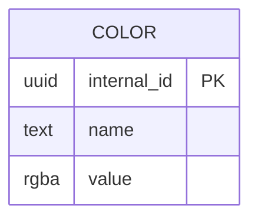

# Color

> [Home](../../README.md) › [Metadata](../README.md) › [Entities](README.md) › Color

| Version | Date | Status | Change |
| --- | --- | --- | --- |
| 1 | 2026-11-22 | Draft | Creation of the file |

A color is one color of a [Palette](03-palette.md), picked for the appearance of a type. It exists only inside its palette's file.

## The entity



```json
{
  "$schema": "https://json-schema.org/draft/2020-12/schema",
  "$id": "color.schema.json",
  "title": "Synoptic Studio color",
  "type": "object",
  "required": ["internal_id", "name", "value"],
  "additionalProperties": false,
  "properties": {
    "internal_id": {
      "description": "Primary key.",
      "type": "string",
      "pattern": "^[0-9a-f]{8}-[0-9a-f]{4}-7[0-9a-f]{3}-[89ab][0-9a-f]{3}-[0-9a-f]{12}$",
      "readOnly": true
    },
    "name": {
      "description": "A name for people; two colors of a palette may share it.",
      "type": ["string", "null"],
      "minLength": 1
    },
    "value": {
      "description": "The color in sRGB; its last two digits are the opacity, ff opaque, 00 fully transparent.",
      "type": "string",
      "pattern": "^#[0-9a-f]{8}$",
      "examples": ["#1f77b4ff"]
    }
  }
}
```
