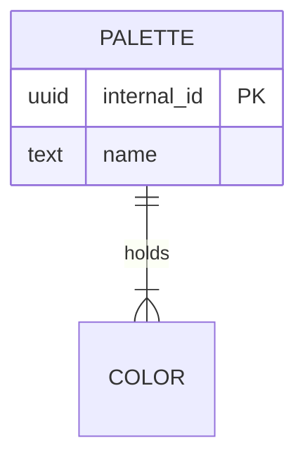

# Palette

> [Home](../../README.md) › [Metadata](../README.md) › [Entities](README.md) › Palette

| Version | Date | Status | Change |
| --- | --- | --- | --- |
| 1 | 2026-11-22 | Draft | Creation of the file |

| Tag | Value |
| --- | --- |
| File | `<name>.palette.json` |

A palette is a set of [colors](01-color.md): the only colors a type can pick.

## The entity



```json
{
  "$schema": "https://json-schema.org/draft/2020-12/schema",
  "$id": "palette.schema.json",
  "title": "Synoptic Studio palette",
  "type": "object",
  "required": ["internal_id", "name", "colors"],
  "additionalProperties": false,
  "properties": {
    "internal_id": {
      "description": "Primary key.",
      "type": "string",
      "pattern": "^[0-9a-f]{8}-[0-9a-f]{4}-7[0-9a-f]{3}-[89ab][0-9a-f]{3}-[0-9a-f]{12}$",
      "readOnly": true
    },
    "name": {
      "description": "Unique among the palettes.",
      "type": "string",
      "minLength": 1
    },
    "colors": {
      "description": "Every color of the palette, in the order chosen by the user.",
      "type": "array",
      "minItems": 1,
      "items": { "$ref": "color.schema.json" }
    }
  }
}
```

## The file

```json
{
  "$schema": "https://json-schema.org/draft/2020-12/schema",
  "$id": "palette-file.schema.json",
  "title": "Synoptic Studio palette file",
  "type": "object",
  "required": ["format_version", "palette"],
  "additionalProperties": false,
  "properties": {
    "format_version": {
      "const": 1
    },
    "palette": {
      "description": "The palette the file holds.",
      "$ref": "palette.schema.json"
    }
  }
}
```
