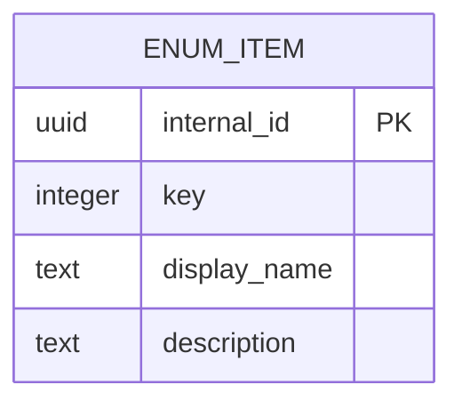

# Enum item

> [Home](../../README.md) › [Metadata](../README.md) › [Entities](README.md) › Enum item

| Version | Date | Status | Change |
| --- | --- | --- | --- |
| 1 | 2026-11-22 | Draft | Creation of the file |

An enum item is one value of an [Enum](05-enum.md): the whole number the model receives, and the name people read in its place. It exists only inside its enum.

## The entity



```json
{
  "$schema": "https://json-schema.org/draft/2020-12/schema",
  "$id": "enum-item.schema.json",
  "title": "Synoptic Studio enum item",
  "type": "object",
  "required": ["internal_id", "key", "display_name", "description"],
  "additionalProperties": false,
  "properties": {
    "internal_id": {
      "description": "Primary key.",
      "type": "string",
      "pattern": "^[0-9a-f]{8}-[0-9a-f]{4}-7[0-9a-f]{3}-[89ab][0-9a-f]{3}-[0-9a-f]{12}$",
      "readOnly": true
    },
    "key": {
      "description": "The whole number the model receives, chosen by the user; unique in its enum.",
      "type": "integer"
    },
    "display_name": {
      "description": "What people read in place of the key; empty, the key is shown.",
      "type": ["string", "null"],
      "minLength": 1
    },
    "description": {
      "description": "What the item means, for people.",
      "type": ["string", "null"],
      "minLength": 1
    }
  }
}
```

## Open questions

- The items of a template, completed on each placed symbol, follow this schema too (`TEMPLATE_ITEM` of the [synoptics data model](../../synoptics/11-data-model.md) has the same fields): to settle with the synoptics.
