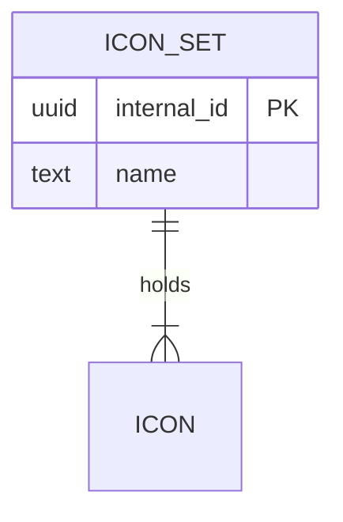

# Icon set

> [Home](../../README.md) › [Metadata](../README.md) › [Entities](README.md) › Icon set

| Version | Date | Status | Change |
| --- | --- | --- | --- |
| 1 | 2026-11-22 | Draft | Creation of the file |

| Tag | Value |
| --- | --- |
| File | `<name>.icon-set.json` |

An icon set is a set of [icons](03-icon.md) of one style or one origin, such as Carbon's or Microsoft's: the icons a type can pick. A user's icon set of the same file name replaces the software's: that is how the icon sets the software ships are overridden. An icon set says nothing of where its icons come from nor of their licence.

## The entity



```json
{
  "$schema": "https://json-schema.org/draft/2020-12/schema",
  "$id": "icon-set.schema.json",
  "title": "Synoptic Studio icon set",
  "type": "object",
  "required": ["internal_id", "name", "icons"],
  "additionalProperties": false,
  "properties": {
    "internal_id": {
      "description": "Primary key.",
      "type": "string",
      "pattern": "^[0-9a-f]{8}-[0-9a-f]{4}-7[0-9a-f]{3}-[89ab][0-9a-f]{3}-[0-9a-f]{12}$",
      "readOnly": true
    },
    "name": {
      "description": "Unique among the icon sets.",
      "type": "string",
      "minLength": 1,
      "examples": ["Carbon"]
    },
    "icons": {
      "description": "Every icon of the set, in the order chosen by the user.",
      "type": "array",
      "minItems": 1,
      "items": { "$ref": "icon.schema.json" }
    }
  }
}
```

## The file

```json
{
  "$schema": "https://json-schema.org/draft/2020-12/schema",
  "$id": "icon-set-file.schema.json",
  "title": "Synoptic Studio icon set file",
  "type": "object",
  "required": ["format_version", "icon_set"],
  "additionalProperties": false,
  "properties": {
    "format_version": {
      "const": 1
    },
    "icon_set": {
      "description": "The icon set the file holds.",
      "$ref": "icon-set.schema.json"
    }
  }
}
```
