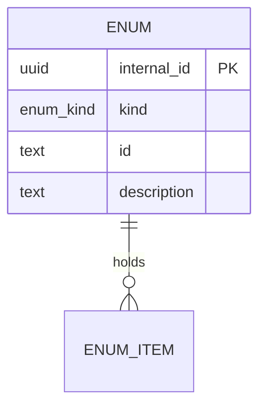

# Enum

> [Home](../../README.md) › [Metadata](../README.md) › [Entities](README.md) › Enum

| Version | Date | Status | Change |
| --- | --- | --- | --- |
| 1 | 2026-11-22 | Draft | Creation of the file |

| Tag | Value |
| --- | --- |
| File | `enums.json` |

An enum is a named list of [items](05-enum-item.md), picked by a signal whose value is an enum. A global enum is the same everywhere; a template has only its `id` and its description here, its items being completed on each placed symbol. Every enum is kept in one file. A built-in enum is an enum like the others, shipped in the software's internal `enums.json`; a user's enum of the same `internal_id` overrides it (see [Built-in enums](../draft.md#built-in-enums)).

## The entity



```json
{
  "$schema": "https://json-schema.org/draft/2020-12/schema",
  "$id": "enum.schema.json",
  "title": "Synoptic Studio enum",
  "type": "object",
  "required": ["internal_id", "kind", "id", "description", "enum_items"],
  "additionalProperties": false,
  "properties": {
    "internal_id": {
      "description": "Primary key.",
      "type": "string",
      "pattern": "^[0-9a-f]{8}-[0-9a-f]{4}-7[0-9a-f]{3}-[89ab][0-9a-f]{3}-[0-9a-f]{12}$",
      "readOnly": true
    },
    "kind": {
      "description": "global: its items are written here, the same everywhere; template: its items are completed on each placed symbol. It can change at any time.",
      "enum": ["global", "template"]
    },
    "id": {
      "description": "The key of the enum, such as operating_mode; unique among the enums.",
      "type": "string",
      "minLength": 1
    },
    "description": {
      "description": "What the enum is about as a whole, for people.",
      "type": ["string", "null"],
      "minLength": 1
    },
    "enum_items": {
      "description": "Every item, in the order chosen by the user. A template keeps the items it had as a global enum, unused, so that going back to global finds them.",
      "type": "array",
      "items": { "$ref": "enum-item.schema.json" }
    }
  }
}
```

## The file

```json
{
  "$schema": "https://json-schema.org/draft/2020-12/schema",
  "$id": "enums.schema.json",
  "title": "Synoptic Studio enums file",
  "type": "object",
  "required": ["format_version", "enums"],
  "additionalProperties": false,
  "properties": {
    "format_version": {
      "const": 1
    },
    "enums": {
      "description": "Every enum.",
      "type": "array",
      "items": { "$ref": "enum.schema.json" }
    }
  }
}
```
