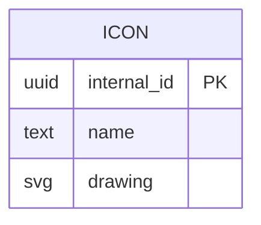

# Icon

> [Home](../../README.md) › [Metadata](../README.md) › [Entities](README.md) › Icon

| Version | Date | Status | Change |
| --- | --- | --- | --- |
| 1 | 2026-11-22 | Draft | Creation of the file |

An icon is one drawing of an [Icon set](07-icon-set.md), picked for the appearance of a type. It exists only inside its icon set's file.

## The entity



```json
{
  "$schema": "https://json-schema.org/draft/2020-12/schema",
  "$id": "icon.schema.json",
  "title": "Synoptic Studio icon",
  "type": "object",
  "required": ["internal_id", "name", "drawing"],
  "additionalProperties": false,
  "properties": {
    "internal_id": {
      "description": "Primary key.",
      "type": "string",
      "pattern": "^[0-9a-f]{8}-[0-9a-f]{4}-7[0-9a-f]{3}-[89ab][0-9a-f]{3}-[0-9a-f]{12}$",
      "readOnly": true
    },
    "name": {
      "description": "A name for people, read on hover and searched in the list; two icons of a set may share it.",
      "type": ["string", "null"],
      "minLength": 1,
      "examples": ["centrifugal-pump"]
    },
    "drawing": {
      "description": "The whole SVG of the icon, from <svg> to </svg>: an ordinary SVG, which may have a viewBox. Drawn with fills only, never strokes, even its thin lines. The software puts the color of the type on every fill, whatever color the drawing gives it: an icon is always of one color. An icon drawn with a stroke is shown as it is, its stroke not always of the color of the type.",
      "type": "string",
      "minLength": 1
    }
  }
}
```

## Open questions

- What the hover and the search show for an icon without a name: with the screens.
