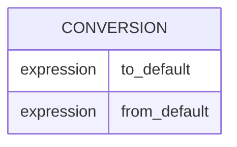

# Conversion

> [Home](../../README.md) › [Metadata](../README.md) › [Entities](README.md) › Conversion

| Version | Date | Status | Change |
| --- | --- | --- | --- |
| 1 | 2026-11-22 | Draft | Creation of the file |

A conversion turns a value of a [unit](08-unit.md) into the default unit of its [quantity](10-quantity.md), and back, by two formulas in `x`, written as [Formulas](../formulas.md) says. Every unit but the default unit has one, kept inside the unit; it has no `internal_id`, since nothing points to it. Any unit goes to any other of its quantity, whatever their unit systems, through the default unit: `to_default` of the first, then `from_default` of the second (metre to mile: `x`, then `x / 1609.344`). A difference is converted by the software from the same two formulas: `to_default(x) − to_default(0)`, and back `from_default(x) − from_default(0)`.

## The entity



```json
{
  "$schema": "https://json-schema.org/draft/2020-12/schema",
  "$id": "conversion.schema.json",
  "title": "Synoptic Studio conversion",
  "type": "object",
  "required": ["to_default", "from_default"],
  "additionalProperties": false,
  "properties": {
    "to_default": {
      "description": "Takes x in this unit and gives the value in the default unit.",
      "type": "string",
      "minLength": 1,
      "examples": ["x + 273.15"]
    },
    "from_default": {
      "description": "Takes x in the default unit and gives the value in this unit. It undoes to_default, as the tests of the catalogue check.",
      "type": "string",
      "minLength": 1,
      "examples": ["x - 273.15"]
    }
  }
}
```
