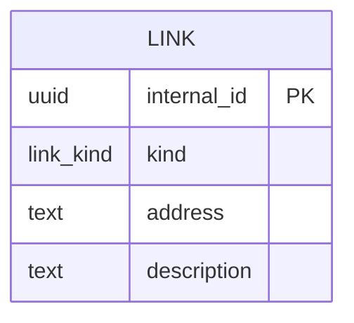

# Link

> [Home](../../README.md) › [Metadata](../README.md) › [Entities](README.md) › Link

| Version | Date | Status | Change |
| --- | --- | --- | --- |
| 1 | 2026-11-22 | Draft | Creation of the file |

A link points from the [Documentation](10-documentation.md) of a type to a file, a folder or a web page. It exists only inside its documentation, in the type's file. Only the address is kept: no document is ever loaded, copied or embedded.

## The entity



```json
{
  "$schema": "https://json-schema.org/draft/2020-12/schema",
  "$id": "link.schema.json",
  "title": "Synoptic Studio link",
  "type": "object",
  "required": ["internal_id", "kind", "address", "description"],
  "additionalProperties": false,
  "properties": {
    "internal_id": {
      "description": "Primary key.",
      "type": "string",
      "pattern": "^[0-9a-f]{8}-[0-9a-f]{4}-7[0-9a-f]{3}-[89ab][0-9a-f]{3}-[0-9a-f]{12}$",
      "readOnly": true
    },
    "kind": {
      "description": "A path to a file or a folder, or the URL of a web page.",
      "enum": ["path", "url"]
    },
    "address": {
      "description": "The path, kept as it was chosen, with no translation; or the URL, as it was typed or pasted.",
      "type": "string",
      "minLength": 1,
      "examples": ["W:/projects/line-1/datasheets/P-101.pdf", "https://example.com/datasheets/centrifugal-pump"]
    },
    "description": {
      "description": "What the link leads to, in plain text.",
      "type": ["string", "null"],
      "minLength": 1,
      "examples": ["Datasheet"]
    }
  }
}
```

## Open questions

- Is the description of a link optional, like every other description of Metadata? Written optional for now.
