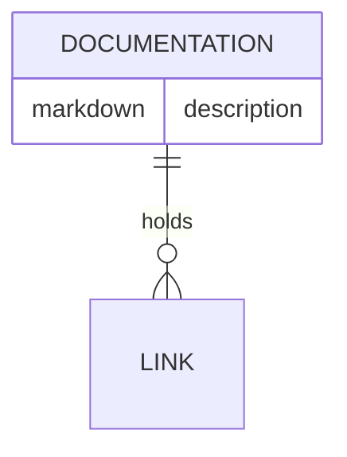

# Documentation

> [Home](../../README.md) › [Metadata](../README.md) › [Entities](README.md) › Documentation

| Version | Date | Status | Change |
| --- | --- | --- | --- |
| 1 | 2026-11-22 | Draft | Creation of the file |

The documentation explains a type to people: a description and [links](09-link.md) to documents and sources. Each type has exactly one, kept inside the type's file; it has no `internal_id`, since nothing points to it. Neither the description nor the links go to the model.

## The entity



```json
{
  "$schema": "https://json-schema.org/draft/2020-12/schema",
  "$id": "documentation.schema.json",
  "title": "Synoptic Studio documentation",
  "type": "object",
  "required": ["description", "links"],
  "additionalProperties": false,
  "properties": {
    "description": {
      "description": "What the type is, in Markdown.",
      "type": ["string", "null"],
      "minLength": 1,
      "examples": ["A **centrifugal** pump, driven by a variable speed motor."]
    },
    "links": {
      "description": "Every link of the documentation, in the order chosen by the user.",
      "type": "array",
      "items": { "$ref": "link.schema.json" }
    }
  }
}
```
