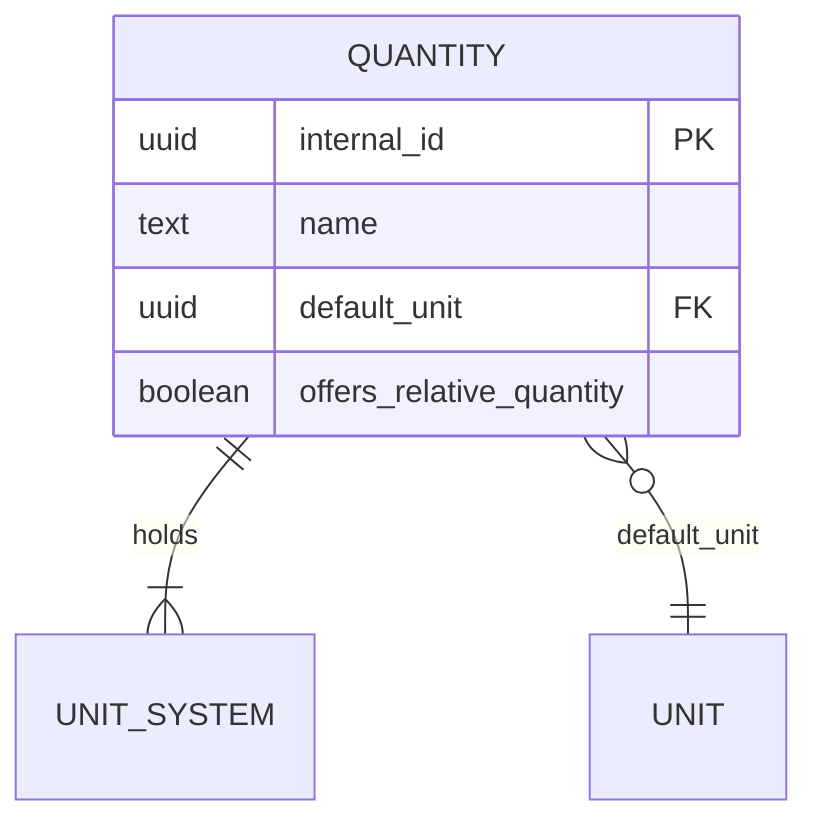

# Quantity

> [Home](../../README.md) › [Metadata](../README.md) › [Entities](README.md) › Quantity

| Version | Date | Status | Change |
| --- | --- | --- | --- |
| 1 | 2026-11-22 | Draft | Creation of the file |

| Tag | Value |
| --- | --- |
| File | `<name>.quantity.json` |

A quantity is what a value measures, such as mass or temperature: a signal whose value is an integer or a real picks one. Its [units](08-unit.md) are grouped in [unit systems](09-unit-system.md), and each converts to its default unit. Quantities ship with the software, one file each, read only in it; contributors add those that are missing.

## The entity



```json
{
  "$schema": "https://json-schema.org/draft/2020-12/schema",
  "$id": "quantity.schema.json",
  "title": "Synoptic Studio quantity",
  "type": "object",
  "required": ["internal_id", "name", "default_unit", "offers_relative_quantity", "unit_systems"],
  "additionalProperties": false,
  "properties": {
    "internal_id": {
      "description": "Primary key.",
      "type": "string",
      "pattern": "^[0-9a-f]{8}-[0-9a-f]{4}-7[0-9a-f]{3}-[89ab][0-9a-f]{3}-[0-9a-f]{12}$",
      "readOnly": true
    },
    "name": {
      "description": "Unique among the quantities.",
      "type": "string",
      "minLength": 1,
      "examples": ["temperature"]
    },
    "default_unit": {
      "description": "Foreign key to one of its own units: every conversion of the quantity is written against it.",
      "type": "string",
      "pattern": "^[0-9a-f]{8}-[0-9a-f]{4}-7[0-9a-f]{3}-[89ab][0-9a-f]{3}-[0-9a-f]{12}$"
    },
    "offers_relative_quantity": {
      "description": "Whether a signal of this quantity may hold a difference. Only for a quantity whose conversions all multiply then shift, such as temperature, as the tests of the catalogue check.",
      "type": "boolean",
      "default": false
    },
    "unit_systems": {
      "description": "Every unit system of the quantity, in the order of the file.",
      "type": "array",
      "minItems": 1,
      "items": { "$ref": "unit-system.schema.json" }
    }
  }
}
```

## The file

```json
{
  "$schema": "https://json-schema.org/draft/2020-12/schema",
  "$id": "quantity-file.schema.json",
  "title": "Synoptic Studio quantity file",
  "type": "object",
  "required": ["format_version", "quantity"],
  "additionalProperties": false,
  "properties": {
    "format_version": {
      "const": 1
    },
    "quantity": {
      "description": "The quantity the file holds.",
      "$ref": "quantity.schema.json"
    }
  }
}
```

## Open questions

- The default unit is also the model unit while the model unit stays in the catalogue. If the model unit moves to a configuration of the project, it becomes a field of its own, and the default unit stays the unit the formulas are written against.
