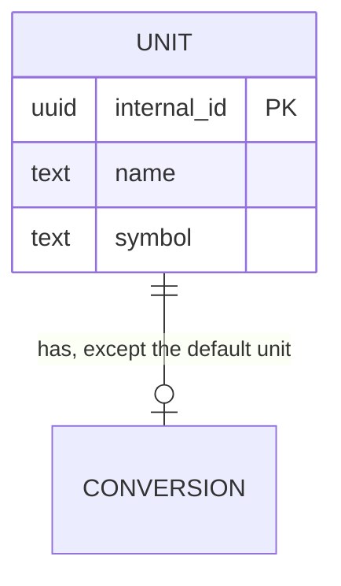

# Unit

> [Home](../../README.md) › [Metadata](../README.md) › [Entities](README.md) › Unit

| Version | Date | Status | Change |
| --- | --- | --- | --- |
| 1 | 2026-11-22 | Draft | Creation of the file |

A unit is one way to count a [quantity](14-quantity.md): the kilogram is a unit of the mass. It exists only inside its [unit system](13-unit-system.md), in its quantity's file. A unit is flat: m³/h is one unit with its own [conversion](11-conversion.md), nothing is deduced from its parts.

## The entity



```json
{
  "$schema": "https://json-schema.org/draft/2020-12/schema",
  "$id": "unit.schema.json",
  "title": "Synoptic Studio unit",
  "type": "object",
  "required": ["internal_id", "name", "symbol"],
  "additionalProperties": false,
  "properties": {
    "internal_id": {
      "description": "Primary key.",
      "type": "string",
      "pattern": "^[0-9a-f]{8}-[0-9a-f]{4}-7[0-9a-f]{3}-[89ab][0-9a-f]{3}-[0-9a-f]{12}$",
      "readOnly": true
    },
    "name": {
      "description": "Unique among the units of its quantity, with its variant when one name hides several values, such as US gallon or thermochemical calorie.",
      "type": "string",
      "minLength": 1,
      "examples": ["degree Celsius"]
    },
    "symbol": {
      "description": "What is written after a value in this unit, the same for a difference. Empty when nothing is written, such as the unit 1 of a count: 12, not 12 1.",
      "type": ["string", "null"],
      "minLength": 1,
      "examples": ["°C"]
    },
    "conversion": {
      "description": "Every unit but the default unit of its quantity has one; the default unit has none.",
      "$ref": "conversion.schema.json"
    }
  }
}
```
