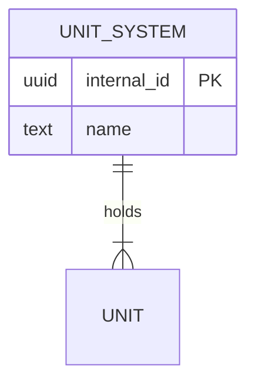

# Unit system

> [Home](../../README.md) › [Metadata](../README.md) › [Entities](README.md) › Unit system

| Version | Date | Status | Change |
| --- | --- | --- | --- |
| 1 | 2026-11-22 | Draft | Creation of the file |

A unit system groups the [units](12-unit.md) of a [quantity](14-quantity.md) that belong to one system, such as metric or imperial. It only groups them for reading: every unit converts to the default unit of its quantity, never to another system. It exists only inside its quantity's file.

## The entity



```json
{
  "$schema": "https://json-schema.org/draft/2020-12/schema",
  "$id": "unit-system.schema.json",
  "title": "Synoptic Studio unit system",
  "type": "object",
  "required": ["internal_id", "name", "units"],
  "additionalProperties": false,
  "properties": {
    "internal_id": {
      "description": "Primary key.",
      "type": "string",
      "pattern": "^[0-9a-f]{8}-[0-9a-f]{4}-7[0-9a-f]{3}-[89ab][0-9a-f]{3}-[0-9a-f]{12}$",
      "readOnly": true
    },
    "name": {
      "description": "The system its units belong to; unique among the unit systems of its quantity.",
      "type": "string",
      "minLength": 1,
      "examples": ["metric"]
    },
    "units": {
      "description": "Every unit of the system, in any order: the software sorts them by the size of one step in the default unit, smallest first, then by name; two steps equal within a relative tolerance of 1e-9 count as equal. The units of a quantity whose conversions give no finite step keep the order of the file.",
      "type": "array",
      "minItems": 1,
      "items": { "$ref": "unit.schema.json" }
    }
  }
}
```
