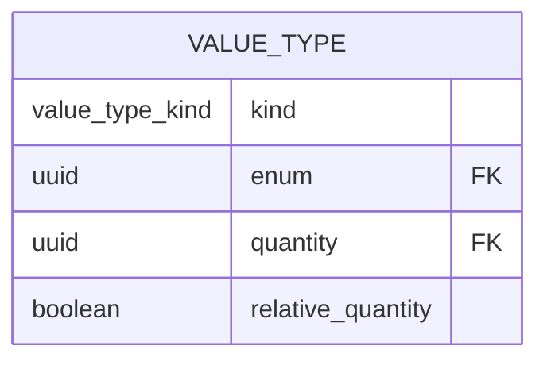

# Value type

> [Home](../../README.md) › [Metadata](../README.md) › [Entities](README.md) › Value type

| Version | Date | Status | Change |
| --- | --- | --- | --- |
| 1 | 2026-11-22 | Draft | Creation of the file |

The value type says what kind of value a [signal](16-signal.md) holds: a whole number, a number, true or false, or an item of an [enum](06-enum.md). An integer or a real measures a [quantity](10-quantity.md), or a difference of it. When its enum is deleted, its signal is flagged in error and kept as written, until another enum is picked. Each signal has exactly one, kept inside the signal; it has no `internal_id`, since nothing points to it.

## The entity



```json
{
  "$schema": "https://json-schema.org/draft/2020-12/schema",
  "$id": "value-type.schema.json",
  "title": "Synoptic Studio value type",
  "type": "object",
  "required": ["kind"],
  "additionalProperties": false,
  "properties": {
    "kind": {
      "description": "integer: a whole number; real: a 64-bit number; boolean: true or false; enum: one item of an enum.",
      "enum": ["integer", "real", "boolean", "enum"]
    },
    "enum": {
      "description": "Foreign key to the enum whose items the value takes, a global enum or a template.",
      "type": "string",
      "pattern": "^[0-9a-f]{8}-[0-9a-f]{4}-7[0-9a-f]{3}-[89ab][0-9a-f]{3}-[0-9a-f]{12}$"
    },
    "quantity": {
      "description": "Foreign key to the quantity the value measures, picked in the catalogue.",
      "type": "string",
      "pattern": "^[0-9a-f]{8}-[0-9a-f]{4}-7[0-9a-f]{3}-[89ab][0-9a-f]{3}-[0-9a-f]{12}$"
    },
    "relative_quantity": {
      "description": "Whether the value is a difference of the quantity, such as a temperature rise, rather than the quantity itself. True only for a quantity that offers it.",
      "type": "boolean",
      "default": false
    }
  },
  "allOf": [
    {
      "if": { "properties": { "kind": { "const": "enum" } } },
      "then": { "required": ["enum"] },
      "else": { "properties": { "enum": false } }
    },
    {
      "if": { "properties": { "kind": { "enum": ["integer", "real"] } } },
      "then": { "required": ["quantity", "relative_quantity"] },
      "else": { "properties": { "quantity": false, "relative_quantity": false } }
    }
  ]
}
```
