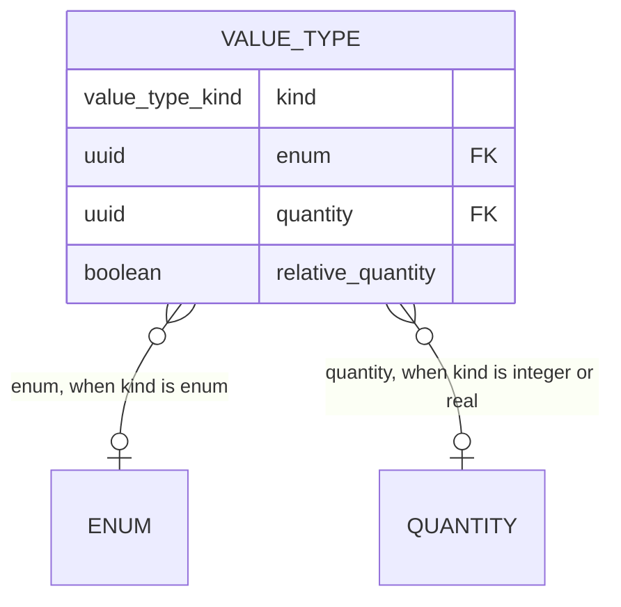

# Value type

> [Home](../../README.md) › [Metadata](../README.md) › [Entities](README.md) › Value type

| Version | Date | Status | Change |
| --- | --- | --- | --- |
| 1 | 2026-11-22 | Draft | Creation of the file |

The value type says what kind of value a [signal](16-signal.md) holds. Its `kind` decides which other fields it has: a number (`integer` or `real`) measures a [quantity](14-quantity.md), or a difference of it; a `boolean` has nothing more; an `enum` takes the items of an [enum](05-enum.md). Each signal has exactly one, kept inside the signal; it has no `internal_id`, since nothing points to it.

## The entity



```json
{
  "$schema": "https://json-schema.org/draft/2020-12/schema",
  "$id": "value-type.schema.json",
  "title": "Synoptic Studio value type",
  "oneOf": [
    {
      "title": "Number",
      "type": "object",
      "required": ["kind", "quantity", "relative_quantity"],
      "additionalProperties": false,
      "properties": {
        "kind": {
          "description": "integer: a whole number; real: a 64-bit number.",
          "enum": ["integer", "real"]
        },
        "quantity": {
          "description": "Foreign key to the quantity the value measures, picked in the catalogue.",
          "type": "string",
          "pattern": "^[0-9a-f]{8}-[0-9a-f]{4}-7[0-9a-f]{3}-[89ab][0-9a-f]{3}-[0-9a-f]{12}$"
        },
        "relative_quantity": {
          "description": "Whether the value is a difference of the quantity, such as a temperature rise, rather than the quantity itself. True only for a quantity that offers it.",
          "type": "boolean"
        }
      }
    },
    {
      "title": "Boolean",
      "type": "object",
      "required": ["kind"],
      "additionalProperties": false,
      "properties": {
        "kind": {
          "description": "true or false.",
          "const": "boolean"
        }
      }
    },
    {
      "title": "Enum",
      "type": "object",
      "required": ["kind", "enum"],
      "additionalProperties": false,
      "properties": {
        "kind": {
          "description": "One item of an enum.",
          "const": "enum"
        },
        "enum": {
          "description": "Foreign key to the enum whose items the value takes, a global enum or a template.",
          "type": "string",
          "pattern": "^[0-9a-f]{8}-[0-9a-f]{4}-7[0-9a-f]{3}-[89ab][0-9a-f]{3}-[0-9a-f]{12}$"
        }
      }
    }
  ]
}
```
