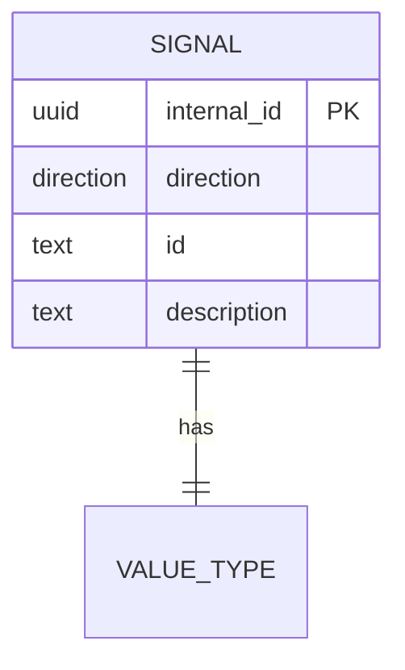

# Signal

> [Home](../../README.md) › [Metadata](../README.md) › [Entities](README.md) › Signal

| Version | Date | Status | Change |
| --- | --- | --- | --- |
| 1 | 2026-11-22 | Draft | Creation of the file |

A signal is a value that goes between the front and the model: an input the model receives, or an output it sends. Its [value type](15-value-type.md) says what kind of value it holds. A signal exists only inside its type, in the type's list of signals (see the [Data model](../data-model.md)); a sub-type inherits the signals of its parent. Its `id` is the contract with the model: renaming it breaks the models that use it.

## The entity



```json
{
  "$schema": "https://json-schema.org/draft/2020-12/schema",
  "$id": "signal.schema.json",
  "title": "Synoptic Studio signal",
  "type": "object",
  "required": ["internal_id", "direction", "id", "description", "value_type"],
  "additionalProperties": false,
  "properties": {
    "internal_id": {
      "description": "Primary key.",
      "type": "string",
      "pattern": "^[0-9a-f]{8}-[0-9a-f]{4}-7[0-9a-f]{3}-[89ab][0-9a-f]{3}-[0-9a-f]{12}$",
      "readOnly": true
    },
    "direction": {
      "description": "Seen from the model: input, it receives the value; output, it sends it.",
      "enum": ["input", "output"]
    },
    "id": {
      "description": "The name of the signal for the model; unique along its branch: among the signals of its type, of its parents and of its sub-types.",
      "type": "string",
      "minLength": 1,
      "examples": ["speed_setpoint"]
    },
    "description": {
      "description": "What the signal means, for the person who writes the model; written in the configuration files sent with the model.",
      "type": ["string", "null"],
      "minLength": 1
    },
    "value_type": {
      "description": "What kind of value the signal holds.",
      "$ref": "value-type.schema.json"
    }
  }
}
```
