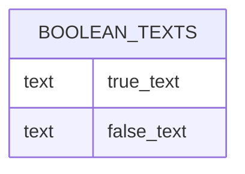

# Boolean texts

> [Home](../../README.md) › [Metadata](../README.md) › [Entities](README.md) › Boolean texts

| Version | Date | Status | Change |
| --- | --- | --- | --- |
| 1 | 2026-11-22 | Draft | Creation of the file |

The boolean texts are the two words shown for the states of a boolean [signal](16-signal.md), such as "Running" and "Stopped": a sub-type may name them differently from its parent. They are for display only: the model always gets true or false. They are kept inside their [signal setting](19-signal-setting.md); they have no `internal_id`, since nothing points to them.

## The entity



```json
{
  "$schema": "https://json-schema.org/draft/2020-12/schema",
  "$id": "boolean-texts.schema.json",
  "title": "Synoptic Studio boolean texts",
  "type": "object",
  "required": ["true_text", "false_text"],
  "additionalProperties": false,
  "properties": {
    "true_text": {
      "description": "What is shown when the value is true; \"true\" is shown when it is null.",
      "type": ["string", "null"],
      "minLength": 1,
      "examples": ["Running"]
    },
    "false_text": {
      "description": "What is shown when the value is false; \"false\" is shown when it is null.",
      "type": ["string", "null"],
      "minLength": 1,
      "examples": ["Stopped"]
    }
  }
}
```

## Open questions

- Are they ever written in the configuration files sent with the model, or never, since they are display only?
