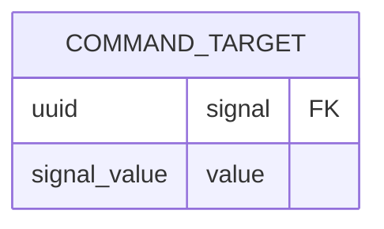

# Command target

> [Home](../../README.md) › [Metadata](../README.md) › [Entities](README.md) › Command target

| Version | Date | Status | Change |
| --- | --- | --- | --- |
| 1 | 2026-11-22 | Draft | Creation of the file |

The command target says which [signal](16-signal.md) a [command](17-command.md) sends its value to, and that value, fixed in Metadata: the person who clicks never types it. A command `set_signal` targets an input, a command `override` an output; a trigger has none. It is kept inside its command; it has no `internal_id`, since nothing points to it.

## The entity



```json
{
  "$schema": "https://json-schema.org/draft/2020-12/schema",
  "$id": "command-target.schema.json",
  "title": "Synoptic Studio command target",
  "type": "object",
  "required": ["signal", "value"],
  "additionalProperties": false,
  "properties": {
    "signal": {
      "description": "Foreign key to a signal of the type, own or inherited: an input for a command set_signal, an output for a command override.",
      "type": "string",
      "pattern": "^[0-9a-f]{8}-[0-9a-f]{4}-7[0-9a-f]{3}-[89ab][0-9a-f]{3}-[0-9a-f]{12}$"
    },
    "value": {
      "description": "The value sent, of the signal's value type: a number in the default unit of its quantity, true or false, or the internal_id of an item of its enum, whose key the model receives.",
      "oneOf": [
        { "type": "number" },
        { "type": "boolean" },
        {
          "type": "string",
          "pattern": "^[0-9a-f]{8}-[0-9a-f]{4}-7[0-9a-f]{3}-[89ab][0-9a-f]{3}-[0-9a-f]{12}$"
        }
      ]
    }
  }
}
```
