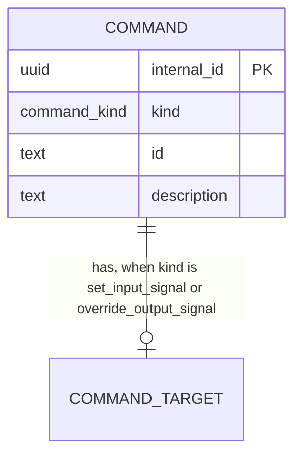

# Command

> [Home](../../README.md) › [Metadata](../README.md) › [Entities](README.md) › Command

| Version | Date | Status | Change |
| --- | --- | --- | --- |
| 1 | 2026-11-22 | Draft | Creation of the file |

A command is what the front sends with one click: a fixed value to an input, a fixed value that overrides an output, or a trigger. A trigger never goes to the model, which only has inputs and outputs: it tells the layer above the model that an action happened, and that layer decides what to send to the model. A command that sends a value has a [command target](17-command-target.md): the signal and the value. A command exists only inside its type, in the type's list of commands (see the [Data model](../data-model.md)); a sub-type inherits the commands of its parent. Its `id` is a contract: renaming it breaks what uses it, such as the layer above the model for a trigger.

## The entity



```json
{
  "$schema": "https://json-schema.org/draft/2020-12/schema",
  "$id": "command.schema.json",
  "title": "Synoptic Studio command",
  "type": "object",
  "required": ["internal_id", "kind", "id", "description"],
  "additionalProperties": false,
  "properties": {
    "internal_id": {
      "description": "Primary key.",
      "type": "string",
      "pattern": "^[0-9a-f]{8}-[0-9a-f]{4}-7[0-9a-f]{3}-[89ab][0-9a-f]{3}-[0-9a-f]{12}$",
      "readOnly": true
    },
    "kind": {
      "description": "set_input_signal: sends a fixed value to an input signal; trigger: tells the layer above the model that an action happened, never the model itself; that layer decides what to send to the model; override_output_signal: replaces the value of an output signal by a fixed value.",
      "enum": ["set_input_signal", "trigger", "override_output_signal"]
    },
    "id": {
      "description": "The name of the command for the model; unique along its branch: among the commands of its type, of its parents and of its sub-types.",
      "type": "string",
      "minLength": 1,
      "examples": ["start"]
    },
    "description": {
      "description": "What the command means, for the person who writes the model, or, for a trigger, what the layer above the model is expected to do; written in the configuration files sent with the model.",
      "type": ["string", "null"],
      "minLength": 1
    },
    "command_target": {
      "description": "The signal the command sends its value to, and that value.",
      "$ref": "command-target.schema.json"
    }
  },
  "if": { "properties": { "kind": { "enum": ["set_input_signal", "override_output_signal"] } } },
  "then": { "required": ["command_target"] },
  "else": { "properties": { "command_target": false } }
}
```
