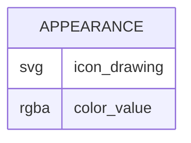

# Appearance

> [Home](../../README.md) › [Metadata](../README.md) › [Entities](README.md) › Appearance

| Version | Date | Status | Change |
| --- | --- | --- | --- |
| 1 | 2026-11-22 | Draft | Creation of the file |

The appearance is the icon and the color a type shows in the type tree and wherever types are listed. Each type has exactly one, kept inside the type; it has no `internal_id`, since nothing points to it. It holds values, never links: the drawing of an [icon](06-icon.md) and the value of a [color](02-color.md) are copied when the user picks them, and changing or removing their [icon set](07-icon-set.md) or [palette](03-palette.md) afterwards changes nothing here. Each value left `null` is inherited: the type shows its parent's, and a type without a parent shows the software's default.

## The entity



```json
{
  "$schema": "https://json-schema.org/draft/2020-12/schema",
  "$id": "appearance.schema.json",
  "title": "Synoptic Studio appearance",
  "type": "object",
  "required": ["icon_drawing", "color_value"],
  "additionalProperties": false,
  "properties": {
    "icon_drawing": {
      "description": "The SVG of the icon the user picked in an icon set. Null: the type shows the icon of its parent, or the default icon when it has no parent.",
      "type": ["string", "null"],
      "minLength": 1
    },
    "color_value": {
      "description": "The color the user picked in a palette, in sRGB; its last two digits are the opacity. Null: the type shows the color of its parent, or the default color when it has no parent.",
      "type": ["string", "null"],
      "pattern": "^#[0-9a-f]{8}$",
      "examples": ["#1f77b4ff"]
    }
  }
}
```
