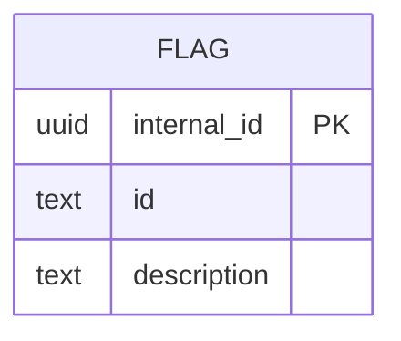

# Flag

> [Home](../../README.md) › [Metadata](../README.md) › [Entities](README.md) › Flag

| Version | Date | Status | Change |
| --- | --- | --- | --- |
| 1 | 2026-11-22 | Draft | Creation of the file |

A flag is a key that each placed symbol of a type has on or off. Synoptic Studio does nothing with it: it writes the flags that are on in the configuration files it produces, for a program outside it. A flag exists only inside its type, in the type's list of flags (see the [Data model](../data-model.md)); a sub-type inherits the flags of its parent.

## The entity



```json
{
  "$schema": "https://json-schema.org/draft/2020-12/schema",
  "$id": "flag.schema.json",
  "title": "Synoptic Studio flag",
  "type": "object",
  "required": ["internal_id", "id", "description"],
  "additionalProperties": false,
  "properties": {
    "internal_id": {
      "description": "Primary key.",
      "type": "string",
      "pattern": "^[0-9a-f]{8}-[0-9a-f]{4}-7[0-9a-f]{3}-[89ab][0-9a-f]{3}-[0-9a-f]{12}$",
      "readOnly": true
    },
    "id": {
      "description": "The key written in the configuration files when the flag is on; unique along its branch: among the flags of its type, of its parents and of its sub-types.",
      "type": "string",
      "minLength": 1,
      "examples": ["under_maintenance"]
    },
    "description": {
      "description": "What the flag is for, shown to people when they tick it on a placed symbol.",
      "type": ["string", "null"],
      "minLength": 1
    }
  }
}
```
