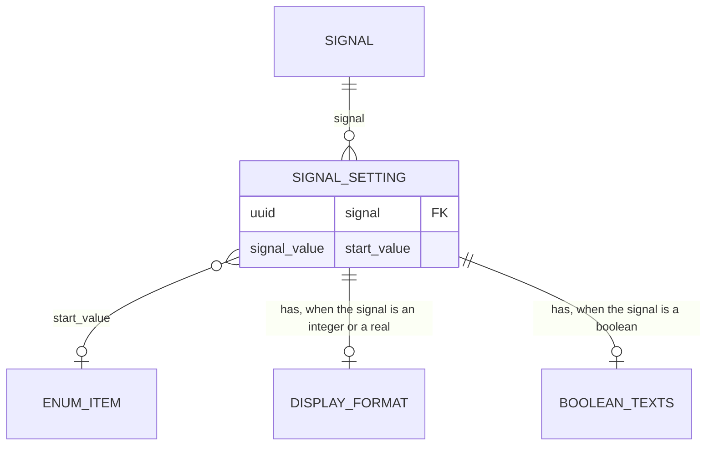

# Signal setting

> [Home](../../README.md) › [Metadata](../README.md) › [Entities](README.md) › Signal setting

| Version | Date | Status | Change |
| --- | --- | --- | --- |
| 1 | 2026-11-22 | Draft | Creation of the file, as Preset value |
| 2 | 2026-11-24 | Draft | No more presets: renamed Signal setting, held by the type; a sub-type replaces those of its parents, and removes its own to follow them again |

A signal setting says, for one [signal](16-signal.md) of the type, how it starts and how its value is shown: its start value, then its [display format](17-display-format.md) for an integer or a real, or its [boolean texts](18-boolean-texts.md) for a boolean. It is what the page Signal settings shows on each line ([MD-07](../../screens/metadata.md#md-07--signal-settings)). A [type](30-type.md) holds one signal setting per own signal, in its list of signal settings. A sub-type may change the signal setting of an inherited signal: it then holds one for this signal too, which replaces its parent's whole; until then the signal shows its parent's. The reset button of the line removes it from the list, and the signal follows its parent again (Product Owner, 2026-11-24). When the enum item of its start value is deleted, the signal setting is flagged in error and kept as written, until another item is picked. It has no `internal_id`, since nothing points to it.

## The entity



```json
{
  "$schema": "https://json-schema.org/draft/2020-12/schema",
  "$id": "signal-setting.schema.json",
  "title": "Synoptic Studio signal setting",
  "type": "object",
  "required": ["signal", "start_value"],
  "additionalProperties": false,
  "properties": {
    "signal": {
      "description": "Foreign key to a signal of the type, own or inherited; unique among the signal settings of its type.",
      "type": "string",
      "pattern": "^[0-9a-f]{8}-[0-9a-f]{4}-7[0-9a-f]{3}-[89ab][0-9a-f]{3}-[0-9a-f]{12}$"
    },
    "start_value": {
      "description": "The first value sent to the model, for an input, and the value shown until the model sends one, for an input and an output. Of the signal's value type: a number in the default unit of its quantity, typed in the display unit; true or false; or the internal_id of an item of its enum. Null when the enum is a template, whose items exist only on each placed symbol, where the start value is picked.",
      "oneOf": [
        { "type": "number" },
        { "type": "boolean" },
        {
          "type": "string",
          "pattern": "^[0-9a-f]{8}-[0-9a-f]{4}-7[0-9a-f]{3}-[89ab][0-9a-f]{3}-[0-9a-f]{12}$"
        },
        { "type": "null" }
      ]
    },
    "display_format": {
      "description": "The unit and the decimals the value is shown with; there when the signal is an integer or a real, never otherwise.",
      "$ref": "display-format.schema.json"
    },
    "boolean_texts": {
      "description": "The words shown for true and for false; there when the signal is a boolean, never otherwise.",
      "$ref": "boolean-texts.schema.json"
    }
  }
}
```
