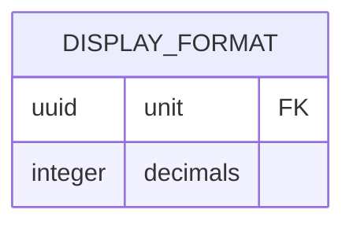

# Display format

> [Home](../../README.md) › [Metadata](../README.md) › [Entities](README.md) › Display format

| Version | Date | Status | Change |
| --- | --- | --- | --- |
| 1 | 2026-11-22 | Draft | Creation of the file |

The display format says how a preset shows the value of an integer or a real [signal](16-signal.md): in which [unit](12-unit.md) and with how many decimals. It serves the faceplate and the texts of a symbol that show the value; it never changes what the model receives, which always gets the full value in the default unit of the quantity. It is kept inside its [preset value](22-preset-value.md); it has no `internal_id`, since nothing points to it.

## The entity



```json
{
  "$schema": "https://json-schema.org/draft/2020-12/schema",
  "$id": "display-format.schema.json",
  "title": "Synoptic Studio display format",
  "type": "object",
  "required": ["unit", "decimals"],
  "additionalProperties": false,
  "properties": {
    "unit": {
      "description": "Foreign key to the unit the value is shown and typed in, one of the units of the signal's quantity; starts as its default unit.",
      "type": "string",
      "pattern": "^[0-9a-f]{8}-[0-9a-f]{4}-7[0-9a-f]{3}-[89ab][0-9a-f]{3}-[0-9a-f]{12}$"
    },
    "decimals": {
      "description": "How many decimals are shown; only rounds what is shown. Its default is fixed by the software, never set for a project.",
      "type": "integer",
      "minimum": 0,
      "default": 2
    }
  }
}
```
