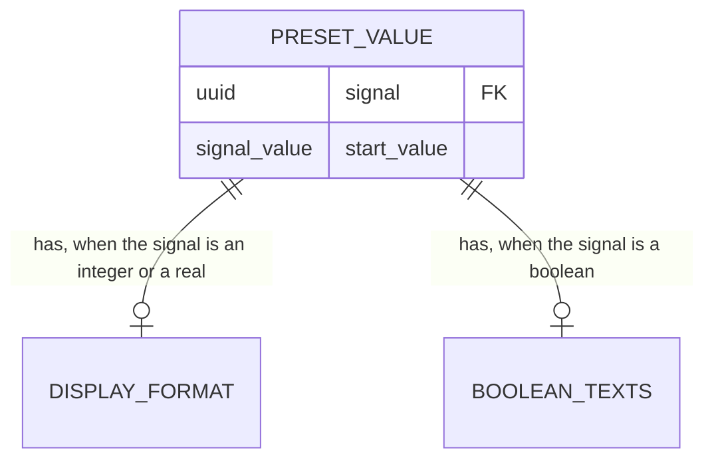

# Preset value

> [Home](../../README.md) › [Metadata](../README.md) › [Entities](README.md) › Preset value

| Version | Date | Status | Change |
| --- | --- | --- | --- |
| 1 | 2026-11-22 | Draft | Creation of the file |

A preset value says, for one [signal](16-signal.md) of the type, how a preset starts it and shows it: its start value, then its [display format](20-display-format.md) for an integer or a real, or its [boolean texts](21-boolean-texts.md) for a boolean. A preset holds exactly one preset value per signal of the type, own and inherited, in its list of preset values (see the [Data model](../data-model.md)); it has no `internal_id`, since nothing points to it.

## The entity



```json
{
  "$schema": "https://json-schema.org/draft/2020-12/schema",
  "$id": "preset-value.schema.json",
  "title": "Synoptic Studio preset value",
  "type": "object",
  "required": ["signal", "start_value"],
  "additionalProperties": false,
  "properties": {
    "signal": {
      "description": "Foreign key to a signal of the type, own or inherited; unique among the preset values of its preset.",
      "type": "string",
      "pattern": "^[0-9a-f]{8}-[0-9a-f]{4}-7[0-9a-f]{3}-[89ab][0-9a-f]{3}-[0-9a-f]{12}$"
    },
    "start_value": {
      "description": "The first value sent to the model, for an input, and the value shown until the model sends one, for an input and an output. Of the signal's value type: a number in the default unit of its quantity, typed in the display unit; true or false; or the internal_id of an item of its enum.",
      "oneOf": [
        { "type": "number" },
        { "type": "boolean" },
        {
          "type": "string",
          "pattern": "^[0-9a-f]{8}-[0-9a-f]{4}-7[0-9a-f]{3}-[89ab][0-9a-f]{3}-[0-9a-f]{12}$"
        }
      ]
    },
    "display_format": {
      "description": "The unit and the decimals the value is shown with; there when the signal is an integer or a real, never otherwise.",
      "$ref": "display-format.schema.json"
    },
    "boolean_texts": {
      "description": "The words shown for true and for false; there when the signal is a boolean, never otherwise.",
      "$ref": "boolean-texts.schema.json"
    }
  }
}
```

## Open questions

- The start value of a signal whose enum is a template: its items are only filled on each placed symbol, so Metadata has no item to pick. No start value in the preset, or one picked on the placed symbol?
