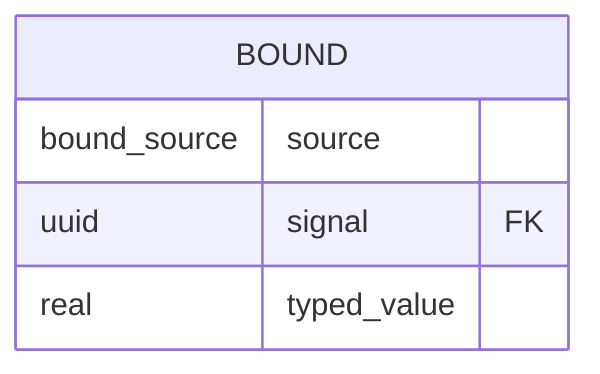

# Bound

> [Home](../../README.md) › [Metadata](../README.md) › [Entities](README.md) › Bound

| Version | Date | Status | Change |
| --- | --- | --- | --- |
| 1 | 2026-11-22 | Draft | Creation of the file |

A bound is the minimum or the maximum of a [range](24-range.md): a number typed in the faceplate builder, or the value of an input [signal](16-signal.md) of the type, read at each moment. It is kept inside its range, as its `min` or its `max`; it has no `internal_id`, since nothing points to it.

## The entity



```json
{
  "$schema": "https://json-schema.org/draft/2020-12/schema",
  "$id": "bound.schema.json",
  "title": "Synoptic Studio bound",
  "type": "object",
  "required": ["source"],
  "additionalProperties": false,
  "properties": {
    "source": {
      "description": "typed: a number typed in the builder; signal: the value of an input signal of the type, read at each moment.",
      "enum": ["typed", "signal"]
    },
    "signal": {
      "description": "Foreign key to an input signal of the type, own or inherited, never an output: an integer or a real of the same quantity as the signal shown, so that both compare in the same default unit.",
      "type": "string",
      "pattern": "^[0-9a-f]{8}-[0-9a-f]{4}-7[0-9a-f]{3}-[89ab][0-9a-f]{3}-[0-9a-f]{12}$"
    },
    "typed_value": {
      "description": "The number, in the default unit of the quantity of the signal shown, typed in the display unit of the preset: changing the display unit never changes it.",
      "type": "number"
    }
  },
  "if": { "properties": { "source": { "const": "typed" } } },
  "then": {
    "required": ["typed_value"],
    "properties": { "signal": false }
  },
  "else": {
    "required": ["signal"],
    "properties": { "typed_value": false }
  }
}
```
