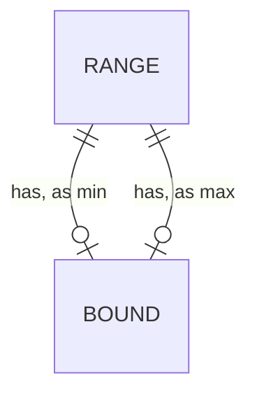

# Range

> [Home](../../README.md) › [Metadata](../README.md) › [Entities](README.md) › Range

| Version | Date | Status | Change |
| --- | --- | --- | --- |
| 1 | 2026-11-22 | Draft | Creation of the file |

A range is the values a person may type in a number field of the faceplate: a minimum and a maximum, each a [bound](23-bound.md). A typed value outside the range is refused. In the faceplate builder, a minimum typed greater than the maximum is refused. A range is kept inside its [signal field](25-signal-field.md), which has one when its input is a number field; it has no `internal_id`, since nothing points to it.

## The entity



```json
{
  "$schema": "https://json-schema.org/draft/2020-12/schema",
  "$id": "range.schema.json",
  "title": "Synoptic Studio range",
  "type": "object",
  "required": ["min", "max"],
  "additionalProperties": false,
  "properties": {
    "min": {
      "description": "The smallest value allowed. Null: no minimum.",
      "oneOf": [{ "$ref": "bound.schema.json" }, { "type": "null" }]
    },
    "max": {
      "description": "The largest value allowed. Null: no maximum.",
      "oneOf": [{ "$ref": "bound.schema.json" }, { "type": "null" }]
    }
  }
}
```

## Open questions

- Bounds read from signals: what does the number field do while the two signals give a minimum greater than the maximum?
