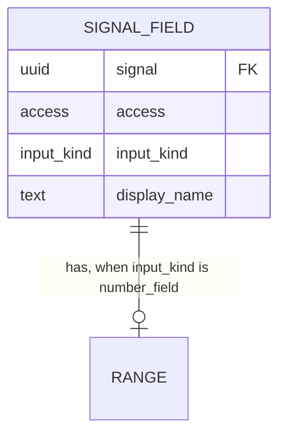

# Signal field

> [Home](../../README.md) › [Metadata](../README.md) › [Entities](README.md) › Signal field

| Version | Date | Status | Change |
| --- | --- | --- | --- |
| 1 | 2026-11-22 | Draft | Creation of the file |

A signal field shows the value of one [signal](16-signal.md) in the faceplate, with a label, and lets a person type it when its access allows. In read, the value is shown as text alone: in the display unit and with the decimals of its [signal setting](22-signal-setting.md), an enum by the display name of its item, a boolean by its [boolean texts](21-boolean-texts.md). A signal field is kept inside its [faceplate element](28-faceplate-element.md), which has one when its kind is signal; it has no `internal_id`, since nothing points to it.

## The entity



```json
{
  "$schema": "https://json-schema.org/draft/2020-12/schema",
  "$id": "signal-field.schema.json",
  "title": "Synoptic Studio signal field",
  "type": "object",
  "required": ["signal", "access", "display_name"],
  "additionalProperties": false,
  "properties": {
    "signal": {
      "description": "Foreign key to the signal shown, one of the type, own or inherited.",
      "type": "string",
      "pattern": "^[0-9a-f]{8}-[0-9a-f]{4}-7[0-9a-f]{3}-[89ab][0-9a-f]{3}-[0-9a-f]{12}$"
    },
    "access": {
      "description": "read: the value is only shown; write, for an input only: a person types the value the model receives; override, for an output only: a person types a value that replaces the model's.",
      "enum": ["read", "write", "override"]
    },
    "input_kind": {
      "description": "How the value is typed. number_field: for an integer or a real; radio_horizontal (the buttons on one line), radio_vertical (one button per line) or select: for an enum, its items in the order of the Enums page; switch: for a boolean, one click turns it on or off.",
      "enum": ["number_field", "radio_horizontal", "radio_vertical", "select", "switch"]
    },
    "display_name": {
      "description": "The label beside the field, for people; never sent to the model. Null: the signal's id is shown.",
      "type": ["string", "null"],
      "minLength": 1,
      "examples": ["Speed setpoint"]
    },
    "range": {
      "description": "The values a person may type.",
      "$ref": "range.schema.json"
    }
  },
  "allOf": [
    {
      "if": { "properties": { "access": { "enum": ["write", "override"] } } },
      "then": { "required": ["input_kind"] },
      "else": { "properties": { "input_kind": false } }
    },
    {
      "if": {
        "required": ["input_kind"],
        "properties": { "input_kind": { "const": "number_field" } }
      },
      "then": { "required": ["range"] },
      "else": { "properties": { "range": false } }
    }
  ]
}
```
