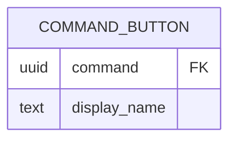

# Command button

> [Home](../../README.md) › [Metadata](../README.md) › [Entities](README.md) › Command button

| Version | Date | Status | Change |
| --- | --- | --- | --- |
| 1 | 2026-11-22 | Draft | Creation of the file |

A command button is a button of the faceplate that sends one [command](18-command.md) of the type when a person clicks it. It is kept inside its [faceplate element](28-faceplate-element.md), which has one when its kind is command; it has no `internal_id`, since nothing points to it. A command removed from the type, or from one of its parents, removes the faceplate elements whose button sends it.

## The entity



```json
{
  "$schema": "https://json-schema.org/draft/2020-12/schema",
  "$id": "command-button.schema.json",
  "title": "Synoptic Studio command button",
  "type": "object",
  "required": ["command", "display_name"],
  "additionalProperties": false,
  "properties": {
    "command": {
      "description": "Foreign key to the command sent by a click, one of the type, own or inherited.",
      "type": "string",
      "pattern": "^[0-9a-f]{8}-[0-9a-f]{4}-7[0-9a-f]{3}-[89ab][0-9a-f]{3}-[0-9a-f]{12}$"
    },
    "display_name": {
      "description": "The text on the button, for people; never sent to the model. Null: the command's id is shown.",
      "type": ["string", "null"],
      "minLength": 1,
      "examples": ["Start"]
    }
  }
}
```
