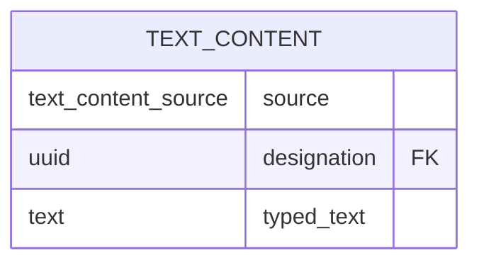

# Text content

> [Home](../../README.md) › [Metadata](../README.md) › [Entities](README.md) › Text content

| Version | Date | Status | Change |
| --- | --- | --- | --- |
| 1 | 2026-11-22 | Draft | Creation of the file |

A text content is the text a title or a paragraph of the faceplate shows: a text typed in the builder, or the text each placed symbol fills for a [designation](11-designation.md), such as its tag. It never comes from a signal: a signal is shown by a [signal field](24-signal-field.md) in read. When its designation is deleted, its faceplate element is flagged in error and kept as written, until another designation is picked. A text content is kept inside its [faceplate element](27-faceplate-element.md), which has one when its kind is title or paragraph; it has no `internal_id`, since nothing points to it.

## The entity



```json
{
  "$schema": "https://json-schema.org/draft/2020-12/schema",
  "$id": "text-content.schema.json",
  "title": "Synoptic Studio text content",
  "type": "object",
  "required": ["source"],
  "additionalProperties": false,
  "properties": {
    "source": {
      "description": "typed: a text typed in the builder; designation: the text each placed symbol fills for a designation.",
      "enum": ["typed", "designation"]
    },
    "designation": {
      "description": "Foreign key to the designation whose text is shown: the same faceplate shows P-101 on one pump and P-102 on the next.",
      "type": "string",
      "pattern": "^[0-9a-f]{8}-[0-9a-f]{4}-7[0-9a-f]{3}-[89ab][0-9a-f]{3}-[0-9a-f]{12}$"
    },
    "typed_text": {
      "description": "The text, plain, without Markdown; a paragraph keeps its line breaks. Null while nothing is typed.",
      "type": ["string", "null"],
      "minLength": 1,
      "examples": ["Feed pump of the main loop."]
    }
  },
  "if": { "properties": { "source": { "const": "typed" } } },
  "then": {
    "required": ["typed_text"],
    "properties": { "designation": false }
  },
  "else": {
    "required": ["designation"],
    "properties": { "typed_text": false }
  }
}
```
