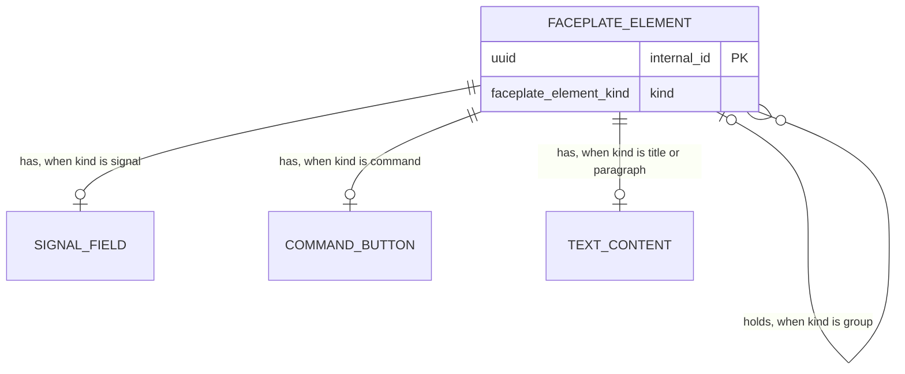

# Faceplate element

> [Home](../../README.md) › [Metadata](../README.md) › [Entities](README.md) › Faceplate element

| Version | Date | Status | Change |
| --- | --- | --- | --- |
| 1 | 2026-11-22 | Draft | Creation of the file |
| 2 | 2026-11-24 | Draft | No more presets: kept inside its type; inherited by the sub-types, read only, moved by their `faceplate_order` |

A faceplate element is one line of the faceplate builder of a type ([MD-14](../../screens/metadata.md#md-14--faceplate)): a signal, a command button, a title, a paragraph or a group. Its kind gives it exactly one part, or, for a group, its own list of elements, of the same five kinds, at any depth. The faceplate shows the elements in the order of the list, and shows nothing that is not in it. The same signal or the same command may be in several elements, for instance read in one group and written in another. An element is kept inside its [type](30-type.md), or inside its group. The sub-types of the type show it too, read only: they never change nor remove it, and only its place among the elements of the faceplate changes, through the `faceplate_order` of the sub-type, which points to its `internal_id`.

## The entity



```json
{
  "$schema": "https://json-schema.org/draft/2020-12/schema",
  "$id": "faceplate-element.schema.json",
  "title": "Synoptic Studio faceplate element",
  "type": "object",
  "required": ["internal_id", "kind"],
  "additionalProperties": false,
  "properties": {
    "internal_id": {
      "description": "Primary key.",
      "type": "string",
      "pattern": "^[0-9a-f]{8}-[0-9a-f]{4}-7[0-9a-f]{3}-[89ab][0-9a-f]{3}-[0-9a-f]{12}$",
      "readOnly": true
    },
    "kind": {
      "description": "signal: shows a signal, and lets a person type it when its access allows; command: a button that sends a command; title: a heading; paragraph: a text; group: gathers its own elements, with no title nor text of its own.",
      "enum": ["signal", "command", "title", "paragraph", "group"]
    },
    "signal_field": {
      "description": "The signal shown and how.",
      "$ref": "signal-field.schema.json"
    },
    "command_button": {
      "description": "The command sent and the text of its button.",
      "$ref": "command-button.schema.json"
    },
    "text_content": {
      "description": "The text of the title or of the paragraph.",
      "$ref": "text-content.schema.json"
    },
    "faceplate_elements": {
      "description": "The elements inside the group, in the order the faceplate shows them.",
      "type": "array",
      "items": { "$ref": "faceplate-element.schema.json" }
    }
  },
  "allOf": [
    {
      "if": { "properties": { "kind": { "const": "signal" } } },
      "then": { "required": ["signal_field"] },
      "else": { "properties": { "signal_field": false } }
    },
    {
      "if": { "properties": { "kind": { "const": "command" } } },
      "then": { "required": ["command_button"] },
      "else": { "properties": { "command_button": false } }
    },
    {
      "if": { "properties": { "kind": { "enum": ["title", "paragraph"] } } },
      "then": { "required": ["text_content"] },
      "else": { "properties": { "text_content": false } }
    },
    {
      "if": { "properties": { "kind": { "const": "group" } } },
      "then": { "required": ["faceplate_elements"] },
      "else": { "properties": { "faceplate_elements": false } }
    }
  ]
}
```
