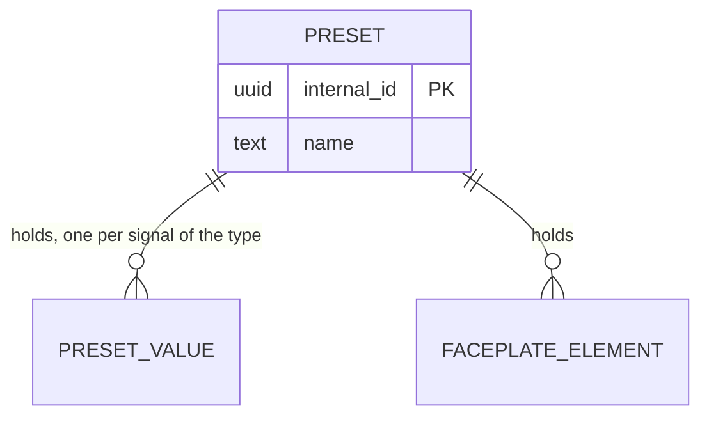

# Preset

> [Home](../../README.md) › [Metadata](../README.md) › [Entities](README.md) › Preset

| Version | Date | Status | Change |
| --- | --- | --- | --- |
| 1 | 2026-11-22 | Draft | Creation of the file |

A preset holds the defaults a symbol and a synoptic start from: how each signal of the type starts and is shown, its [preset values](22-preset-value.md), and the faceplate it builds, its [faceplate elements](28-faceplate-element.md). A type needs at least one preset to be chosen in a symbol or a synoptic. A preset exists only inside its [type](30-type.md), in the type's list of presets; its `name` is unique there.

A signal added to the type, or to one of its parents, adds its preset value to every preset of the type and of its sub-types, with the start value and the display format a new preset value starts with. A signal removed removes its preset value from these presets, and the faceplate elements that show it.

## The entity



```json
{
  "$schema": "https://json-schema.org/draft/2020-12/schema",
  "$id": "preset.schema.json",
  "title": "Synoptic Studio preset",
  "type": "object",
  "required": ["internal_id", "name", "preset_values", "faceplate_elements"],
  "additionalProperties": false,
  "properties": {
    "internal_id": {
      "description": "Primary key.",
      "type": "string",
      "pattern": "^[0-9a-f]{8}-[0-9a-f]{4}-7[0-9a-f]{3}-[89ab][0-9a-f]{3}-[0-9a-f]{12}$",
      "readOnly": true
    },
    "name": {
      "description": "Tells two presets of a type apart, for people; unique among the presets of its type; never sent to the model.",
      "type": "string",
      "minLength": 1,
      "examples": ["Standard"]
    },
    "preset_values": {
      "description": "Exactly one per signal of the type, own and inherited.",
      "type": "array",
      "items": { "$ref": "preset-value.schema.json" }
    },
    "faceplate_elements": {
      "description": "The elements of the faceplate, in the order it shows them.",
      "type": "array",
      "items": { "$ref": "faceplate-element.schema.json" }
    }
  }
}
```
