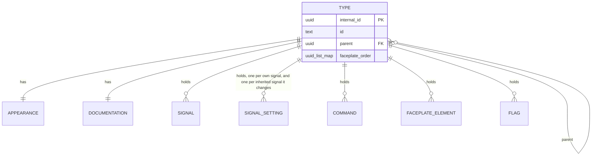

# Type

> [Home](../../README.md) › [Metadata](../README.md) › [Entities](README.md) › Type

| Version | Date | Status | Change |
| --- | --- | --- | --- |
| 1 | 2026-11-22 | Draft | Creation of the file |
| 2 | 2026-11-24 | Draft | No more presets: the type holds its signal settings, its faceplate elements and their order |
| 3 | 2026-11-24 | Draft | Its fields in the order of the parts: signals, signal settings, commands, faceplate, flags |
| 4 | 2026-11-24 | Draft | `faceplate_order` places the elements inside the groups too: a sub-type moves and adds elements in the groups of its parents |

| Tag | Value |
| --- | --- |
| File | `<id>.type.json` |

A type is what a symbol represents, at one level of detail: a pump, a centrifugal pump. Types form a tree: a type has one parent or none, set when it is created and never changed, and inherits everything of its parents: documentation, signals, signal settings, commands, faceplate and flags (see [Inheritance of types](../inheritance.md)). There are no presets: to show a type another way, a sub-type is made. A type holds, in the order of its parts: its [appearance](12-appearance.md), its [documentation](14-documentation.md), its own [signals](16-signal.md), the [signal settings](19-signal-setting.md) of its signals, its own [commands](21-command.md), its own [faceplate elements](27-faceplate-element.md) and their order, and its own [flags](28-flag.md). Its `id` is the contract with the model: renaming it breaks the models that use it, never the software, whose links go through the `internal_id`. One file per type. A type whose parent's file is missing or unreadable is still shown, flagged in error with the missing parent named; its file is left as it is. A type that has sub-types cannot be deleted: its sub-types are deleted first.

## The entity



```json
{
  "$schema": "https://json-schema.org/draft/2020-12/schema",
  "$id": "type.schema.json",
  "title": "Synoptic Studio type",
  "type": "object",
  "required": ["internal_id", "id", "parent", "appearance", "documentation", "signals", "signal_settings", "commands", "faceplate_elements", "faceplate_order", "flags"],
  "additionalProperties": false,
  "properties": {
    "internal_id": {
      "description": "Primary key.",
      "type": "string",
      "pattern": "^[0-9a-f]{8}-[0-9a-f]{4}-7[0-9a-f]{3}-[89ab][0-9a-f]{3}-[0-9a-f]{12}$",
      "readOnly": true
    },
    "id": {
      "description": "The name of the type for the model, readable and exact; unique in the whole type tree.",
      "type": "string",
      "minLength": 1,
      "examples": ["centrifugal_pump"]
    },
    "parent": {
      "description": "Foreign key to the type it is created under, set at creation and never changed. Null: a type at the root of the tree.",
      "type": ["string", "null"],
      "pattern": "^[0-9a-f]{8}-[0-9a-f]{4}-7[0-9a-f]{3}-[89ab][0-9a-f]{3}-[0-9a-f]{12}$"
    },
    "appearance": {
      "description": "The icon and the color the type shows.",
      "$ref": "appearance.schema.json"
    },
    "documentation": {
      "description": "What explains the type to people.",
      "$ref": "documentation.schema.json"
    },
    "signals": {
      "description": "The type's own signals, in the order of its table of signals; those it inherits are not repeated.",
      "type": "array",
      "items": { "$ref": "signal.schema.json" }
    },
    "signal_settings": {
      "description": "How each signal starts and is shown: one per own signal, and one per inherited signal whose setting the type changes; an inherited signal it leaves alone shows its parent's.",
      "type": "array",
      "items": { "$ref": "signal-setting.schema.json" }
    },
    "commands": {
      "description": "The type's own commands, in the order of its table of commands; those it inherits are not repeated.",
      "type": "array",
      "items": { "$ref": "command.schema.json" }
    },
    "faceplate_elements": {
      "description": "The type's own faceplate elements; those of its parents are not repeated: they are shown read only, and only their place changes.",
      "type": "array",
      "items": { "$ref": "faceplate-element.schema.json" }
    },
    "faceplate_order": {
      "description": "Where each element of the faceplate sits, inherited and own: the key top lists the elements at the top of the faceplate, the internal_id of a group the elements inside it, each list in the order it shows them. Any element may go anywhere: an own element between two elements of a parent or inside a group of a parent, an element of a parent out of its group (Product Owner, 2026-11-24). Each element is in one list at most. Empty: every element where the type that declares it puts it, the elements of the parents from the root down, then the own ones. An element in no list is shown at the end of the place its type gives it; an internal_id that no longer exists is ignored.",
      "type": "object",
      "propertyNames": {
        "pattern": "^(top|[0-9a-f]{8}-[0-9a-f]{4}-7[0-9a-f]{3}-[89ab][0-9a-f]{3}-[0-9a-f]{12})$"
      },
      "additionalProperties": {
        "type": "array",
        "items": {
          "type": "string",
          "pattern": "^[0-9a-f]{8}-[0-9a-f]{4}-7[0-9a-f]{3}-[89ab][0-9a-f]{3}-[0-9a-f]{12}$"
        },
        "uniqueItems": true
      },
      "examples": [
        {
          "top": ["0193a1c2-0000-7000-8000-000000000001", "0193a1c2-0000-7000-8000-000000000002"],
          "0193a1c2-0000-7000-8000-000000000002": ["0193a1c2-0000-7000-8000-000000000003", "0193a1c2-0000-7000-8000-000000000009"]
        }
      ]
    },
    "flags": {
      "description": "The type's own flags, in the order of its table of flags; those it inherits are not repeated.",
      "type": "array",
      "items": { "$ref": "flag.schema.json" }
    }
  }
}
```

## The file

```json
{
  "$schema": "https://json-schema.org/draft/2020-12/schema",
  "$id": "type-file.schema.json",
  "title": "Synoptic Studio type file",
  "type": "object",
  "required": ["format_version", "type"],
  "additionalProperties": false,
  "properties": {
    "format_version": {
      "const": 1
    },
    "type": {
      "description": "The type the file holds.",
      "$ref": "type.schema.json"
    }
  }
}
```
