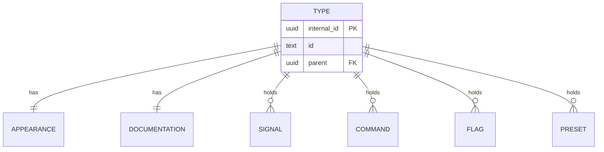

# Type

> [Home](../../README.md) › [Metadata](../README.md) › [Entities](README.md) › Type

| Version | Date | Status | Change |
| --- | --- | --- | --- |
| 1 | 2026-11-22 | Draft | Creation of the file |

| Tag | Value |
| --- | --- |
| File | `<id>.type.json` |

A type is what a symbol represents, at one level of detail: a pump, a centrifugal pump. Types form a tree: a type has one parent or none, set when it is created and never changed, and inherits the signals, the commands and the flags of its parents. A type holds its [appearance](12-appearance.md), its [documentation](14-documentation.md), its own [signals](16-signal.md), [commands](18-command.md) and [flags](19-flag.md), and its [presets](29-preset.md). Its `id` is the contract with the model: renaming it breaks the models that use it, never the software, whose links go through the `internal_id`. One file per type. A type whose parent's file is missing or unreadable is still shown, flagged in error with the missing parent named; its file is left as it is.

## The entity



```json
{
  "$schema": "https://json-schema.org/draft/2020-12/schema",
  "$id": "type.schema.json",
  "title": "Synoptic Studio type",
  "type": "object",
  "required": ["internal_id", "id", "parent", "appearance", "documentation", "signals", "commands", "flags", "presets"],
  "additionalProperties": false,
  "properties": {
    "internal_id": {
      "description": "Primary key.",
      "type": "string",
      "pattern": "^[0-9a-f]{8}-[0-9a-f]{4}-7[0-9a-f]{3}-[89ab][0-9a-f]{3}-[0-9a-f]{12}$",
      "readOnly": true
    },
    "id": {
      "description": "The name of the type for the model, readable and exact; unique in the whole type tree.",
      "type": "string",
      "minLength": 1,
      "examples": ["centrifugal_pump"]
    },
    "parent": {
      "description": "Foreign key to the type it is created under, set at creation and never changed. Null: a type at the root of the tree.",
      "type": ["string", "null"],
      "pattern": "^[0-9a-f]{8}-[0-9a-f]{4}-7[0-9a-f]{3}-[89ab][0-9a-f]{3}-[0-9a-f]{12}$"
    },
    "appearance": {
      "description": "The icon and the color the type shows.",
      "$ref": "appearance.schema.json"
    },
    "documentation": {
      "description": "What explains the type to people.",
      "$ref": "documentation.schema.json"
    },
    "signals": {
      "description": "The type's own signals, in the order of its table of signals; those it inherits are not repeated.",
      "type": "array",
      "items": { "$ref": "signal.schema.json" }
    },
    "commands": {
      "description": "The type's own commands, in the order of its table of commands; those it inherits are not repeated.",
      "type": "array",
      "items": { "$ref": "command.schema.json" }
    },
    "flags": {
      "description": "The type's own flags, in the order of its table of flags; those it inherits are not repeated.",
      "type": "array",
      "items": { "$ref": "flag.schema.json" }
    },
    "presets": {
      "description": "Every preset of the type, in the order of its list of presets.",
      "type": "array",
      "items": { "$ref": "preset.schema.json" }
    }
  }
}
```

## The file

```json
{
  "$schema": "https://json-schema.org/draft/2020-12/schema",
  "$id": "type-file.schema.json",
  "title": "Synoptic Studio type file",
  "type": "object",
  "required": ["format_version", "type"],
  "additionalProperties": false,
  "properties": {
    "format_version": {
      "const": 1
    },
    "type": {
      "description": "The type the file holds.",
      "$ref": "type.schema.json"
    }
  }
}
```
