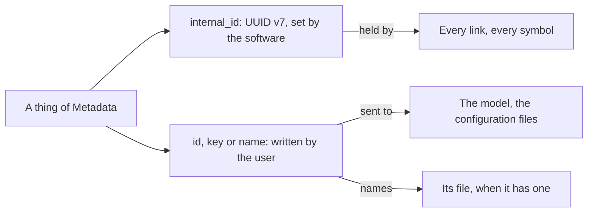

# Identity and renaming

> [Home](../README.md) › [Metadata](README.md) › Identity and renaming

| Version | Date | Status | Change |
| --- | --- | --- | --- |
| 1 | 2026-11-22 | Draft | Creation of the file |
| 2 | 2026-11-22 | Draft | The `id` of a type labelled "ID"; the `display_name` of an enum item unique in its enum, confirmed (decision 0084) |

How each thing of Metadata is known, by the software and by people, what must be unique, and what a rename changes. The rules come from decisions 0038, 0047, 0053, 0060, 0064, 0080, 0081, 0083 and 0084, [Files](files.md), the [whole draft](draft.md#renaming-is-breaking-on-purpose), the [entity files](entities/README.md) and the [Screens of Metadata](../screens/metadata.md).

## Where it is used

| Where | What it takes from here |
| --- | --- |
| Every [entity](entities/README.md) with an `internal_id` | Its primary key, set by the software; every FK to it holds it. |
| [Type](entities/30-type.md), [Signal](entities/16-signal.md), [Command](entities/18-command.md), [Flag](entities/19-flag.md), [Enum](entities/06-enum.md), [Designation](entities/11-designation.md) | An `id`, written by the user, unique in its list, sent outside the software. |
| [Enum item](entities/05-enum-item.md) | A `key`, the whole number the model receives, and a `display_name` for people. |
| [Palette](entities/02-palette.md), [Icon set](entities/04-icon-set.md), [Quantity](entities/10-quantity.md), [Unit](entities/08-unit.md), [Unit system](entities/09-unit-system.md), [Color](entities/01-color.md), [Icon](entities/03-icon.md) | A `name`, for people only. |
| [Files](files.md) | A file named after the `id` or the `name` of its thing; renaming the thing renames its file. |
| [Inheritance of types](inheritance.md) | An `id` unique along the branch; a rename in a parent reaches every sub-type. |
| [Checks and errors](checks-and-errors.md) | A key or a name already taken, refused when typed. |
| [MD-02.1](../screens/metadata.md#md-02--general), [MD-04.6](../screens/metadata.md#md-04--signals), [MD-05.3](../screens/metadata.md#md-05--commands), [MD-09.3, MD-09.6, MD-09.7](../screens/metadata.md#md-09--enums), [MD-12.3](../screens/metadata.md#md-12--flags-a-part-of-the-type), [MD-13.4](../screens/metadata.md#md-13--designations) | The fields where a key or a name is typed, always editable. |
| Symbols | They point to a type, its signals and its commands by their `internal_id`, so a rename never breaks them. |

## The two keys

- **`internal_id` is always a UUID version 7** (decision 0060), set by the software when the thing is created, never changed, never shown. It is the primary key: every link (FK) holds one, and it never leaves the software.
- **`id` is never a UUID**: the key the user writes, shown on screen, sent to the model and written in the configuration files. It is never empty.
- **A thing nothing points to may have no `internal_id`**: the parts nested in another entity (an appearance, a value type, a range...) have none, and are never pointed to.
- **The names `id` and `internal_id` are the ones of the schema** (decision 0064): a readable key written by the user, and a surrogate key set by the software.

**When a file is exported to a standard**, each key goes to its match there, never the other way round:

| Synoptic Studio | AutomationML | OPC UA | FMI |
| --- | --- | --- | --- |
| `internal_id` | `ID` | `NodeId` | — |
| `id` | `Name` | `BrowseName` | `name` |

## The key of each thing

| Thing | Key written by the user | Unique | Goes outside the software |
| --- | --- | --- | --- |
| Type | `id` | In the whole tree (decision 0047) | The model; its file `<id>.type.json` |
| Signal, command | `id` | Along the branch: its type, its parents, its sub-types (decisions 0080, 0081) | The model |
| Flag | `id` | Along the branch, as a signal | The configuration files |
| Enum | `id` | Among the enums | The configuration files |
| Designation | `id` | Among the designations | The configuration files |
| Enum item | `key`, a whole number | In its enum | The model |
| Enum item | `display_name` | In its enum, while another enum may hold the same (decision 0084) | No |
| Palette, icon set, quantity | `name` | Among its kind, since it names a file | Its file |
| Unit, unit system | `name` | Among those of its quantity | No |
| Color, icon | `name`, optional | No: two may share it (decision 0067; [icon sets](data-model-notes.md#settled-on-2026-11-22-icon-sets)) | No |
| Link, faceplate element | None: only an `internal_id` | — | No |

- **A key or a name already taken in its list is refused when typed** (decision 0083): the change does not happen, the value that was there stays. The same for an `id` taken along a branch (decisions 0080, 0081) and for a `name` or an `id` whose file name is taken ([Files](files.md#the-name-of-a-file)).
- **How an `id` is written is free**: no rule on its characters (whole draft, 2026-11-17).
- **Every `id` is labelled "ID" on screen**, the `id` of a type in General too (decision 0084).

## A rename never breaks the software

- **Every link goes through the `internal_id`, never through the `id` or a copy**: the parent of a type, the enum and the quantity of a signal, the target of a command, the symbols that point to a type, its signals and its commands.
- **So a rename changes no link**: what pointed to the thing still points to it, and shows its new key.
- **There is no table from an old key to a new one**: the key is a contract with the model, and a model follows the new key, never an old one.

## How a rename is done

- **The key is typed in place**, like every field of Metadata: no Edit or Save button, no warning, no confirmation (MD-02.1).
- **It is written to the file at once**; the user sees it in the differences of Git, where a mistake is taken back. The software keeps no versions (decision 0053).
- **A thing with a file of its own renames its file**: a type, a palette, an icon set, a quantity ([Files](files.md#the-name-of-a-file)). A quantity is read only in the software: its contributors rename it in its file.
- **A rename in a parent reaches every sub-type at once**, and is refused when a sub-type already has the new `id` as its own line ([Inheritance of types](inheritance.md#when-a-parent-changes)).

## What a rename breaks outside

A key is meant to be set at the start and never to change: the more keys change, the more the model has to change.

| Renamed | Breaks | Source |
| --- | --- | --- |
| The `id` of a type, a signal or a command | The model: its interface definition changed, the model must take the new `id`. | [Whole draft](draft.md#renaming-is-breaking-on-purpose) |
| The `key` of an enum item | The model, which receives the number. | Decision 0038 |
| The `id` of a flag, an enum or a designation | The configuration files that hold it, and what reads them (assistant's reading). | [Data model: notes](data-model-notes.md#settled-on-2026-11-22-unique-ids-of-enums-and-designations) |
| A `display_name`, a `description` | Nothing outside: only people read them. | MD-09.7 |
| The `name` of a palette or an icon set | Nothing in the types: an appearance keeps a copy of the color and the drawing it picked. | [Data model: notes](data-model-notes.md#settled-on-2026-11-22-appearance) |

- **Nothing warns**: a rename is allowed and not checked ([Checks and errors](checks-and-errors.md#not-checked)). Its consequences for models are explained in a user manual, which is not part of the open source version.

## Open questions

- **The `id` of a flag, an enum or a designation renamed**: what it breaks in the configuration files of the synoptics already made.
- **A file renamed by hand**, whose name no longer gives the `id` or the `name` it holds.
- **The format of the `id`s**, a regular expression per kind of `id` in the settings: open in [Files](files.md#open-questions).
- **The same `internal_id` under two file names**, in the software's folder and in the user's: open in [Files](files.md#open-questions).
- **The `internal_id` of the boxes nothing points to** (link, unit system, flag; a faceplate element is pointed to by `faceplate_order` since 2026-11-24): kept or removed, open in [Data model: notes](data-model-notes.md#open).
