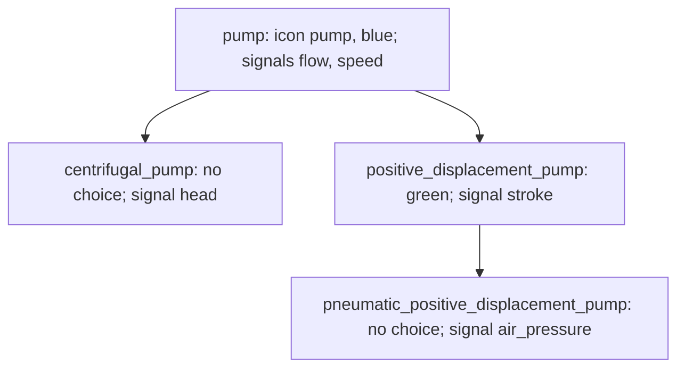
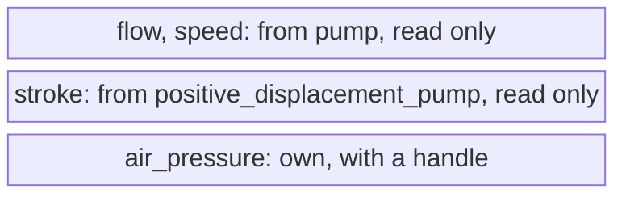

# Inheritance of types

> [Home](../README.md) › [Metadata](README.md) › Inheritance of types

| Version | Date | Status | Change |
| --- | --- | --- | --- |
| 1 | 2026-11-22 | Draft | Creation of the file |
| 2 | 2026-11-23 | Draft | The presets of the parents are shown and duplicated (decision 0087) |
| 3 | 2026-11-24 | Draft | No more presets: everything is inherited, the documentation, the signal settings and the faceplate included |

What a sub-type takes from its parents, what it may change, and what happens when a parent changes or is missing. There are no presets (2026-11-24): types and sub-types only, everything inherited, so that the same kind of equipment shows the same faceplate everywhere; to show a type another way, a sub-type is made. The rules come from decisions 0003, 0013, 0033, 0047, 0079, 0080, 0082, the Product Owner's of 2026-11-24, the [whole draft](draft.md#types) and the [entity files](entities/README.md).

## Where it is used

| Where | What it takes from here |
| --- | --- |
| [Type](entities/30-type.md) | `parent`, and the lists of the type, which hold its own lines only. |
| [Signal](entities/16-signal.md), [Command](entities/18-command.md), [Flag](entities/19-flag.md) | An `id` unique along the branch: among the lines of the type, of its parents and of its sub-types. |
| [Appearance](entities/12-appearance.md) | A value left `null` shows the parent's. |
| [Documentation](entities/14-documentation.md) | The description and the links of the parents, shown first, read only. |
| [Signal setting](entities/22-signal-setting.md) | One per own signal; one per inherited signal the sub-type changes. |
| [Faceplate element](entities/28-faceplate-element.md) | The elements of the parents, read only, placed by the `faceplate_order` of the type. |
| [Signal field](entities/25-signal-field.md), [Command button](entities/26-command-button.md), [Bound](entities/23-bound.md), [Command target](entities/17-command-target.md) | A signal or a command of the type, own or inherited. |
| [MD-04 · Signals](../screens/metadata.md#md-04--signals), [MD-05 · Commands](../screens/metadata.md#md-05--commands) | The inherited lines first, read only. |
| [MD-03 · Documentation](../screens/metadata.md#md-03--documentation), [MD-07 · Signal settings](../screens/metadata.md#md-07--signal-settings), [MD-14 · Faceplate](../screens/metadata.md#md-14--faceplate) | What the parents wrote, first and read only; the values, changeable. |

## The tree

- **A type has one parent or none.** Its parents are every type up its branch, to the root: `pneumatic_positive_displacement_pump` has `positive_displacement_pump` and `pump`.
- **The parent is set when the type is created and never changes** (decision 0013): by the + of the type it is created under, or the + of the title for a root type. A type created under the wrong parent is deleted and created again under the right one.
- **A type that has sub-types cannot be deleted** (decision 0082): its sub-types are deleted first, from the bottom of the branch up (see [Deleting and its consequences](deleting.md)).
- **Every type can be chosen**, at any level: there are no abstract types.
- **The `id` of a type is unique in the whole tree** (decision 0047), not only among its brothers.

The example used on this page:

## What a sub-type inherits

| What | Inherited | How |
| --- | --- | --- |
| Signals | Yes, all | Read from each parent up the branch; never copied into the sub-type's file. |
| Commands | Yes, all | The same as the signals. |
| Flags | Yes, all (decision 0033) | The same; a placed symbol has the flags of its type and of its parents. |
| Icon, color | Yes, each one alone | A value left `null` shows the parent's, which may itself be inherited; at the root, the software's default. |
| `id` | No | Each type has its own, unique in the tree. |
| Documentation | Yes (2026-11-24, replaces decision 0081) | The description of each parent, from the root down, is shown above the sub-type's own, read only; its links come before the sub-type's own, read only. Each level writes its chapter: "Pump", then "Centrifugal pump". Never copied into the sub-type's file. |
| Signal settings | Yes, each one alone (2026-11-24) | An inherited signal shows its parent's signal setting until the sub-type changes it; the changed one is kept in the sub-type's file and replaces the parent's whole; its reset button removes it, and the signal follows its parent again. |
| Faceplate | Yes, all its elements (2026-11-24) | The elements of every parent are in the sub-type's faceplate, read only: never changed nor removed, only moved. The sub-type adds its own; their order is kept in its `faceplate_order`. |

`pneumatic_positive_displacement_pump` has the signals `flow`, `speed`, `stroke` and `air_pressure`, and shows the pump icon in green: the icon of `pump`, the color of `positive_displacement_pump`.

## What a sub-type may change

- **It adds its own signals, commands and flags**, after the inherited ones.
- **It never declares again an `id` it inherits**: the `id` of a signal, a command or a flag is unique among those of the type, of its parents and of its sub-types. No redefinition: an `id` stays one thing along the branch.
- **It never changes an inherited line**: a signal, a command, a flag, a text or a link of the documentation, an element of the faceplate is changed in the type that declares it, and the change reaches every sub-type.
- **It chooses its own icon or its own color**, each one alone; its sub-types then follow it. The reset button sets the value back to `null`: the type follows its parent again.
- **It changes the signal settings of every signal**, own and inherited: start value, display unit, decimals, texts of a boolean. This is how a sub-type stands for what was a preset.
- **It moves the elements of its parents' faceplate**, never removes them, and adds its own; they may show an inherited signal or send an inherited command.

## The order of the lines

- **The inherited lines come first, read only**: those of the parent at the root, then those of each parent down the branch, then the type's own.
- Each group keeps the order chosen in the type that declares it; only the type's own lines have a handle to move them.
- The same order everywhere the lines of a type are listed: the tables of signals, commands and flags, and the table of signal settings. The faceplate alone has an order the sub-type chooses.

## When a parent changes

A change in a parent reaches every sub-type at once, on purpose (decisions 0003, 0013): its lines, its icon, its color, its documentation, its signal settings the sub-type did not change, its faceplate. It is the one exception to "no virtual link between types", which holds between types that are not on the same branch.

| Change in a parent | Effect on each sub-type |
| --- | --- |
| A signal, a command or a flag added | The sub-type has it too, among its inherited lines. The addition is refused when a sub-type already has this `id` as its own line (decision 0080). |
| A signal added | Its signal setting starts with the start value and the display format a new one starts with (decision 0079); the sub-types show it. |
| A signal removed | Its signal settings are removed, in the type and its sub-types, with the faceplate elements that show it (decision 0079) and the bounds read from it (decision 0082). A command of the sub-type that targets it is flagged in error and kept as written (decision 0082). |
| A command removed | The faceplate elements that send it are removed, in the type and its sub-types (decision 0080). |
| A faceplate element added or removed | Each sub-type shows it, at the end of the elements of this parent, or no longer shows it; its `faceplate_order` keeps the rest. |
| The documentation changed | Each sub-type shows the new text and links above its own. |
| A line changed (its `id`, its value type, its quantity...) | The sub-type sees the change; renaming an `id` breaks the models that use it, never the software (its links go through the `internal_id`). A rename is refused when a sub-type already has the new `id` as its own line, as an addition is (decision 0081). |
| The icon or the color changed | Each sub-type that leaves the value `null` shows the new one. |

## When a parent is missing

- **A type whose parent's file is missing or unreadable is still shown, flagged in error**, the missing parent named; its file is left as it is (decision 0079).
- Nothing is lost: when the parent's file comes back, the type finds its parent again through `parent`, which holds its `internal_id`.
