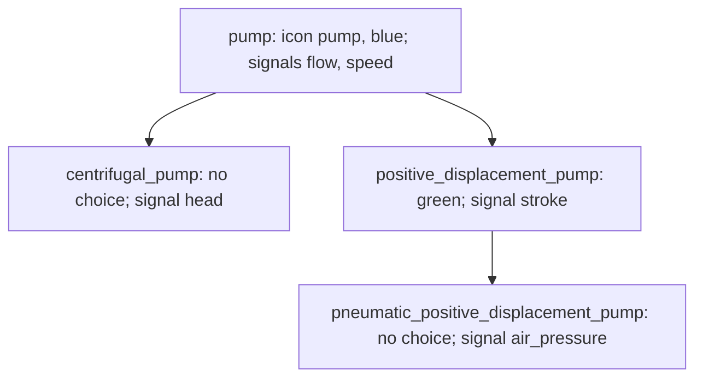
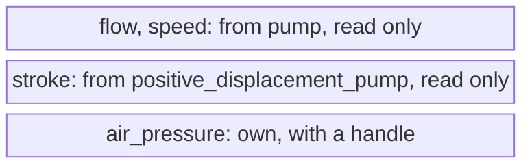

# Inheritance of types

> [Home](../README.md) › [Metadata](README.md) › Inheritance of types

| Version | Date | Status | Change |
| --- | --- | --- | --- |
| 1 | 2026-11-22 | Draft | Creation of the file |

What a sub-type takes from its parents, what it may change, and what happens when a parent changes or is missing. The rules come from decisions 0003, 0013, 0033, 0047 and 0079, the [whole draft](draft.md#types) and the [entity files](entities/README.md); this page gathers them, and decides nothing new.

## Where it is used

| Where | What it takes from here |
| --- | --- |
| [Type](entities/30-type.md) | `parent`, and the lists of the type, which hold its own lines only. |
| [Signal](entities/16-signal.md), [Command](entities/18-command.md), [Flag](entities/19-flag.md) | An `id` unique among the lines of the type and of its parents. |
| [Appearance](entities/12-appearance.md) | A value left `null` shows the parent's. |
| [Preset](entities/29-preset.md), [Preset value](entities/22-preset-value.md), [Signal field](entities/25-signal-field.md), [Command button](entities/26-command-button.md), [Bound](entities/23-bound.md), [Command target](entities/17-command-target.md) | A signal or a command of the type, own or inherited. |
| [MD-04 · Signals](../screens/metadata.md#md-04--signals), [MD-05 · Commands](../screens/metadata.md#md-05--commands) | The inherited lines first, read only. |

## The tree

- **A type has one parent or none.** Its parents are every type up its branch, to the root: `pneumatic_positive_displacement_pump` has `positive_displacement_pump` and `pump`.
- **The parent is set when the type is created and never changes** (decision 0013): by the + of the type it is created under, or the + of the title for a root type. A type created under the wrong parent is deleted and created again under the right one.
- **Every type can be chosen**, at any level: there are no abstract types.
- **The `id` of a type is unique in the whole tree** (decision 0047), not only among its brothers.

The example used on this page:

## What a sub-type inherits

| What | Inherited | How |
| --- | --- | --- |
| Signals | Yes, all | Read from each parent up the branch; never copied into the sub-type's file. |
| Commands | Yes, all | The same as the signals. |
| Flags | Yes, all (decision 0033) | The same; a placed symbol has the flags of its type and of its parents. |
| Icon, color | Yes, each one alone | A value left `null` shows the parent's, which may itself be inherited; at the root, the software's default. |
| `id` | No | Each type has its own, unique in the tree. |
| Documentation | Not settled | See [Open questions](#open-questions). |
| Presets | Not settled | See [Open questions](#open-questions). A preset of the sub-type holds a preset value for each inherited signal. |

`pneumatic_positive_displacement_pump` has the signals `flow`, `speed`, `stroke` and `air_pressure`, and shows the pump icon in green: the icon of `pump`, the color of `positive_displacement_pump`.

## What a sub-type may change

- **It adds its own signals, commands and flags**, after the inherited ones.
- **It never declares again an `id` it inherits**: the `id` of a signal, a command or a flag is unique among those of the type and of its parents. No redefinition: an `id` stays one thing along the branch.
- **It never changes an inherited line**: a signal, a command or a flag is changed in the type that declares it, and the change reaches every sub-type.
- **It chooses its own icon or its own color**, each one alone; its sub-types then follow it. The reset button sets the value back to `null`: the type follows its parent again.
- **In its presets, it sets every signal**, own and inherited: its start value and its display format, and the faceplate may show an inherited signal or send an inherited command.

## The order of the lines

- **The inherited lines come first, read only**: those of the parent at the root, then those of each parent down the branch, then the type's own.
- Each group keeps the order chosen in the type that declares it; only the type's own lines have a handle to move them.
- The same order everywhere the lines of a type are listed: the tables of signals, commands and flags, and the mode Values of a preset.

## When a parent changes

A change in a parent reaches every sub-type at once, on purpose (decisions 0003, 0013): it is the one exception to "no virtual link between types", which holds between types that are not on the same branch.

| Change in a parent | Effect on each sub-type |
| --- | --- |
| A signal, a command or a flag added | The sub-type has it too, among its inherited lines. |
| A signal added | Its preset value is added to every preset of the type and of its sub-types, with the start value and the display format a new preset value starts with (decision 0079). |
| A signal removed | Its preset value is removed from these presets, with the faceplate elements that show it (decision 0079). |
| A command removed | Not settled: see [Open questions](#open-questions). |
| A line changed (its `id`, its value type, its quantity...) | The sub-type sees the change; renaming an `id` breaks the models that use it, never the software (its links go through the `internal_id`). |
| The icon or the color changed | Each sub-type that leaves the value `null` shows the new one. |

## When a parent is missing

- **A type whose parent's file is missing or unreadable is still shown, flagged in error**, the missing parent named; its file is left as it is (decision 0079).
- Nothing is lost: when the parent's file comes back, the type finds its parent again through `parent`, which holds its `internal_id`.

## Open questions

- **Presets**: does a sub-type inherit the presets of its parents? A new sub-type has none, and a type needs a preset to be chosen in a symbol or a synoptic.
- **Documentation**: does a sub-type show the description and the links of its parent when it has none?
- **An `id` taken twice**: a parent receives a signal, a command or a flag whose `id` a sub-type already has as its own. Is the addition refused, or are both lines flagged in error?
- **A command removed from a parent**: are the command buttons that send it removed from the presets, as the faceplate elements of a removed signal are?
- **A bound or a command target** that points to an inherited signal removed from its parent: removed, or flagged in error?
- Deleting a type that has sub-types: in the topic "Deleting and its consequences", still to write (see the [Documentation plan](documentation-plan.md#the-topics-missing)).
