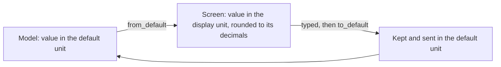

# Units on screen

> [Home](../README.md) › [Metadata](README.md) › Units on screen

| Version | Date | Status | Change |
| --- | --- | --- | --- |
| 1 | 2026-11-22 | Draft | Creation of the file |
| 2 | 2026-11-22 | Draft | An integer that gives no whole number refused; the converter of the Units page settled (decision 0085) |

In which unit a number of Metadata is kept, shown, typed and sent to the model, with how many decimals, and how it is rounded. The rules come from decisions 0003, 0024, 0043, 0049, 0050, 0051, 0056, 0075, 0076 and 0085, [Formulas](formulas.md), the [entity files](entities/README.md), the [whole draft](draft.md#units), the [notes](data-model-notes.md) and the [Screens of Metadata](../screens/metadata.md).

## Where it is used

| Where | What it takes from here |
| --- | --- |
| [Quantity](entities/10-quantity.md) | Its default unit, and whether it offers a difference. |
| [Unit](entities/08-unit.md), [Conversion](entities/07-conversion.md) | The symbol shown after a value; the two formulas that go to the default unit and back. |
| [Unit system](entities/09-unit-system.md) | A group of units for reading, and their order on the Units page. |
| [Value type](entities/15-value-type.md) | The quantity of an integer or a real, and whether its value is a difference. |
| [Display format](entities/17-display-format.md) | The display unit and the decimals of a signal, in its signal setting. |
| [Signal setting](entities/19-signal-setting.md), [Command target](entities/20-command-target.md), [Bound](entities/22-bound.md) | A number typed, kept in the default unit. |
| [Formulas](formulas.md) | How a conversion is computed; a result that is not a finite number. |
| [Checks and errors](checks-and-errors.md) | A decimal typed for an integer, an integer that gives no whole number in the default unit, a value with no finite conversion: refused. |
| [MD-04.9](../screens/metadata.md#md-04--signals), [MD-07.12, MD-07.13, MD-07.14](../screens/metadata.md#md-07--signal-settings), [MD-14.6](../screens/metadata.md#md-14--faceplate), [MD-08](../screens/metadata.md#md-08--units) | Where a unit, a difference or decimals show on screen. |
| Symbols and synoptics | They show a value in the display unit and with the decimals of the signal settings of the type; a synoptic may change both on a placed symbol. |

## Three units

A number of Metadata meets three units: the one it is kept in, the one it is shown in, and the one the model works in.

| Unit | What it is | Set where | Changes the value kept |
| --- | --- | --- | --- |
| **Default unit** | The unit of the quantity every formula is written against; the files keep every number in it. | The quantity file of the catalogue (`default_unit`) | — |
| **Display unit** | The unit a value is shown and typed in, any unit of the same quantity, whatever its unit system. | The signal settings of the type, for each signal; changed by a sub-type, and on a placed symbol in a synoptic | Never (decision 0051) |
| **Model unit** | The unit the model works in, one per quantity, the same for every signal (decision 0024). | Outside Metadata; today, the default unit of the catalogue | — |

- **A signal takes a quantity, never a unit** (decision 0024): it has no model unit and no display unit of its own.
- **The display unit starts as the default unit** of the quantity ([Display format](entities/17-display-format.md)).
- **The model always receives the full value in the default unit**: the display unit and the decimals only change what people read.

## Every number has a quantity

- **An integer or a real signal always has a quantity** (decision 0051), picked in the read-only catalogue, in the column Quantity / Difference of the signals (MD-04.9).
- **A number that measures nothing physical takes "ratio" or "count"**: "ratio" (units 1, %, ‰, ppm; default unit 1) for a rate, an efficiency, a valve opening from 0 to 1; "count" (unit 1) for a number of things. Both names are working names.
- **A boolean and an enum have no quantity**: no unit, no decimals.

## A value or a difference

- **A value is a point on the scale, a difference a gap between two points**: 20 °C is 68 °F, but a rise of 20 °C is a rise of 36 °F.
- **The signal says which one it holds** (`relative_quantity`, [Value type](entities/15-value-type.md)), in the same column as its quantity: the list offers the temperature and the temperature difference side by side, each with its icon, the icon alone (MD-04.9).
- **Only a quantity whose conversions multiply then shift offers a difference** (`offers_relative_quantity`, decision 0050): today the temperatures. A quantity that only multiplies converts a value and a difference the same way.
- **Gauge pressure is a quantity of its own**, with no conversion to pressure (decision 0075); neither offers a difference.
- **The software computes a difference** from the formulas of the value: `to_default(x) − to_default(0)`, and back `from_default(x) − from_default(0)` (decision 0050).
- **A difference shows the same symbol as a value**: 5 °C, never 5 Δ°C (decision 0049, 2026-11-22).

## Shown and typed

- **To show a number, the software converts it from the default unit** with `from_default` of the display unit; **what is typed in the display unit is turned back** with `to_default` before it is kept (decision 0051).
- **This holds for every number typed in Metadata**: the start value of a signal setting, the value a command sends, and a bound typed in a number field of the faceplate (the bound: assistant's reading, decision 0051).
- **Changing the display unit never changes a value kept**: only how it reads.
- **Any unit goes to any other through the default unit**, whatever their unit systems: `to_default` of the first, then `from_default` of the second (decision 0075). A unit system only groups; it has no preferred unit.
- **A typed bound is shown in the display unit of the signal settings** (MD-14.6); a bound read from a signal has the same quantity as the signal shown, so both compare in the default unit (decision 0056).
- **A value typed that has no finite conversion is refused**, and a value shown that has none shows a mark in its place ([Formulas](formulas.md#out-of-the-domain-of-a-formula), decision 0076).

## Decimals

- **The decimals are set in the signal settings only**, for each integer and real signal, next to its display unit (MD-07.13; decision 0050). The quantity has no decimals of its own: the right number depends on the unit shown.
- **The decimals start at 2, fixed by the software** for every signal, never set for a project ([Display format](entities/17-display-format.md)).
- **The decimals only round what is shown**: the model and the files keep the full value.
- **A sub-type, and a synoptic on a placed symbol, may change the display unit and the decimals**; a symbol never does (2026-11-24).
- **A signal set to read in the faceplate shows the text of its value**, in the display unit and with the decimals of the signal settings ([whole draft](draft.md#typing-a-value)).

## Rounding

| Number | Rounding | Source |
| --- | --- | --- |
| A value shown in the signal settings, a faceplate, a symbol | To the decimals of the signal settings | Decision 0050 |
| A value typed in the display unit | Turned back to the default unit, then rounded to 12 significant digits before it is kept or sent: 100.03999999999999 becomes 100.04 | [Whole draft](draft.md#the-units-page) |
| A decimal typed for an integer signal | Refused | Decisions 0003, 0043 |
| A number typed for an integer signal in another unit, which gives no whole number in the default unit (24.17 rps is 1450.2 rpm) | Refused | Decision 0085 |
| A value of the converter of the Units page | 12 significant digits | Decision 0085, MD-08.14 |

## On the Units page

- **The page is read only** (MD-08): it lists the quantities, one line each with the icon `quantity` and, when it has one, the icon `difference`; a quantity shows a switch Quantity | Difference when it has a difference, then its default unit and its unit systems; a unit system shows a converter and the table of its units.
- **The converter is a number field in the default unit**, 1 to start with (decision 0085): its value is shown in every unit of the table, and nothing is kept.
- **The table of units**: Unit (its name, with its variant: US gallon), Symbol, Value, Formula (how the unit is computed from the default unit). The line of the default unit is marked (assistant's reading).
- **The units are sorted by the software**: smallest first, by the size of one step in the default unit, then by name; a quantity whose formulas give no finite step keeps the order of its file ([Unit system](entities/09-unit-system.md)).

## Open questions

- **Where the model unit is set**: once and for good in the catalogue, once per project in a configuration file, or on an annex page (decision 0024). If it leaves the catalogue, it becomes a field of its own, and the default unit stays the unit of the formulas ([Quantity](entities/10-quantity.md#open-questions)).
- **The names "ratio" and "count"**, working names ([Data model: notes](data-model-notes.md#open)).
- **Finding a quantity or a unit** in a catalogue that holds every unit: a search field (gap of MD-08).
- **The source and the licence of the catalogue data** (UCUM, QUDT, CLDR, NIST not checked; MD-08.11).
- **A quantity whose file is missing**: what the signals and display formats that point to it show ([Checks and errors](checks-and-errors.md#open-questions)).
