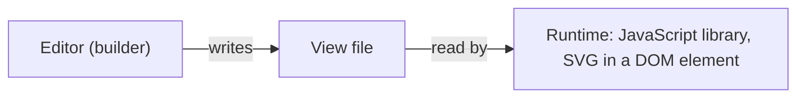
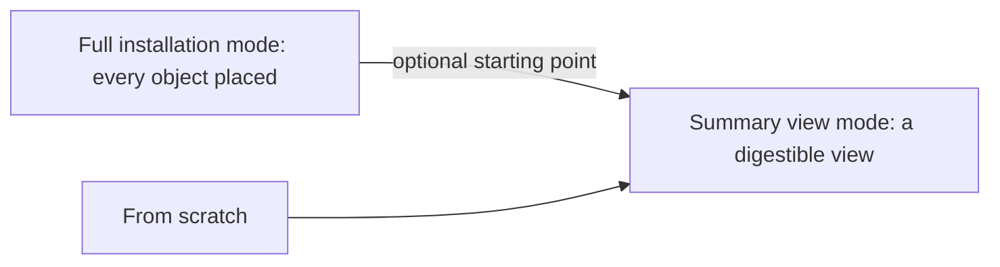

# Introduction

> [Home](../README.md) › [Overview](README.md) › Introduction

Status: draft, written from the Product Owner's oral introduction. Nothing here is validated yet.

## What Synoptic Studio is

Synoptic Studio is a desktop application to model and build synoptics (animated process views of an industrial installation).

It lets a company have synoptics animated in JavaScript without using a SCADA. The company connects itself to its machines.

## The problem it answers

- An installation has controllers (PLCs) and boards with all the sensors.
- A SCADA brings the visual part, the link to the controllers and more.
- Synoptic Studio replaces only the visual part of a SCADA: creating a view and displaying it.
- The company wires its own controllers to the displayed view.

## The three parts of the application

The Product Owner splits the application in three parts.

| Part | What it holds | Specified in |
| --- | --- | --- |
| Metadata | The data and documentation a symbol can be attached to: type tree, icons, documentation, properties, units, enums, commands, pop-ups, presets, libraries. | [Metadata](../metadata/README.md) |
| Two other parts | Not described yet. | To come. |

How the files of every part are read and written is described in [Storage](../storage/README.md).

## Two products around one format

| Part | What it is | Status in these specs |
| --- | --- | --- |
| Editor (builder) | The application: draw the installation and build views. | In scope. |
| Runtime | A JavaScript library. It receives a DOM element, creates an SVG inside it and displays the views made in the editor. | Open question (see below). |

The editor writes the views, the runtime reads them. The file format of a view is therefore the contract between the two.

## More than synoptics: modeling and simulation

The editor is also a tool to specify an installation and to help the people who simulate a whole circuit.

- The user can draw the whole plan of the installation.
- Every symbol has a type (a pump, for example).
- A type carries linked documentation: when the user selects a pump, they find the information on how to create a pump.
- A type's properties are the inputs and outputs of the model: they define in advance the signals that simulation models connect to.

## Two modes

1. **Full installation mode.** The user places all the objects of the installation, to model it completely.
2. **Summary view mode.** The user builds a more digestible view, either from scratch or from the complete installation already drawn.

## Scope

These specs cover only the open source desktop application.

## Open questions

- **The two other parts** of the application: to describe with the Product Owner.
- **Runtime.** It is not one of the 7 validated projects. Option advised: note it apart, specify the editor first and the view file format the runtime will read.
- **The "big drawing"** mentioned by the Product Owner was not received (the message held only text).
- **Summary view.** Is a summary view a separate file, or a view stored inside the installation file? Not asked yet.
- **Symbol types.** Who defines them: a built-in library, the user, or both? Partly answered by the Metadata part (types are created in a tree, libraries list them); to confirm.
- **Simulation.** What exactly does the editor do for it: describe the circuit only, or run something? Not asked yet.
