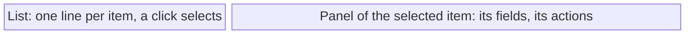
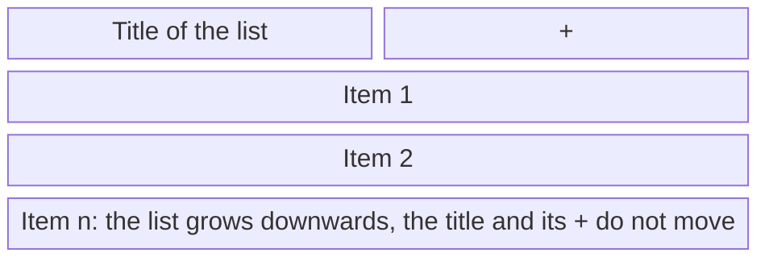
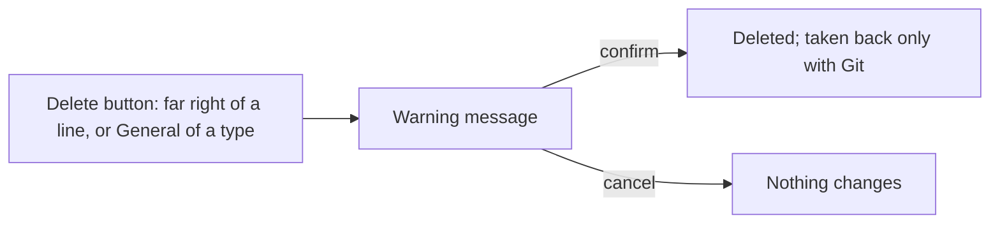
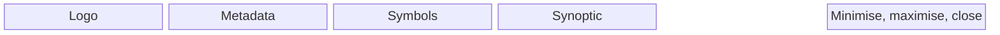
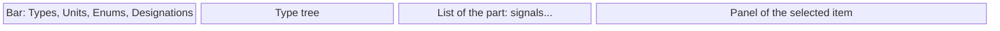
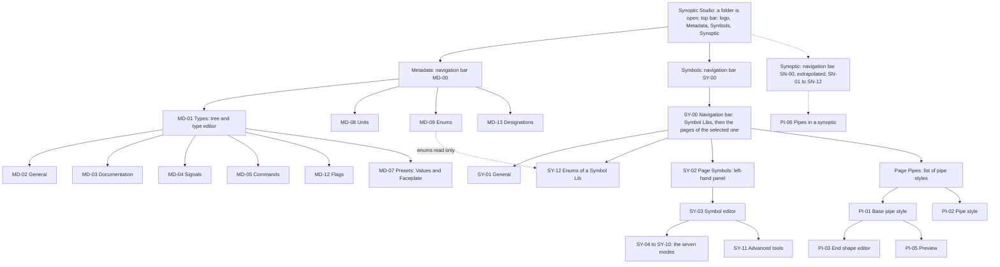

# screens

> [Home](../README.md) › Screens

Status: draft, written by the assistant on 2026-11-11 from the pages of [Metadata](../metadata/README.md) and [Symbols](../symbols/README.md). It adds no rule: it only shows, screen by screen, what the specs already say. Where the specs say nothing, it says so. The only rules written here are the [layout rules](#layout-rules), which hold for every screen (Product Owner, 2026-11-16).

This folder is the **inventory of the screens and menus** of Synoptic Studio. For each screen it answers three questions at a glance:

1. What do I see on this screen? (a map of its zones)
2. Which buttons, fields, lists and menus does it hold? (a table, one line per control)
3. What is missing? (the gaps the inventory reveals, as questions)

The rules stay in the pages of each part. When a page changes, the screen that shows it changes here too.

## The wireframes in Figma

The screens are also drawn as wireframes on the page **"Spec"** of the Figma file of the design system, one frame per screen, named by its identifier (`MD-04 · Signals`).

- **Every decision that changes a screen changes, in the same go, the pages of the part, this inventory and the wireframe in Figma** (Product Owner, 2026-11-17: "à chaque décision qui change un écran [...] faut changer les specs et les écrans sur Figma"). Never one without the others.
- The change in Figma is checked on a capture of the frame before it is said done.
- The texts of the wireframes are in English, like these specs; their notes cite the decision and its date.
- The designed screens of Metadata, made of the components of the [design system](../design-system/README.md), are on the page **"Metadata"** of the same file, one frame per screen and per content state, with their prototype (2026-11-22; see [Figma file](../design-system/05-figma-file.md#screens-of-metadata)). The wireframes of the page "Spec" stay as they are.
- Two sections were added on 2026-11-20, at the Product Owner's request: **"Synoptic · SN-00 to SN-12"**, the screens of [Synoptic](synoptics.md), extrapolated by the assistant; and **"Symbol editor · ideas"** (SY-I1 to SY-I8), ideas for the symbol mode drawn in Figma only, which change none of the pages of [Symbols](../symbols/README.md).

## What it contains

| File | Screens |
| --- | --- |
| [Metadata](metadata.md) | The navigation bar, Types (tree and type editor with its five parts), Units, Enums, Designations; Flags is a part of the type editor. |
| [Symbol editor](symbols.md) | The navigation bar, Symbol Libs, the left-hand panel of a Symbol Lib, the symbol editor (layout, floating bars, layers) and its seven modes, the advanced tools, the Enums page of a Symbol Lib. |
| [Pipes](pipes.md) | The base pipe style, the pipe styles, the end shapes, the dash sequences, the preview, and pipes in a synoptic (part 3, preview). |
| [Synoptic](synoptics.md) | The navigation bar, General, the editor and its modes (Build, Pipes, Annotate, Links, Test), the panel of a placed symbol, Faults, Placed symbols, Create a view, Publish. Extrapolated by the assistant on 2026-11-20. |

## Layout rules

Set by the Product Owner on 2026-11-16, while reviewing the wireframes. They hold for every screen.

### Columns, not rows

- Things are separated in **columns**, side by side, rather than one under the other.
- Most screens show a list. The **list goes on the left**, and the **panel of the selected item on the right**. A panel placed under a list moves down as the list grows: the user would look further and further for it.
- So the information stays where the eye already is, whatever the length of the list.

### Add buttons above the list

Decided by the Product Owner on 2026-11-16, for every screen ("il faut que tu appliques cette méthode partout").

- The buttons that add an item to a list always sit **above the list**, never under it.
- A button under a list moves down as the list grows, and gets harder and harder to reach.
- It does not change the + shown on hover on each type of the type tree, which creates a child of that type (see [Types](../metadata/draft.md#types)).

### A title and a small + on its right

Decided by the Product Owner on 2026-11-16, while reviewing the wireframes ("ça doit être un petit +, une petite icône à côté du titre, et il faut appliquer ça un peu partout"). It makes the rule above precise, for every list and every table.

- Each list and each table has a **title** that names what it holds: "Type tree", "Signals", "Commands", "Links", "Presets", "Enums", "Items"...
- The button that adds an item is a **small + icon on the line of that title, on its right**. No button with a text ("+ Add a signal"), no button on a line of its own.
- The title is the title of the list, not of the whole page: the page itself has no big title that repeats it (Product Owner: "Preset, ça ne doit pas être le titre de toute la page. Tu dois juste mettre Preset comme titre de la liste et avoir un petit + à droite"). The room saved goes to the content: the switch of a preset, for example, moves up.
- When a list takes items of several kinds, there is **one small icon per kind, each with a small +**, side by side on the line of the title, rather than one + that opens a menu: two clicks at most, with no menu to read (Product Owner, 2026-11-16, for the links: "ça va pas rapide, alors que là, tu peux faire clac-clac. C'est beaucoup plus rapide"). For the links: a path icon with a + and a URL icon with a +. For the five elements of the faceplate builder: the same rule, confirmed by the Product Owner on 2026-11-16.
- It holds in the symbol mode and for the pipes too (Product Owner, 2026-11-16): the + that creates a Symbol Lib, a pipe style, an override of a pipe style, and a segment of a dash sequence sits on the right of the title of its list.
- It is the rule the type tree and the Enums page already followed: a + on the line of their title.

### Columns of buttons have no header

Decided by the Product Owner on 2026-11-16, while reviewing the wireframes: "pas besoin de mettre de titre pour les boutons Delete, un peu comme pour les poignées de déplacement".

- In a table, the column of the **delete buttons** has **no header**, like the column of the **handles** that move a line. Everyone knows what the icon does.
- Both columns take the **least room possible**: the width of their icon.

### Handles to choose the order

Decided by the Product Owner on 2026-11-16 for the signals, then for the commands and the links of the documentation, while reviewing the wireframes ("il faut pouvoir changer de place [...] Les petits trucs de changement de position, c'est super").

- A list or a table whose order the user chooses has a **handle** at the very left of each line: held and dragged, it moves the line; the order is kept.
- Lines the user cannot change here (the inherited signals and commands) have no handle.
- Where it holds: the signals, the commands, the links of the documentation, the flags (2026-11-17), the elements of the faceplate builder (proposed for the builder).
- Where it does not: the items of an enum (Product Owner, 2026-11-17: "On peut pas changer l'ordre, ça me chante pas").

### Tables take the whole width

Asked by the Product Owner on 2026-11-17, while reviewing the wireframes ("ces tableaux ne prennent jamais l'entièreté de la page").

- A table fills the **whole width of the panel** that holds it. The column of text that can be long (a description) takes the room left; the others take the width of their content; the columns of handles and of delete buttons take the width of their icon.

### Delete with a button and a warning, in Metadata

Decided by the Product Owner on 2026-11-16, while reviewing the wireframes. It replaces the delete by right click decided earlier the same day.

- **No right click in Metadata.** Its menu held only Delete, and deleting is "une option un peu vénère": it must not hide behind a right click.
- Deleting is done with a **delete button** (an icon):
  - on a line of a table or a list, in the **last column, on the far right**: links of the documentation, signals, commands, presets, elements of the faceplate builder, enums and their items;
  - for a **type**, in its **General** part, not in the tree.
- A click on the button opens a **warning message** that asks to confirm. Nothing is deleted before the user confirms. So deleting is never "aussi simple que ça".
- The same warning everywhere, for a type as for a line.
- The application keeps no versions: what is deleted is taken back only with Git, on the JSON files (decision 0053; see [Always editable, no versions](../metadata/draft.md#always-editable-no-versions)).
- **The warning never says what the delete breaks** (Product Owner, 2026-11-17: "c'est à la personne de savoir qu'elle supprime quelque chose et qu'il faut faire attention [...] sinon ça va le dire tout le temps et ça ne sert à rien"). What is broken is listed in the symbol mode and in the synoptic mode (see [Libraries and symbols](../symbols/01-libraries-and-symbols.md#when-metadata-changes)). The wording of the warning itself: to settle.

### Tables for the parts of a type

Decided by the Product Owner on 2026-11-16: the signals and the commands of a type are shown in one table each, one line per item and one column per field, taking as much room as possible (see [Signals](../metadata/draft.md#the-table-of-signals) and [Commands](../metadata/draft.md#the-table-of-commands)). The selected preset is a table of its signals in its mode Values, and a list of elements in its mode Faceplate, the two modes chosen by a switch at the top of the right side (see [Presets](../metadata/draft.md#two-modes-chosen-by-a-switch)). They replace, for these parts, the panel of the selected item on the right.

### Navigation bar on the left

- A narrow bar of icons sits on the far left of the window (a "rail").
- In Metadata, it holds one icon per page: **Types**, **Units**, **Enums** (decided), then **Designations** (2026-11-18, place to confirm; called Identifiers until 2026-11-22, decision 0064). The **Versions** icon added on 2026-11-16 was removed on 2026-11-21 (decision 0053; see [Always editable, no versions](../metadata/draft.md#always-editable-no-versions)). The Product Owner first named an icon for the libraries too, then removed the libraries of types in the same review.
- In the symbol mode, it holds a **Libraries** button (a kind of "home"), a separator, then the list of every Symbol Lib (decided): see [Libraries and symbols](../symbols/01-libraries-and-symbols.md#navigation-bar-of-the-symbol-mode).
- There is one bar per part. Going from one part to another is done in the top bar (below).

### Top bar of the window

Decided by the Product Owner on 2026-11-16. From left to right:

1. The **logo**: a valve, like the logo already in the Figma file (Product Owner, 2026-11-16). The word "Epipasta" heard earlier was a transcription error; the wireframes said "Logo · a valve" until the Product Owner pointed to the logo of the page "Cover" (2026-11-17); since then every top bar of the wireframes holds an instance of its component "App mark", size 24.
2. Three icons, one per part: **Metadata**, **Symbols**, **Synoptic** (part 3, extrapolated on 2026-11-20, see [Synoptic](synoptics.md)), **right after the logo, with the normal gap of the bar**: no wide empty space between the logo and the three parts (Product Owner, 2026-11-17: "il y a un espace de taré, ça fait ultra moche").
3. On the right, the window buttons **minimise, maximise, close**, as in Windows.

- Open: the window buttons on macOS (on the left there, as macOS does, or on the right as on Windows), and in a browser, where the window has no such buttons.

## How to read a screen

Each screen has:

- an **identifier** (`MD-04`, `SY-03`, `PI-02`...), and each of its controls an identifier of its own (`MD-04.3`): use them to talk about a control without ambiguity;
- a **path**: how the user gets there;
- a **map** (a mindmap): the screen, its zones, and what each zone holds;
- a **table of controls**;
- its **gaps**, when there are some.

### Kinds of control

| Kind | What it is |
| --- | --- |
| Button | An action, done at once. |
| Text field | Free text on one line (multi-line when said). |
| Number field | A number, with its unit when it has one. One shared component: arrows ±1, ±10 with a key (see [Number and text fields](../controls/number-and-text-fields.md)). |
| Select | A choice in a list that drops down. |
| Radio | A choice among a few options, all visible. |
| Toggle | On or off. |
| Checkbox | Ticked or not, often in a list. |
| List | Items one under the other, with their own actions. |
| Tree | Items with parents and children, folded or unfolded. |
| Colour | A colour picker. |
| Slider | A value chosen by dragging. |
| Editor | A dedicated editing area (Markdown, drawing...). |
| Table | Items one per line, their fields in columns. |
| Dialog | A small window that asks something before going on. |

When the specs do not say the kind, the table says "not said" and gives the most likely kind in brackets.

### Status of a control

| Status | Meaning |
| --- | --- |
| Decided | Written in the specs from the Product Owner's words. |
| Proposed | Proposed by a research or by the assistant, written "to confirm" in the specs. |
| Implied | Needed by a rule of the specs, but the specs never describe the control itself (example: a rule says signals are created, but no page says there is an "Add a signal" button). |
| Open | An open question of the specs. |

The gaps of each screen are mostly the "Implied" and "Open" lines: they are what to check first.

## Map of the screens

How the user goes from one screen to another. Part 3 (the synoptic) is an extrapolation of the assistant (2026-11-20): it is shown dotted, its screens are in [Synoptic](synoptics.md).

## What the inventory found missing overall

These gaps come back on several screens; each file lists its own.

- **Create, rename, delete, duplicate**: the specs say what things are and how they link, rarely how the user creates, deletes or duplicates them (types, signals, commands, presets, enums, quantities, libraries, symbols, pipe styles).
- **Order**: the order of the lines of a preset, of signals in a list, of layers in a symbol.
- **Layers panel**: described since 2026-11-15 (see [Layers](../symbols/03-editor/layers.md)); what a line shows besides its name is still open.
- **Undo and redo, save**: not described anywhere.
- **Navigation**: decided on 2026-11-16: the top bar goes from one part to another, and a bar on the left goes inside a part (see [Layout rules](#layout-rules)).

## See also

- [Metadata](../metadata/README.md) and [Symbols](../symbols/README.md): the rules behind every line of these tables.
- [Symbols: open questions](../symbols/10-open-questions.md) and [Metadata: open questions](../metadata/draft.md#metadata-open-questions).
