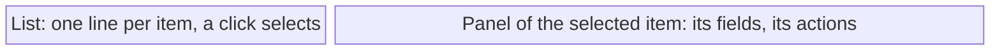
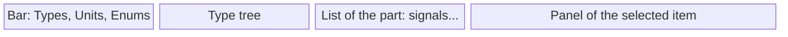
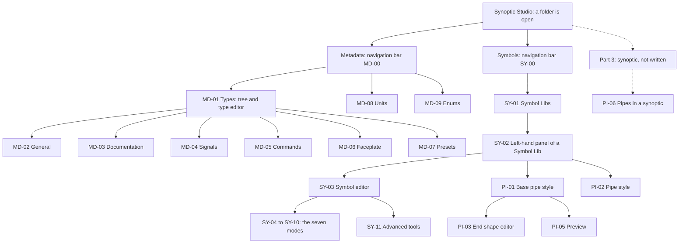

# screens

> [Home](../README.md) › Screens

Status: draft, written by the assistant on 2026-11-11 from the pages of [Metadata](../metadata/README.md) and [Symbols](../symbols/README.md). It adds no rule: it only shows, screen by screen, what the specs already say. Where the specs say nothing, it says so. The only rules written here are the [layout rules](#layout-rules), which hold for every screen (Product Owner, 2026-11-16).

This folder is the **inventory of the screens and menus** of Synoptic Studio. For each screen it answers three questions at a glance:

1. What do I see on this screen? (a map of its zones)
2. Which buttons, fields, lists and menus does it hold? (a table, one line per control)
3. What is missing? (the gaps the inventory reveals, as questions)

The rules stay in the pages of each part. When a page changes, the screen that shows it changes here too.

## What it contains

| File | Screens |
| --- | --- |
| [Metadata](metadata.md) | The navigation bar, Types (tree and type editor with its six parts), Units, Enums. |
| [Symbol editor](symbols.md) | The navigation bar, Symbol Libs, the left-hand panel of a Symbol Lib, the symbol editor (layout, floating bars, layers) and its seven modes, the advanced tools. |
| [Pipes](pipes.md) | The base pipe style, the pipe styles, the end shapes, the dash sequences, the preview, and pipes in a synoptic (part 3, preview). |

## Layout rules

Set by the Product Owner on 2026-11-16, while reviewing the wireframes. They hold for every screen.

### Columns, not rows

- Things are separated in **columns**, side by side, rather than one under the other.
- Most screens show a list. The **list goes on the left**, and the **panel of the selected item on the right**. A panel placed under a list moves down as the list grows: the user would look further and further for it.
- So the information stays where the eye already is, whatever the length of the list.

### Navigation bar on the left

- A narrow bar of icons sits on the far left of the window (a "rail").
- In Metadata, it holds one icon per page: **Types**, **Units**, **Enums** (decided). The Product Owner first named an icon for the libraries too, then removed the libraries of types in the same review.
- In the symbol mode, it holds a **Libraries** button (a kind of "home"), a separator, then the list of every Symbol Lib (decided): see [Libraries and symbols](../symbols/01-libraries-and-symbols.md#navigation-bar-of-the-symbol-mode).
- Open: how the user goes from Metadata to the symbol mode (one bar for the whole application, or one bar per part).

## How to read a screen

Each screen has:

- an **identifier** (`MD-04`, `SY-03`, `PI-02`...), and each of its controls an identifier of its own (`MD-04.3`): use them to talk about a control without ambiguity;
- a **path**: how the user gets there;
- a **map** (a mindmap): the screen, its zones, and what each zone holds;
- a **table of controls**;
- its **gaps**, when there are some.

### Kinds of control

| Kind | What it is |
| --- | --- |
| Button | An action, done at once. |
| Text field | Free text on one line (multi-line when said). |
| Number field | A number, with its unit when it has one. One shared component: arrows ±1, ±10 with a key (see [Number and text fields](../controls/number-and-text-fields.md)). |
| Select | A choice in a list that drops down. |
| Radio | A choice among a few options, all visible. |
| Toggle | On or off. |
| Checkbox | Ticked or not, often in a list. |
| List | Items one under the other, with their own actions. |
| Tree | Items with parents and children, folded or unfolded. |
| Colour | A colour picker. |
| Slider | A value chosen by dragging. |
| Editor | A dedicated editing area (Markdown, drawing...). |
| Dialog | A small window that asks something before going on. |

When the specs do not say the kind, the table says "not said" and gives the most likely kind in brackets.

### Status of a control

| Status | Meaning |
| --- | --- |
| Decided | Written in the specs from the Product Owner's words. |
| Proposed | Proposed by a research or by the assistant, written "to confirm" in the specs. |
| Implied | Needed by a rule of the specs, but the specs never describe the control itself (example: a rule says signals are created, but no page says there is an "Add a signal" button). |
| Open | An open question of the specs. |

The gaps of each screen are mostly the "Implied" and "Open" lines: they are what to check first.

## Map of the screens

How the user goes from one screen to another. Part 3 (the synoptic) is not written yet: only what the pipes pages already say about it is shown, dotted.

## What the inventory found missing overall

These gaps come back on several screens; each file lists its own.

- **Create, rename, delete, duplicate**: the specs say what things are and how they link, rarely how the user creates, deletes or duplicates them (types, signals, commands, presets, enums, quantities, libraries, symbols, pipe styles).
- **Order**: the order of faceplate entries, of signals in a list, of layers in a symbol.
- **Layers panel**: described since 2026-11-15 (see [Layers](../symbols/03-editor/layers.md)); what a line shows besides its name is still open.
- **Undo and redo, save**: not described anywhere.
- **Navigation**: between the Metadata pages, a navigation bar on the left (decided 2026-11-16); from Metadata to Symbols, still not described.

## See also

- [Metadata](../metadata/README.md) and [Symbols](../symbols/README.md): the rules behind every line of these tables.
- [Symbols: open questions](../symbols/10-open-questions.md) and [Metadata: open questions](../metadata/12-open-questions.md).
