# Screens of Metadata

> [Home](../README.md) › [Screens](README.md) › Metadata

Status: drafted by the assistant from the pages of [Metadata](../metadata/README.md), reviewed screen by screen on wireframes, since replaced by the [designed screens](../design-system/10-screens/01-metadata/README.md). It adds no rule. Kinds, statuses and the [layout rules](README.md#layout-rules) are explained in the [guide of this folder](README.md).

## MD-00 · Navigation bar of Metadata

Path: on the far left of every screen of Metadata.

| ID | Element | Kind | Values and behaviour | Status | Source |
| --- | --- | --- | --- | --- | --- |
| MD-00.1 | Types | Button (icon) | Opens [MD-01](#md-01--types-the-tree-and-the-type-editor). | Decided | [Layout rules](README.md#layout-rules) |
| MD-00.2 | Units | Button (icon) | Opens [MD-08](#md-08--units). | Decided | [Layout rules](README.md#layout-rules) |
| MD-00.3 | Enums | Button (icon) | Opens [MD-09](#md-09--enums). | Decided | [Layout rules](README.md#layout-rules) |
| MD-00.4 | Versions | — | Removed (2026-11-21, decision 0053): no versions in the application, the JSON files are versioned with Git by the user. | Decided | [Always editable, no versions](../metadata/draft.md#always-editable-no-versions) |
| MD-00.5 | Flags | — | Removed (2026-11-17): flags are a part of the type, not a page of the bar (see [MD-12](#md-12--flags-a-part-of-the-type)). | Decided | [Flags](../metadata/draft.md#flags) |
| MD-00.6 | Designations | Button (icon) | Opens [MD-13](#md-13--designations). A page of the bar, like Units and Enums. Last, after Enums: assistant's reading. Named Designations on 2026-11-22 (decision 0064), "Identifiers" until then. | Decided (page of the bar, name), Proposed (place) | [Designation](../metadata/entities/11-designation.md) |
| MD-00.7 | Divider | — | After Types: the types on one side, what they use on the other, Units, Enums and Designations (assistant's choice). | Proposed | [Layout rules](README.md#layout-rules) |
| MD-00.8 | Name of a button | Tooltip | When the mouse stays on an icon of the bar, a tooltip gives the name of its page, on its right: Types, Units, Enums, Designations; the parts of the top bar do the same under them: Metadata, Symbols, Synoptic. It shows after 0.8 s (assistant's choice) and leaves with the mouse. | Decided (tooltip), Proposed (delay) | [nav-rail-item](../design-system/07-molecules/nav-rail-item.md) |

Gaps:

- Which icons (to choose with the design system). Going from Metadata to the symbol mode is done in the top bar (see the [layout rules](README.md#top-bar-of-the-window)).

## MD-01 · Types: the tree and the type editor

Path: Metadata › Types.

The tree is on the left, as in a code editor, just right of the navigation bar; the parts of the selected type are listed by name under the tree, in the same column, fixed; the selected part is edited on the right.

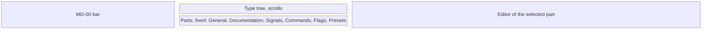

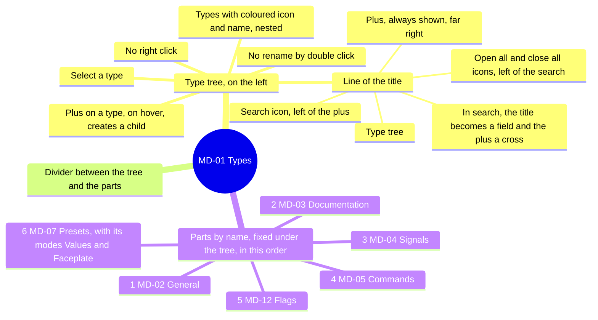

| ID | Element | Kind | Values and behaviour | Status | Source |
| --- | --- | --- | --- | --- | --- |
| MD-01.1 | Type tree | Tree | On the left. Shows each type with its icon, in its colour, and its name; types nest at any depth. A click selects the type. Validated (2026-11-16). | Decided | [Types](../metadata/draft.md#types), [Icons](../metadata/draft.md#type-icons) |
| MD-01.2 | Double click on a type | — | Does **not** rename: the name changes in General only. | Decided | [Types](../metadata/draft.md#types) |
| MD-01.3 | Create a child type | Button (+), on hover | On the right of each type, shown when the mouse is over it; creates a type inside it, with a default name. Always shown in a light colour: thought of, then dropped as too loaded (2026-11-16). | Decided | [Types](../metadata/draft.md#types) |
| MD-01.3b | Create a root type | Button (+), always shown | On the line of the title "Type tree", always on the far right. | Decided | [Types](../metadata/draft.md#types) |
| MD-01.4 | Delete a type | — | Removed from the tree (2026-11-16): no right click in Metadata; the type is deleted in General ([MD-02.8](#md-02--general)). | Decided | [Types](../metadata/draft.md#types) |
| MD-01.5 | Parts of the type | List of names | In the column of the type tree, under it, fixed at the bottom: it never moves when the tree grows. The names in whole words, in this order: General, Documentation, Signals, Commands, Flags, Presets (Flags added on 2026-11-17; proposal B, 2026-11-16, replacing the strip of icons of proposal C; moved above the tree for a while the same day, then back under it). No Faceplate part (removed at the end of 2026-11-16). | Decided | [Types](../metadata/draft.md#the-parts-of-a-type-a-list-fixed-under-the-tree) |
| MD-01.6 | Search | Button (icon) on the line of the title, left of the + | A click turns the title into a search field; typing filters the tree; the + becomes a cross that closes the search and brings the title back (2026-11-16). It replaces the field under the title. | Decided | [Types](../metadata/draft.md#the-type-tree-search-create-delete-product-owner-2026-11-16) |
| MD-01.6b | Search field | Text field | In place of the title "Type tree", while searching. | Decided | [Types](../metadata/draft.md#the-type-tree-search-create-delete-product-owner-2026-11-16) |
| MD-01.6c | Close the search | Button (×) | In place of the + while searching. | Decided | [Types](../metadata/draft.md#the-type-tree-search-create-delete-product-owner-2026-11-16) |
| MD-01.7 | Open all, close all | Two buttons (icon) on the line of the title, left of the search | Open all unfolds every branch of the tree, close all folds them all, to find a type faster. Icons `expand-all` and `collapse-all`; their place: assistant's choice. While searching, the search field takes the line. | Decided (buttons), Proposed (place) | [Icons](../design-system/05-icons/README.md) |
| MD-01.8 | Divider between the tree and the parts | Line | A horizontal line across the column, between the type tree and the list of the parts, so that they read as two different things. | Decided | — |

Gaps:

- Does the filtered tree keep the parents of a type that matches?
- Fold arrows on the branches: drawn, never said.
- How the selected part is marked in the list (to choose with the design system).

## MD-02 · General

Path: Metadata › Types › a type › General. Complete: nothing more is needed.

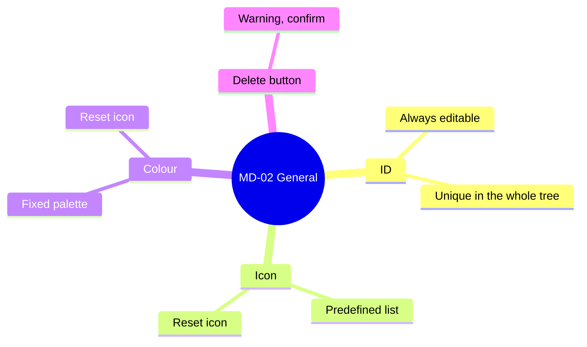

| ID | Element | Kind | Values and behaviour | Status | Source |
| --- | --- | --- | --- | --- | --- |
| MD-02.1 | ID | Text field | Labelled "ID", as for the signals, the commands, the flags, the enums and the designations (2026-11-22, decision 0084; replaces "Name"). Always editable (2026-11-16). The model identifier, readable (`centrifugal_pump`), unique in the whole tree; an ID already taken is refused when typed (decisions 0047, 0083). A rename breaks the model; nothing warns, it is seen in Git (2026-11-21). | Decided | [Types](../metadata/draft.md#types) |
| MD-02.2 | Edit | — | Removed (2026-11-16): everything is editable all the time. | Decided | [Always editable](../metadata/draft.md#always-editable-no-versions) |
| MD-02.3 | Save | — | Removed (2026-11-16): each change is kept as it is made. | Decided | [Always editable](../metadata/draft.md#always-editable-no-versions) |
| MD-02.4 | Parent | — | Removed: General does not show the parent, which the tree already shows. The parent is set at creation and never changed (decision 0013); a wrong parent: delete the type and create it again. | Decided | [Types](../metadata/draft.md#types) |
| MD-02.5 | Icon | List of icons | One icon of the predefined SVG list. No import. Validated (2026-11-16). | Decided | [Icons](../metadata/draft.md#type-icons) |
| MD-02.6 | Colour | Colour (palette only) | One colour of a fixed palette; no free colour. Validated (2026-11-16). | Decided | [Icons](../metadata/draft.md#type-icons) |
| MD-02.7 | Reset icon, reset colour | Button (icon) | Shown when the type overrides its parent's choice; makes it follow the parent again. An icon, no text label (2026-11-16). | Decided | [Icons](../metadata/draft.md#type-icons) |
| MD-02.8 | Delete the type | Button, then a warning (dialog) | In General (2026-11-16): the only way to delete a type. A click opens a warning that asks to confirm. Refused while the type has sub-types: they are deleted first (decision 0082). The warning says "Delete centrifugal_pump?" (the ID of the type), then "The type is deleted with everything it holds." (2026-11-23: "Only Git can bring it back" removed, since the undo history takes a delete back, decision 0093). A whole type is one of the few deletes that warn (decision 0093). | Decided | [Types](../metadata/draft.md#the-type-tree-search-create-delete-product-owner-2026-11-16) |

Gaps:

- Which icons for Reset (to choose with the design system).
- The palette and the icons may take several lines: where the reset buttons go then.
- How the refused delete of a type with sub-types shows: open in [Checks and errors](../metadata/checks-and-errors.md#open-questions).

## MD-03 · Documentation

Path: Metadata › Types › a type › Documentation.

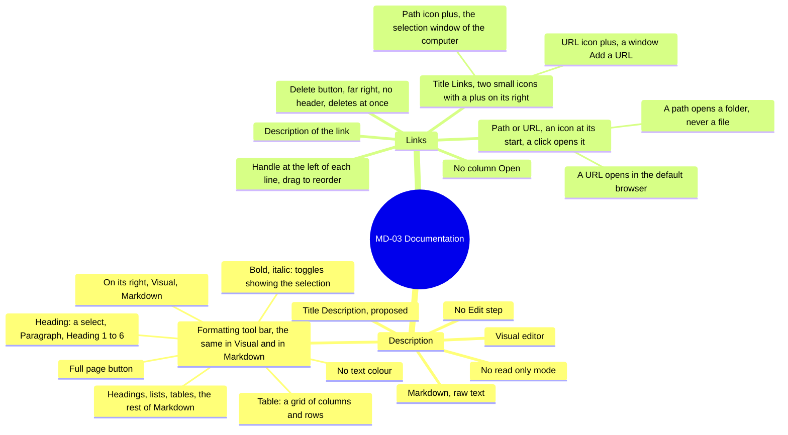

| ID | Element | Kind | Values and behaviour | Status | Source |
| --- | --- | --- | --- | --- | --- |
| MD-03.1 | Description, read only | — | Removed: only Visual and Markdown. | Decided | [Documentation](../metadata/draft.md#the-description) |
| MD-03.1b | Title "Description" | Title, above the editor | Tells what the text is, as "Links" does for the links. | Decided | [Documentation](../metadata/draft.md#the-description) |
| MD-03.2 | Description, visual editor | Editor (visual) | A "what you see is what you get" editor with a formatting tool bar. The mode that opens first (2026-11-22, questionnaire). | Decided | [Documentation](../metadata/draft.md#type-documentation) |
| MD-03.3 | Description, Markdown | Editor (raw text) | For those who write Markdown faster, with the same formatting tool bar; the user switches between the two modes at any time. | Decided | [Documentation](../metadata/draft.md#type-documentation) |
| MD-03.4 | Go to edit, Save | — | None: switching mode is not an Edit step, nothing to save or confirm (2026-11-16). | Decided | [Always editable](../metadata/draft.md#always-editable-no-versions) |
| MD-03.4b | Visual, Markdown | Buttons (switch) | On the right of the formatting tool bar, on the same line (2026-11-16); Read only removed (2026-11-22). | Decided | [Documentation](../metadata/draft.md#type-documentation) |
| MD-03.4d | Formatting tool bar | Buttons | In Visual and in Markdown (2026-11-16). Like a word processor: heading levels, lists, tables and the rest of Markdown (proposed list in [Documentation](../metadata/draft.md#the-formatting-tool-bar)); no text colour. Bold, italic, strikethrough: toggles that show the state of the selection; the heading: a select, Paragraph or Heading 1 to 6; the table: a grid to pick its columns and rows (grid of 8 × 6: assistant's reading). | Decided (both modes), Proposed (content) | [Documentation](../metadata/draft.md#the-formatting-tool-bar) |
| MD-03.4c | Full page | Button (icon), in the tool bar | The description takes the whole editing part; the links are hidden; the window, the menus of the application and the type tree stay. The same button brings the page back (2026-11-16). The editing area goes down to the bottom of the page, whatever the length of the text (2026-11-22). | Decided | [Documentation](../metadata/draft.md#type-documentation) |
| MD-03.5 | Links | List | Each link: a path or a URL, and a description. | Decided | [Documentation](../metadata/draft.md#type-documentation) |
| MD-03.13 | Table in the visual editor | Table, with small + on hover | A table of the description shows as a table, header line first. Under the mouse, a small round + sits between two lines, on the left edge, and between two columns, on the top edge: a click inserts a line or a column there; a + under the table adds a line at the end, a + on its right a column at the end. Only two + show at a time: the one of the line limit nearest to the mouse and the one of the column limit nearest to it; near the bottom edge it is the + under the table, near the right edge the + on its right. | Decided | [content-table](../design-system/07-molecules/content-table.md) |
| MD-03.14 | Headings of the description | Text styles | Heading 1 to 6 are all larger than the paragraph, down to Heading 6, so that a bold line never reads as a heading. Sizes proposed: 28, 24, 20, 18, 17, 16 against 14 for the paragraph. | Decided (rule), Proposed (sizes) | [Foundations](../design-system/02-foundations.md#styles-of-a-description) |
| MD-03.12 | Documentation of a sub-type | Rule | A sub-type shows its own description and links only, never its parent's, even when they are empty (2026-11-22, decision 0081). | Decided | [Inheritance of types](../metadata/inheritance.md#what-a-sub-type-inherits) |
| MD-03.6 | Add a path | Button (icon with a small +), then the selection window of the computer | On the right of the title "Links", first of two icons (2026-11-16). The server opens the selection window of the computer; only the path is kept (`W:/...`). A file or a folder. The new link goes at the end of the list. In the mockups, the window is a stand-in frame (2026-11-22). | Decided (window), Proposed (stand-in) | [Layout rules](README.md#a-title-and-a-small--on-its-right) |
| MD-03.7 | Add a URL | Button (icon with a small +), then a window "Add a URL" | Next to MD-03.6 (2026-11-16): two icons, no menu, "clac-clac". The window has a URL field (typed or pasted) and a description field (optional), then Cancel and Add; the new link goes at the end of the list (2026-11-22). | Decided (icon), Proposed (window) | [Documentation](../metadata/draft.md#the-links) |
| MD-03.11 | Handle of a link | Grip, dragged, no header | At the very left of each link: moves it; the order is kept (2026-11-16). | Decided | [Documentation](../metadata/draft.md#the-links) |
| MD-03.8 | Description of a link | Text field | Plain text, not Markdown. Once a link is added, the only thing that changes in it: its path or URL stays; a wrong link is deleted and added again (2026-11-22, questionnaire). | Decided | [Documentation](../metadata/draft.md#type-documentation) |
| MD-03.9 | Open | Click on the path or the URL, an icon at its start | No column Open (2026-11-16). A click on a path opens a folder: the one that contains the file, or the folder itself; never a file or a program. A click on a URL opens it in the default browser. The icon at the start says folder or link. | Decided | [Documentation](../metadata/draft.md#the-links) |
| MD-03.10 | Delete a link | Button (icon) | In the last column of the line, on the far right, with no header (2026-11-16). A click deletes the link at once, with no warning (decision 0093, which replaces the warning of 2026-11-16). No right click. | Decided | [Layout rules](README.md#delete-a-warning-only-for-a-whole-thing) |

Gaps:

- The exact content of the formatting tool bar.

## MD-04 · Signals

Path: Metadata › Types › a type › Signals.

The signals are shown in **one table** that takes as much room as possible: one line per signal, one column per field. It replaces the list on the left and its panel on the right, drawn earlier the same day. The + that adds a signal is a small icon on the right of the title "Signals".

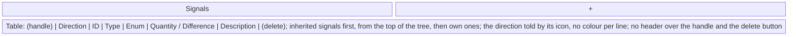

How the fields depend on each other: the type decides which fields exist. There is no model unit on the signal: it is one per quantity, set outside Metadata (2026-11-16). There is no minimum or maximum on the signal: a bound is a plain signal of its own, on a line of its own, usually an input (2026-11-17). There are no decimals on the signal (2026-11-17).

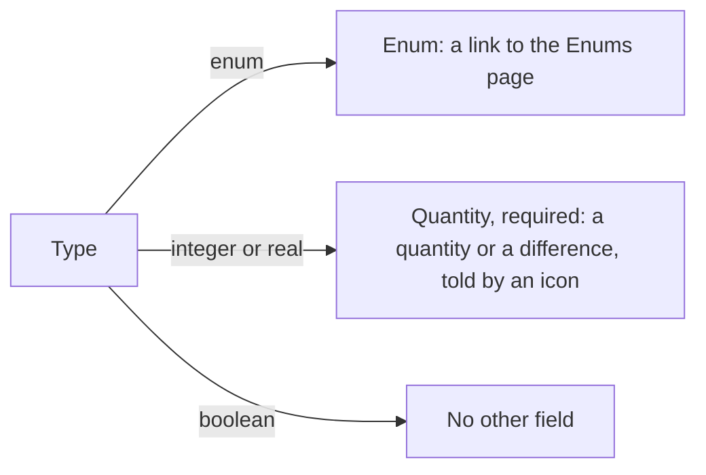

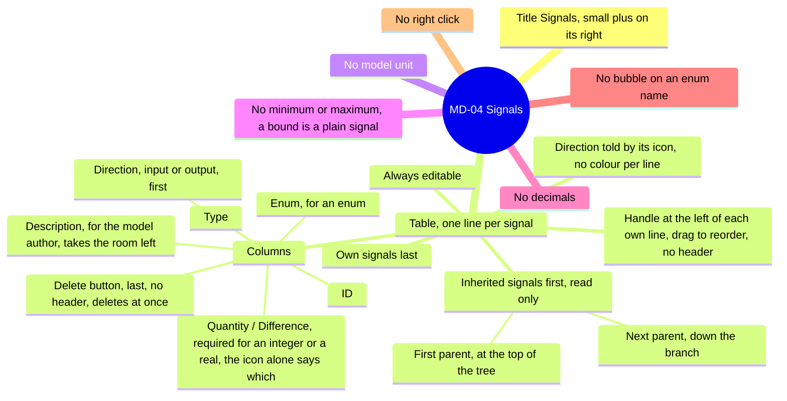

| ID | Element | Kind | Values and behaviour | Status | Source |
| --- | --- | --- | --- | --- | --- |
| MD-04.1 | Table of signals | Table | One line per signal, one column per field; takes as much room as possible. Own and inherited signals (2026-11-16). | Decided | [Signals](../metadata/draft.md#the-table-of-signals) |
| MD-04.2 | Enum on a signal line | — | The line shows the enum's name. No bubble listing its items when the mouse rests on the name (2026-11-17). | Decided | [Signals](../metadata/draft.md#the-table-of-signals) |
| MD-04.3 | Inherited signals | Lines of the table | First, read only: the signals of the first parent at the top of the tree, then of the next parent, then the type's own (2026-11-16). Edited in the type that declares them. Drawn read only, with no handle nor delete; the line never names its parent, which the tree already shows. | Decided | [Signals](../metadata/draft.md#the-table-of-signals) |
| MD-04.4 | Add a signal | Button (+), small icon | On the right of the title "Signals", above the table (2026-11-16). | Decided | [Layout rules](README.md#a-title-and-a-small--on-its-right) |
| MD-04.5 | Edit, Save | — | Removed (2026-11-16): the table is always editable. | Decided | [Always editable](../metadata/draft.md#always-editable-no-versions) |
| MD-04.5b | Colour of a line | — | Removed (2026-11-22): no background per direction, the icon of the column Direction tells an input from an output, both icons in the same colour. Replaces one colour per direction (2026-11-16). | Decided | [Signals](../metadata/draft.md#the-table-of-signals) |
| MD-04.6 | ID | Column, text field | Second column, after Direction. Model identifier; header "ID" (2026-11-16). Unique along the branch: a sub-type cannot reuse an inherited ID. An ID already taken is refused when typed (decisions 0080, 0081, 0083). | Decided | [Signals](../metadata/draft.md#signals) |
| MD-04.6b | Display name | — | Removed (2026-11-16), confirmed while reviewing the wireframes: the name people see is written in the faceplate builder of the preset ([MD-07](#md-07--presets)). | Decided | [Presets](../metadata/draft.md#mode-faceplate-the-faceplate-builder) |
| MD-04.7 | Type | Column, select | Integer, real (64-bit double), boolean, enum. No text (2026-11-18). | Decided | [Signals](../metadata/draft.md#signals) |
| MD-04.8 | Enum | Column, select | Only for the type enum: an enum of the Enums page, global or template (2026-11-17), as a link. Empty otherwise. | Decided | [Enums](../metadata/draft.md#enums) |
| MD-04.9 | Quantity | Column, select | Integer and real only, and **required** for them (2026-11-19, decision 0051, replaces "optional"): a number that measures nothing physical takes "ratio" (1, %, ‰, ppm) or "count". From the read-only catalogue. The same list offers the temperature and the temperature difference, in this one column; only the quantities whose conversion changes have the two items (2026-11-16): the temperatures, since gauge pressure is a quantity of its own (2026-11-22, decision 0075). An icon before the name, one for a quantity, one for a difference, and **the icon alone**: no "(quantity)" or "(difference)" written (2026-11-16). Header **"Quantity / Difference"** (2026-11-17). | Decided | [Units](../metadata/draft.md#value-or-difference-chosen-in-the-signal) |
| MD-04.10 | Model unit | — | Removed (2026-11-16, end of the day): one model unit per quantity, the same everywhere, set outside Metadata (the catalogue or the project: open). | Decided | [Units](../metadata/draft.md#model-unit-and-display-unit) |
| MD-04.11 | Minimum, maximum | — | Removed (2026-11-17): a bound is a plain signal of its own, on a line of its own, with no tie to the signal it bounds; its direction is chosen as for any signal, usually an input (example: `speed_setpoint_max`). | Decided | [Signals](../metadata/draft.md#rules-3) |
| MD-04.15 | Decimals | — | None (2026-11-17): the model takes the whole value; decimals, if needed, are set once for the project, outside Metadata. | Decided | [Signals](../metadata/draft.md#rules-3) |
| MD-04.12 | Direction | Column, select | First column (2026-11-16). Input or output of the model. | Decided | [Signals](../metadata/draft.md#signals) |
| MD-04.13 | Delete a signal | Button (icon) | Last column, on the far right of each own line, with no header and the least width (2026-11-16). A click deletes the signal at once, with no warning (decision 0093). No right click ([layout rules](README.md#delete-a-warning-only-for-a-whole-thing)). | Decided | [Signals](../metadata/draft.md#the-table-of-signals) |
| MD-04.14 | Handle of a line | Grip, dragged, no header | At the very left of each own line, before Direction: held and dragged to move the line; the order chosen is kept (2026-11-16). Inherited lines have none. A new signal goes at the end: to confirm. Its look: with the design system. | Decided | [Signals](../metadata/draft.md#the-order-of-the-lines) |
| MD-04.16 | Description | Column, text field, takes the room left | What the signal means, for the person who writes the model (2026-11-20, decision 0052). After Quantity / Difference, before the delete button: the long field last, as for flags and enum items (assistant's reading). Plain text: assistant's reading. Optional; written in the configuration files sent with the model (2026-11-20). | Decided (field, optional, in the files), Proposed (place, plain text) | [Signals](../metadata/draft.md#rules-3) |
| MD-04.17 | True / False | — | Removed (2026-11-21, decision 0058): the two texts of a boolean are set in the preset ([MD-07.13b](#md-07--presets)), not on the signal. | Decided | [Data model](../metadata/data-model-notes.md#changed-on-2026-11-21-boolean-texts) |

Gaps:

- Width of the window: what happens when the columns do not fit (scroll sideways, narrower columns)?
- Whether the table shows which parent an inherited line comes from.

## MD-05 · Commands

Path: Metadata › Types › a type › Commands.

As for the signals, the commands are shown in **one table**, the kind in the first column. The + that adds a command is a small icon on the right of the title "Commands".

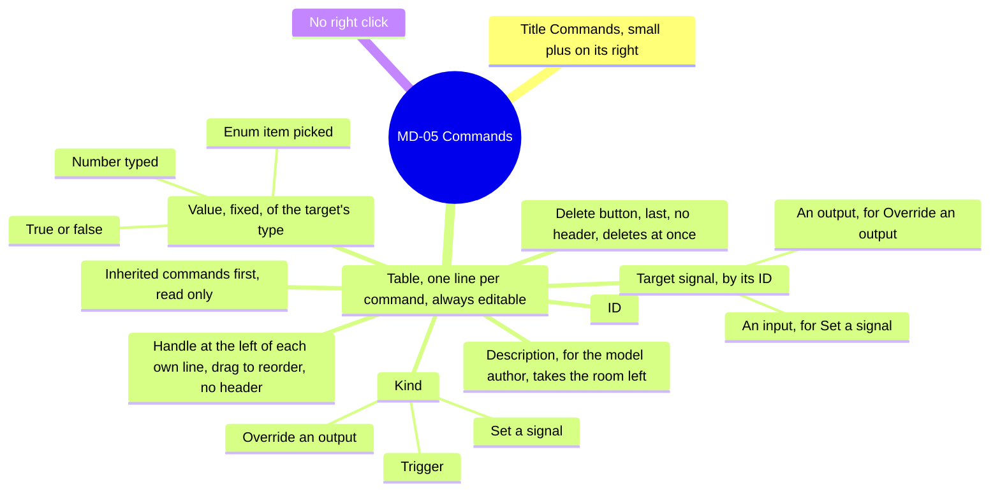

| ID | Element | Kind | Values and behaviour | Status | Source |
| --- | --- | --- | --- | --- | --- |
| MD-05.1 | Table of commands | Table | One line per command; kind, ID, target signal, value, description (2026-11-20); always editable (2026-11-16). | Decided | [Commands](../metadata/draft.md#the-table-of-commands) |
| MD-05.2 | Add a command | Button (+), small icon | On the right of the title "Commands", above the table (2026-11-16). | Decided | [Layout rules](README.md#a-title-and-a-small--on-its-right) |
| MD-05.3 | ID | Column, text field | The command's identifier, called ID as for the signals, never "name" (2026-11-16). For a trigger, all it has. Symbols follow a change (internal identifier). Unique along the branch; an ID already taken is refused when typed (decisions 0080, 0081, 0083). | Decided | [Commands](../metadata/draft.md#commands) |
| MD-05.4 | Kind | Column, select | First column. Set a signal, Trigger, or Override an output (2026-11-16). | Decided | [Commands](../metadata/draft.md#commands) |
| MD-05.5 | Target signal | Column, select | Picked by its ID. "Set a signal": the inputs of the model only; "Override an output": the outputs only (2026-11-16); empty for a trigger. | Decided | [Commands](../metadata/draft.md#commands) |
| MD-05.6 | Value: fixed or typed | — | Removed (2026-11-16): the value is always fixed. | Decided | [Commands](../metadata/draft.md#the-value-is-always-fixed) |
| MD-05.7 | Value | Column, field of the target signal's type | Fixed, written in Metadata: a number, true or false, or an item of the enum; never a text (2026-11-18, decision 0043). Empty for a trigger. A number is typed and kept in the default unit of the target signal's quantity (2026-11-19, decision 0051). | Decided | [Commands](../metadata/draft.md#the-value-is-always-fixed) |
| MD-05.8 | Typed value | — | Removed (2026-11-16): a person types a value in the faceplate, for a signal set to write in the preset. | Decided | [Presets](../metadata/draft.md#typing-a-value) |
| MD-05.9 | Delete a command | Button (icon) | Last column, on the far right of each own line, with no header (2026-11-16). A click deletes the command at once, with no warning (decision 0093). No right click. | Decided | [Commands](../metadata/draft.md#the-table-of-commands) |
| MD-05.10 | Handle of a line | Grip, dragged, no header | At the very left of each own line, before Kind; same behaviour as [MD-04.14](#md-04--signals) (2026-11-16, confirmed at the end of the day). | Decided | [Commands](../metadata/draft.md#the-table-of-commands) |
| MD-05.11 | Inherited commands | Lines of the table | First, read only, from the first parent at the top of the tree down; then the type's own (2026-11-16, as for the signals). | Decided | [Commands](../metadata/draft.md#the-table-of-commands) |
| MD-05.12 | Description | Column, text field, takes the room left | What the command means, for the person who writes the model; for a trigger, what the layer above the model is expected to do (2026-11-20, decision 0052; the trigger goes to that layer, never to the model: 2026-11-22). After Value, before the delete button, as on [MD-04.16](#md-04--signals) (assistant's reading). Optional; written in the configuration files sent with the model (2026-11-20). | Decided (field, optional, in the files), Proposed (place, plain text) | [Commands](../metadata/draft.md#commands) |

Gaps:

- Override an output: who applies it and how it ends, open (see [Commands](../metadata/draft.md#open-questions-4)).

## MD-12 · Flags, a part of the type

Path: Metadata › Types › a type › Flags, fifth part of the type, between Commands and Presets. Placed here, in the order of the parts, though its number comes after MD-07.

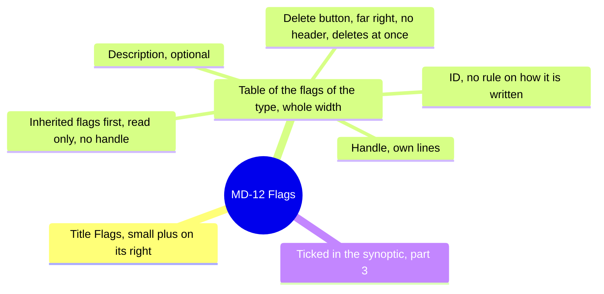

| ID | Element | Kind | Values and behaviour | Status | Source |
| --- | --- | --- | --- | --- | --- |
| MD-12.1 | Table of flags | Table, whole width | The flags of the selected type, one line per flag. Columns in this order: the handle with no header, ID, Description, then the delete button with no header (2026-11-17). Inherited flags first, read only, with no handle, as for signals (inheritance confirmed 2026-11-17). | Decided | [Flags](../metadata/draft.md#flags) |
| MD-12.2 | Add a flag | Button (+), small icon | On the right of the title "Flags" ([layout rules](README.md#a-title-and-a-small--on-its-right)). | Implied | [Flags](../metadata/draft.md#flags) |
| MD-12.6 | Handle of a line | Grip, dragged, no header | At the very left of each own line: the users sort the flags as they want (2026-11-17). | Decided | [Layout rules](README.md#handles-to-choose-the-order) |
| MD-12.3 | ID | Text field | Always editable, as everything in Metadata. No rule on how it is written: the users name it as they want (2026-11-17). Followed through an internal identifier when renamed (2026-11-17). Unique among the flags of its type, of its parents and of its sub-types (2026-11-22; decision 0080); an ID already taken is refused when typed (decision 0083). | Decided | [Flags](../metadata/draft.md#flags) |
| MD-12.5 | Description | Text field, takes the room left | After the ID: what the flag is for, plain text, optional (2026-11-17). Shown when editing a synoptic; kept out of the configuration files: assistant's reading. | Decided (optional), Proposed (not in the files) | [Flags](../metadata/draft.md#flags) |
| MD-12.4 | Delete a flag | Button (icon) | At the far right of the line, with no header ([layout rules](README.md#delete-a-warning-only-for-a-whole-thing)). Deleted at once, with no warning (decision 0093); nothing says which synoptics have the flag on (2026-11-17); the synoptic mode lists what is broken. | Decided | [Flags](../metadata/draft.md#flags) |

Gaps:

- The panel of the synoptic where the flags of a placed symbol are ticked: described with part 3.

## MD-06 · Faceplate: removed

There is no Faceplate part: the faceplate is the mode Faceplate of a preset ([MD-07](#md-07--presets)). The identifier MD-06 is not reused. The faceplate itself (its controls, its size) is drawn with the synoptic part.

## MD-07 · Presets

Path: Metadata › Types › a type › Presets.

On the left, two lists one above the other (decision 0087): "Parent presets", the presets of the parents, read only, each with a duplicate button shown on hover, a click showing it on the right, read only (decision 0088); then "Presets", the type's own, under their title and the small + on its right. A root type shows "Presets" alone. The page has no big title. The selected preset is on the right: a **switch** between its two modes at the top, then its name, then the mode chosen (the labels confirmed and the switch moved up at the end of the day):

- **Values**: one table with every signal of the type, for its display unit, decimals, texts of a boolean and start value; no command;
- **Faceplate**: the faceplate builder, a list of elements added one by one with the + of its title.

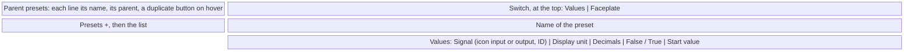

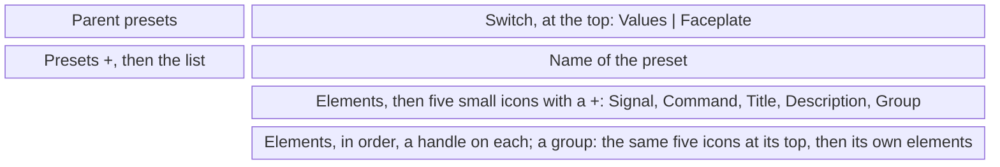

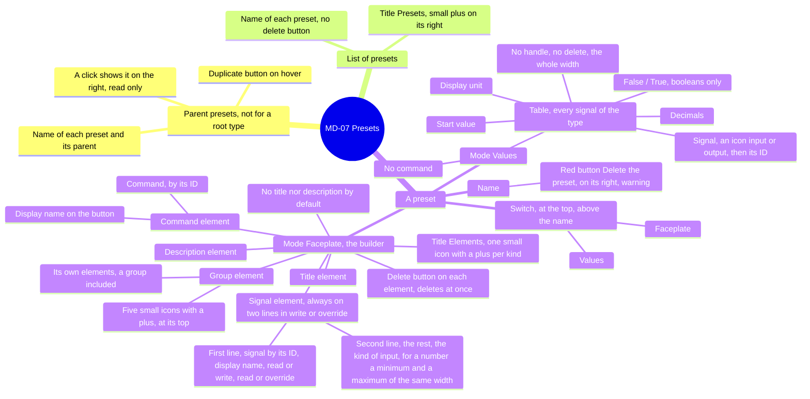

| ID | Element | Kind | Values and behaviour | Status | Source |
| --- | --- | --- | --- | --- | --- |
| MD-07.24 | Parent presets | List, read only | Above the list of presets: the presets of every parent up the branch, from the root down; each line its name, then the `id` of its parent in secondary text. No +, no delete; not shown for a root type (2026-11-23, decision 0087). A click on a line selects it and shows the preset on the right, read only ([MD-07.26](#md-07--presets); decision 0088); one line is selected across the two lists. | Decided | [Presets](../metadata/draft.md#a-type-needs-a-preset), [Inheritance of types](../metadata/inheritance.md#what-a-sub-type-inherits) |
| MD-07.25 | Duplicate a parent preset | Icon button, on hover | On the right of a line of Parent presets, shown on hover. Adds a copy of the preset to the list of presets and selects it (2026-11-23, decision 0087). The copy is named after the preset, followed by "-" and the first number free in the type: "Default-1", "Default-2"... (decision 0088; the hyphen confirmed the same day). | Decided | [Presets](../metadata/draft.md#a-type-needs-a-preset) |
| MD-07.26 | A parent preset, selected | Right side, read only | A line of Parent presets selected: its preset on the right, all read only, to see it before duplicating it (decision 0088). The switch of the modes, Values or Faceplate, works; the name, the table of values and the elements cannot be changed; no "Delete the preset", no + of elements, no handle nor delete on an element. | Decided | [Presets](../metadata/draft.md#a-type-needs-a-preset) |
| MD-07.1 | List of presets | List | The type's own presets, the only ones a symbol can choose: at least one is needed to use the type in a symbol. None is created automatically, for a root type as for a sub-type, which duplicates those of its parents ([MD-07.25](#md-07--presets); 2026-11-23, decision 0087, which replaces the copy at creation of decision 0080). | Decided | [Presets](../metadata/draft.md#presets-and-their-faceplate), [Inheritance of types](../metadata/inheritance.md#what-a-sub-type-inherits) |
| MD-07.2 | Create a preset | Button (+), small icon | On the right of the title "Presets" of the list; the page has no big title (2026-11-16). | Decided | [Layout rules](README.md#a-title-and-a-small--on-its-right) |
| MD-07.2b | Switch of the modes | Switch (two buttons) | At the top of the right side, above the name of the preset: **Values** or **Faceplate** (2026-11-16; labels confirmed at the end of the day). | Decided | [Presets](../metadata/draft.md#two-modes-chosen-by-a-switch) |
| MD-07.3 | Name of the preset | Text field | A preset has a name (2026-11-16). Under the switch, the same in both modes. Unique among the presets of its type; a name already taken is refused when typed (decision 0083). The same name as a preset of a parent is allowed (2026-11-23, decision 0088). | Decided | [Presets](../metadata/draft.md#presets-and-their-faceplate) |
| MD-07.4 | Faceplate title | — | Removed (2026-11-16): no title by default; a title element is added if wanted ([MD-07.19](#md-07--presets)). | Decided | [Presets](../metadata/draft.md#only-elements-in-elements) |
| MD-07.5 | Faceplate description | — | Removed (2026-11-16): no description by default; a description element is added if wanted ([MD-07.19](#md-07--presets)). | Decided | [Presets](../metadata/draft.md#only-elements-in-elements) |
| MD-07.6 | Show the faceplate | — | Removed (2026-11-16): the faceplate is seen in the mode Faceplate; the Faceplate part ([MD-06](#md-06--faceplate-removed)) was removed too. | Decided | [Presets](../metadata/draft.md#no-faceplate-part) |
| MD-07.7 | Table of values | Table | Mode Values: every signal of the type, own and inherited, in the order of Signals; one line each; no "add an entry"; no command (2026-11-16). No room for a handle nor a delete button: the columns take the whole width (2026-11-22). A line lights on hover, to help reading it; a click on the line itself does nothing (2026-11-22). | Decided | [Presets](../metadata/draft.md#mode-values-one-table-of-the-signals) |
| MD-07.8 | Shown | — | Removed (2026-11-16): what is in the builder is shown. | Decided | [Presets](../metadata/draft.md#mode-faceplate-the-faceplate-builder) |
| MD-07.9 | Signal | Column, read only | Mode Values: an icon of the signal's direction, input or output, then its ID (2026-11-17), so that the start value reads right. | Decided | [Presets](../metadata/draft.md#mode-values-one-table-of-the-signals) |
| MD-07.12 | Display unit | Column, select | Mode Values. For every integer and real (each has a quantity, 2026-11-19, decision 0051); starts as the default unit of the quantity ([Units on screen](../metadata/units-on-screen.md#three-units)). Changing it never changes the start value: only how it is shown. Its list is grouped by unit system: the unit systems of the quantity, in the order of its file, each under a small title with its name (Metric, Imperial, US customary...), then its units. Nothing else: every unit is in a quantity file, so there is no "Custom" group. 280 high at most, it scrolls inside. A unit that belongs to two systems shows in both: assistant's reading. | Decided (groups), Proposed (a unit in two systems) | [Presets](../metadata/draft.md#mode-values-one-table-of-the-signals) |
| MD-07.13 | Decimals | Column, number field | Mode Values. Integers and reals; starts as the one default number of decimals, the same everywhere (decision 0050). Display only. | Decided | [Units](../metadata/draft.md#decimal-places) |
| MD-07.13b | False / True | Column, two short text fields | Mode Values. Booleans only: the text of the false state, then of the true state ("Stopped" / "Running"), false on the left as 0 then 1 (assistant's choice); shown in the faceplate for a signal in read; never sent to the model (decisions 0054 and 0058; never in a title, decision 0055). Header "False / True", its place after Decimals, and "true" / "false" shown when empty: assistant's reading. | Decided (field in the preset), Proposed (place, header, empty) | [Data model](../metadata/data-model-notes.md#changed-on-2026-11-21-boolean-texts) |
| MD-07.14 | Start value | Column, field of the signal's type | Mode Values. For an input, the first value sent to the model; for an input and an output, the value shown before the model sends anything (2026-11-17). Called "Default value" until 2026-11-22: `start_value`, the word of FMI (decision 0064). True or false, a number, a text, or an enum item. A number is shown and typed in the display unit, and kept in the default unit of the quantity (2026-11-19, decision 0051). | Decided | [Presets](../metadata/draft.md#mode-values-one-table-of-the-signals) |
| MD-07.18 | Add an element | Buttons (small icons with a +) | Mode Faceplate, on the right of the title "Elements": one icon per kind, a signal, a command, a title, a description, a group, no menu. Each icon carries its small + at its bottom right, as the icons of Links, so that it reads as "add". | Decided | [Presets](../metadata/draft.md#mode-faceplate-the-faceplate-builder) |
| MD-07.9b | Signal element | Element of the builder | The signal, picked by its ID; its display name (plain text, never sent to the model; empty: the ID is shown; called "name shown" until 2026-11-21, decision 0055); read or write (input) or read or override (output); its input. | Decided | [Presets](../metadata/draft.md#mode-faceplate-the-faceplate-builder) |
| MD-07.10 | Input | Select, in a signal element | Chosen in the builder. Enum: radio on one line, radio on several lines, select; its items in the order of their keys (2026-11-22, [MD-09.5](#md-09--enums)). Number: a number field, with its bounds ([MD-07.22](#md-07--presets)). Boolean: a switch (2026-11-21). Shown for write or override only; in read, the faceplate shows the text of the value alone (2026-11-21). In the builder, on the second line of the element, whatever its kind: the first line ends with read or write. A signal in read has nothing for a second line and stays on one. | Decided | [Presets](../metadata/draft.md#mode-faceplate-the-faceplate-builder) |
| MD-07.11 | Read or write, read or override | Radio, in a signal element | Input: read or write. Output: read or override (corrects the single "read or override" written earlier that day). Write or override: a person types a value; what the model side does with it is up to it. | Decided | [Presets](../metadata/draft.md#typing-a-value) |
| MD-07.22 | Minimum, maximum of a number field | Number field each, with a small icon inside to pick a signal | On the second line of the signal element, after the kind of input, both of the same width (two lines: assistant's choice to make room). Each typed by hand, or taken from a signal of the type through the small icon in the field, as Figma's "Apply variable" (end of 2026-11-17). The small icon offers the input signals only, never an output (2026-11-21, decision 0055), and only those of the same quantity as the signal shown (2026-11-21, decision 0056). A typed bound is shown in the display unit of the preset. A value outside them is refused (assistant's reading). | Decided (refusal: Proposed) | [Presets](../metadata/draft.md#bounds-of-a-number-field) |
| MD-07.15 | Command element | Element of the builder | The command, picked by its ID; the display name on its button (plain text, never sent to the model; empty: the command's ID is shown; called "button text" until 2026-11-21, decision 0057). | Decided | [Presets](../metadata/draft.md#mode-faceplate-the-faceplate-builder) |
| MD-07.19 | Title element, description element | Text fields | A heading or a paragraph inside the faceplate or a group; the only way to give either a title or a description (2026-11-16). Description: plain text, line breaks kept. | Decided | [Presets](../metadata/draft.md#only-elements-in-elements) |
| MD-07.23 | Fixed text or variable | Small icon, on the right of the text field of a title or description element | As Figma's "Apply variable" (2026-11-18): a fixed text typed by the user, or a variable, a designation of [MD-13](#md-13--designations). Never a signal (2026-11-21, decision 0055): a signal element in read shows a value. A designation is filled on each placed symbol, in the synoptic. One variable alone in the field, never mixed with text: assistant's reading. | Decided (icon, designation only), Proposed (one variable, whole) | [Presets](../metadata/draft.md#fixed-text-or-a-variable) |
| MD-07.20 | Group element | Element of the builder | No title nor description of its own (confirmed 2026-11-17). At its top, the five small icons with a + (Signal, Command, Title, Description, Group), then its own elements; a group can hold a group (2026-11-16). The icons confirmed on 2026-11-17, after a doubt the same day: they save time. | Decided | [Presets](../metadata/draft.md#only-elements-in-elements) |
| MD-07.21 | Delete an element, delete a preset | Button; a warning for a preset only | An element: an icon at its far right (2026-11-16), deleted at once, with no warning (Product Owner, 2026-11-23, decision 0093). A preset, a whole thing, asks to confirm: a red button "Delete the preset" on the line of its name, on the right of the field, as "Delete the type" in General; no delete on the lines of the list (the place: assistant's choice). | Decided (button, warning), Proposed (place) | [Layout rules](README.md#delete-a-warning-only-for-a-whole-thing) |
| MD-07.17 | Order | Rule | Mode Values: the order of Signals, no handle, no sort. Mode Faceplate: the order of the builder, moved with a handle. | Decided | [Presets](../metadata/draft.md#mode-faceplate-the-faceplate-builder) |
| MD-07.16 | Description per signal | — | Removed (2026-11-16): no description per signal or command in the faceplate; the builder has description elements instead. The description a signal and a command got in Metadata on 2026-11-20 ([MD-04.16](#md-04--signals), [MD-05.12](#md-05--commands)) is for the model author and is not shown in the faceplate: assistant's reading. | Decided | [Presets](../metadata/draft.md#presets-and-their-faceplate) |

Gaps:

- Duplicate one of the type's own presets (a preset of a parent is duplicated with [MD-07.25](#md-07--presets)); what happens to the symbols that use a deleted preset?
- Can an element be added twice? What can a symbol or a synoptic change in the built faceplate (the texts of its title and description elements, at least)?

## MD-08 · Units

Path: Metadata › Units (navigation bar).

The page goes from the list of quantities to a quantity, then to a unit system (called "family" until 2026-11-22, research T5: the word also names families of equipment). Following the [layout rules](README.md#layout-rules), they sit in columns from left to right: the list, the selected quantity, the selected unit system. How a unit is shown elsewhere: [Units on screen](../metadata/units-on-screen.md).

**The whole page is read only**: the catalogue ships with the software, and contributors complete its files; no +, no field that changes the catalogue, no delete. The only field is the converter of a unit system, which tries a value and keeps nothing (2026-11-17).

The name said once, "Default unit", a converter, the formula of each unit in the table, no ratio, no default decimal places (decision 0050).

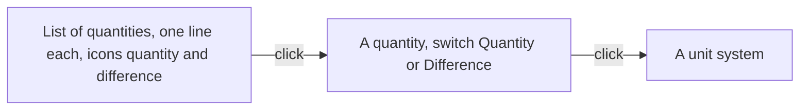

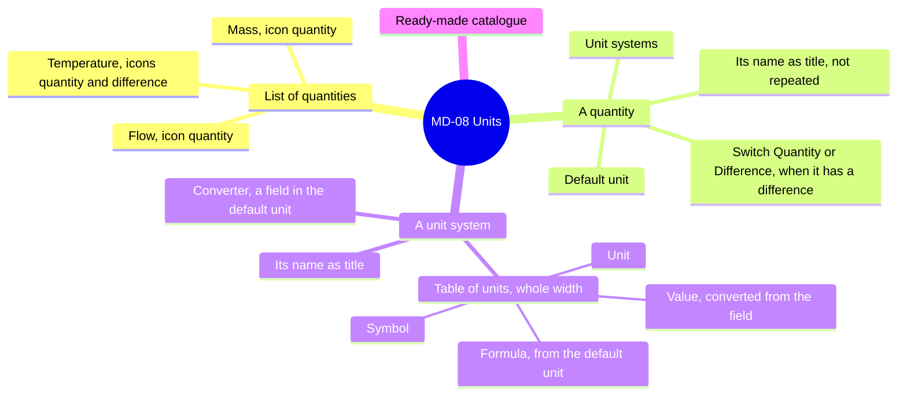

| ID | Element | Kind | Values and behaviour | Status | Source |
| --- | --- | --- | --- | --- | --- |
| MD-08.1 | List of quantities | List | Mass, volume, flow... One line per quantity, its difference included: its name, then the small icon `quantity`, and the icon `difference` when it has one (replaces the difference shown under its quantity). The difference stays a quantity of its own in the catalogue. | Decided | [Units](../metadata/draft.md#the-units-page) |
| MD-08.15 | Quantity or difference | Switch (two buttons) | At the top of a quantity that has a difference, under its title: Quantity or Difference; the same page in both, default unit, unit systems, converter and table. The quantity opens first (assistant's reading). | Decided (switch), Proposed (first) | [Units](../metadata/draft.md#the-units-page) |
| MD-08.2 | Add a quantity, a unit system, a unit | — | Removed: the page is read only; a missing unit is added by a contributor to the catalogue files. | Decided | [Units](../metadata/draft.md#a-ready-made-catalogue-read-only) |
| MD-08.12 | Name of the quantity | Title | The title of the quantity's column; not written again under it. | Decided | [Units](../metadata/draft.md#the-units-page) |
| MD-08.3 | Default unit | Text, read only | Labelled "Default unit" (2026-11-17, replaces "Model unit"): the unit every formula of the quantity is written against, and the display unit until a preset chooses another (decisions 0049, 0051). It stands for the model unit, the same for every signal (decision 0024), while the model unit stays in the catalogue; whether a project can set its own: open. | Decided (label, one per quantity), Open (where the model unit is set) | [Units on screen](../metadata/units-on-screen.md#three-units) |
| MD-08.4 | Default decimal places | — | Removed (2026-11-19, decision 0050): a quantity has no decimals; they are set in the preset only, starting at 2 ([MD-07.13](#md-07--presets)). | Decided | [Units on screen](../metadata/units-on-screen.md#decimals) |
| MD-08.5 | Reference family | — | Removed (2026-11-19, decision 0049): every unit converts to the default unit of its quantity and back. | Decided | [Conversion](../metadata/entities/07-conversion.md) |
| MD-08.6 | Unit systems | List | Named after their system: Metric, Imperial... (2026-11-17); they only group the units (decision 0075). A click opens the unit system (kept 2026-11-17). | Decided | [Unit system](../metadata/entities/09-unit-system.md) |
| MD-08.13 | Converter | Number field | At the top of the unit system, in the default unit of the quantity, 1 to start with (2026-11-22, decision 0085). Its value is converted on every line of the table; nothing is kept. | Decided | [Units](../metadata/draft.md#the-units-page) |
| MD-08.7 | Table of units | Table, read only, whole width | One line per unit; a line lights on hover, to help reading it, and a click on it does nothing. Columns: Unit (name with its variant: US gallon), Symbol, Value, Formula. Flat units (`m³/h` is one unit). No ratio column: a ratio such as "1/16" reads badly. Units sorted by the software, smallest first, by the size of one step in the default unit, then by name; a quantity whose formulas give no finite step keeps the order of its file. The line of the default unit is marked (assistant's reading). | Decided | [Units](../metadata/draft.md#the-units-page) |
| MD-08.14 | Value | Column, read only | The value of the converter in this unit, rounded to 12 significant digits (2026-11-22, decision 0085). | Decided | [Units](../metadata/draft.md#the-units-page) |
| MD-08.8 | Formula | Column, read only | How this unit is computed from the default unit, on its own line, never in a line under the table (2026-11-17): `lb = kg ÷ 0.45359237`, `°F = °C × 9/5 + 32`. It replaces the conversion of the family to the reference family, shown going and back. | Decided | [Units](../metadata/draft.md#the-units-page) |
| MD-08.9 | Parameters of the form | — | Merged into the formula: shown, never typed. | Decided | [Units](../metadata/draft.md#units) |
| MD-08.10 | Round-trip check | — | Done on the catalogue files, not by the user. | Decided | [Units](../metadata/draft.md#units) |
| MD-08.11 | Ready-made catalogue | — | Every unit that can be imagined, in files of the software; source and licence open. | Decided, licence Open | [Units](../metadata/draft.md#source-of-the-catalogue) |

Gaps:

- With every unit imaginable, the list is long: how does the user find a quantity or a unit (a search field)?
- How the catalogue files are checked when a contributor adds a unit (round trip, duplicates): to settle with the architecture.

## MD-09 · Enums

Path: Metadata › Enums (navigation bar).

The list of enums is on the left and the selected enum, with its items, on the right ([layout rules](README.md#layout-rules)).

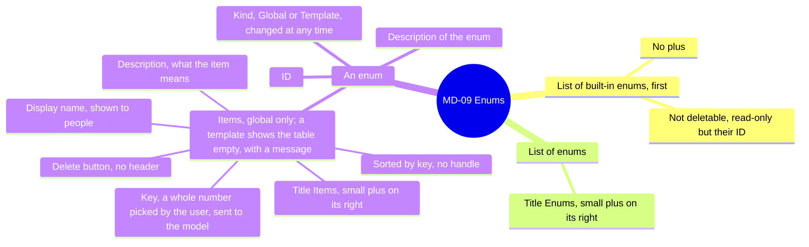

| ID | Element | Kind | Values and behaviour | Status | Source |
| --- | --- | --- | --- | --- | --- |
| MD-09.1 | List of enums | List | A page of its own, not part of the signals. Enums can be made before any signal uses them. | Decided | [Enums](../metadata/draft.md#enums) |
| MD-09.2 | Add an enum | Button (+), small icon | On the right of the title "Enums", above the list. | Decided | [Layout rules](README.md#a-title-and-a-small--on-its-right) |
| MD-09.3 | ID | Text field | The public identifier of the enum, as the ID of a signal (replaces "Name"). Unique among the enums (2026-11-22); an ID already taken is refused when typed (decision 0083). | Decided | [Data model](../metadata/data-model.md) |
| MD-09.10 | Kind: Global or Template | Choice when the enum is made (control not said) | Global: the items are written here, the same everywhere. Template: an ID and a description only, no items here; the items are completed on each placed symbol, in the synoptic, with a small warning until they are. The difference must be explicit on screen; how is for the design system: for a template, the table Items stays, with its columns and no line, no + on its title, and the message "A template has no items here: they are given on each placed symbol, in the synoptic." Global and Template switch the screen of the same enum. The kind can be changed at any time, signals or not, with no warning; going back to global brings back its items. | Decided (control: Open) | [Enums](../metadata/draft.md#global-enums-and-templates) |
| MD-09.11 | Description of the enum | Text field (several lines) | What the enum is about as a whole, for a template and for a global enum alike. Plain text, never sent to the model. | Decided | [Enums](../metadata/draft.md#global-enums-and-templates) |
| MD-09.4 | Kind of key | — | Removed: a key is always a number, there are no string keys. | Decided | [Enums](../metadata/draft.md#enums) |
| MD-09.5 | Items | Table | Columns in this order: Key, Display name, Description, then the delete button with no header (2026-11-17: the short field first, the long one last; replaces Key, Description, Display name of 2026-11-16). The lines are in the order of their keys, smallest first, and nothing else: no handle, no move (replaces decisions 0038 and 0039 on the order). | Decided | [Enums](../metadata/draft.md#rules-5) |
| MD-09.12 | Handle of an item | — | Removed: the items are in the order of their keys only. | Decided | [Enums](../metadata/draft.md#rules-5) |
| MD-09.6 | Key | Whole number field | Typed by the user, any whole number, gaps allowed (0, 2, 4), for a global enum and for the items of a template (end of 2026-11-17). Unique in its enum; what the model receives (2026-11-16). A key already taken is refused when typed (decision 0083). It can still be changed once given: breaking for the model, with no warning (decision 0038); the Versions page that showed it was removed on 2026-11-21 (decision 0053), the change is seen in Git. Changing it moves the line to its new place by key (2026-11-22; replaces decision 0039). | Decided | [Enums](../metadata/draft.md#rules-5) |
| MD-09.7 | Display name | Text field | After the key. What the faceplate, the symbol texts and the test values show. Not breaking. The same word as a signal field (decision 0056). Unique in its enum, while two enums may hold the same (decision 0084: [Enum item](../metadata/entities/05-enum-item.md)); a name already taken in its enum is refused when typed (decision 0083). | Decided | [Enums](../metadata/draft.md#enums) |
| MD-09.9 | Description | Text field | Last, after the display name (2026-11-17): what the item means, plain text, never sent to the model (2026-11-16). Optional, shown on this page only (2026-11-16). | Decided | [Enums](../metadata/draft.md#enums) |
| MD-09.13 | Built-in enums | List | Enums that come with the software (first: pipe direction). A list of their own, **above** the list of the user's enums (2026-11-23). Not deletable; items and description read-only; always global; the ID can be changed. No + on its title (assistant's reading); title wording "Built-in enums" proposed. | Decided (title: Proposed) | [Built-in enums](../metadata/draft.md#built-in-enums) |
| MD-09.8 | Add, delete an item | Button (+), delete button (icon) | The small + on the right of the title "Items"; the delete button at the far right of an item, with no header (2026-11-16); the item goes at once, with no warning (decision 0093; [layout rules](README.md#delete-a-warning-only-for-a-whole-thing)). An enum is deleted with the delete button of its line, then a warning, as a whole type (assistant's reading). Deleting one still used is allowed: the signals, start values and commands that use it are flagged in error (decision 0082). | Decided (item), Proposed (warning for an enum) | [Enums](../metadata/draft.md#enums) |

Gaps:

- Which signals use an enum: is it shown (a usage counter)?

## MD-10 · Libraries: removed

There are no libraries of types (Type Libs). The identifier MD-10 is not reused.

## MD-11 · Versions: removed

There is no Versions page (decision 0053): the application keeps no versions, the JSON files of the types are versioned with Git by the user (see [Always editable, no versions](../metadata/draft.md#always-editable-no-versions)). The identifier MD-11 is not reused.

## MD-13 · Designations

Path: Metadata › Designations (navigation bar, [MD-00.6](#md-00--navigation-bar-of-metadata)). Named Designations by decision 0064.

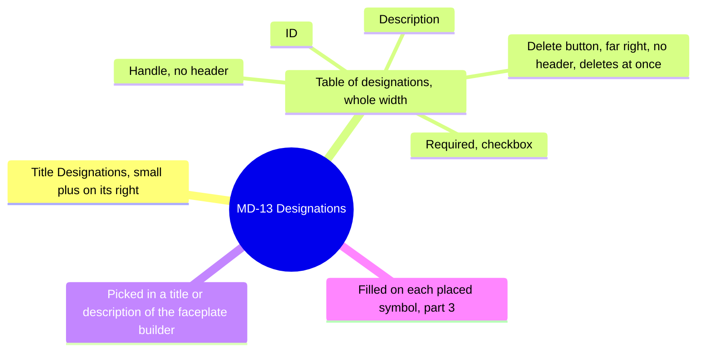

| ID | Element | Kind | Values and behaviour | Status | Source |
| --- | --- | --- | --- | --- | --- |
| MD-13.1 | Table of designations | Table, whole width | One line per designation. Columns in this order: the handle with no header, ID, Required, Description, then the delete button with no header (order: assistant's reading; the order of the fields of a designation, the long Description last, 2026-11-21). No default value (2026-11-18). No display name (2026-11-21): the ID is shown. | Decided (table, fields), Proposed (column order) | [Identifiers (draft)](../metadata/draft.md#identifiers) |
| MD-13.2 | Add a designation | Button (+), small icon | On the right of the title "Designations" ([layout rules](README.md#a-title-and-a-small--on-its-right)). | Implied | [Identifiers (draft)](../metadata/draft.md#identifiers) |
| MD-13.3 | Handle of a line | Grip, dragged, no header | The user chooses the order. | Decided | [Layout rules](README.md#handles-to-choose-the-order) |
| MD-13.4 | ID | Text field | The key. Always editable, followed through its internal ID when renamed (assistant's reading of the general rule). Unique among the designations; an ID already taken is refused when typed (decision 0083). | Decided | [Designation](../metadata/entities/11-designation.md) |
| MD-13.5 | Display name | — | Removed: the ID is shown where the designation is picked and filled. | Decided | [Designation](../metadata/entities/11-designation.md) |
| MD-13.6 | Description | Text field, takes the room left | What the designation is. Optional: assistant's reading. | Decided (field), Proposed (optional) | [Identifiers (draft)](../metadata/draft.md#identifiers) |
| MD-13.8 | Required | Checkbox, narrow column, between ID and Description | Checked: every placed symbol must have the text of this designation (a control ID), whether or not its faceplate shows it; left empty, a warning, never a block. Unchecked: it may stay empty (a location). A checkbox, not a switch, since a table shows several lines: assistant's reading. Unchecked for a new designation. | Decided (field, default), Proposed (control) | [Designation](../metadata/entities/11-designation.md) |
| MD-13.7 | Delete a designation | Button (icon) | At the far right of the line, with no header; deleted at once, with no warning, as every line (decision 0093; [layout rules](README.md#delete-a-warning-only-for-a-whole-thing)). Deleting one still used is allowed: the titles and paragraphs of the faceplate that show it are flagged in error (decision 0082). | Decided | [Identifiers (draft)](../metadata/draft.md#identifiers) |

Gaps:

- What the faceplate of a placed symbol shows for a title whose designation was deleted (flagged in error in Metadata, decision 0082).
- The panel of the synoptic where the text of each designation is filled: described in [Panel of a placed symbol](../synoptics/04-placed-symbol-panel.md#identity).
- The open questions of [Identifiers (draft)](../metadata/draft.md#open-questions-8).
