# Screens of Metadata

> [Home](../README.md) › [Screens](README.md) › Metadata

Status: draft, written by the assistant on 2026-11-11 from the validated [Metadata](../metadata/README.md) pages, then reviewed with the Product Owner the same day (tree on the left, order of the parts, General complete, description modes, links, signals, commands, enums, units), and on 2026-11-16 from the review of the wireframes (navigation bar, list on the left and panel on the right, libraries of types removed; then icon buttons in General, a fixed parent, a description always editable, add buttons above the lists, signals and commands in tables, commands with a fixed value only; then the faceplate merged into the presets, and an ID and a display name for each signal; then the parts of a type as a strip of icons, delete by right click everywhere, commands to inputs only, whole number enum keys, the type tree kept in full page; last, no Edit or Save step anywhere and a Versions page, the read-only mode of the description kept, the direction first in the table of signals, the name shown of a signal moved to the preset, three kinds of command with an ID; then quantity or difference in the one column Quantity, and the parts of a type listed by name, fixed under the tree, replacing the strip of icons; last, the list moved above the tree then back under it, and a Faceplate part, a view only, replacing the button that showed the faceplate; at the end of the day, the tree validated with its search behind an icon, no right click anywhere (a delete button with a warning), inherited lines first, icons for a quantity and a difference, the formatting tool bar in both modes, and a preset in two modes, Values and the faceplate builder). It adds no rule. Kinds, statuses and the [layout rules](README.md#layout-rules) are explained in the [guide of this folder](README.md).

## MD-00 · Navigation bar of Metadata

Path: on the far left of every screen of Metadata (Product Owner, 2026-11-16).

| ID | Element | Kind | Values and behaviour | Status | Source |
| --- | --- | --- | --- | --- | --- |
| MD-00.1 | Types | Button (icon) | Opens [MD-01](#md-01--types-the-tree-and-the-type-editor). | Decided | [Layout rules](README.md#layout-rules) |
| MD-00.2 | Units | Button (icon) | Opens [MD-08](#md-08--units). | Decided | [Layout rules](README.md#layout-rules) |
| MD-00.3 | Enums | Button (icon) | Opens [MD-09](#md-09--enums). | Decided | [Layout rules](README.md#layout-rules) |
| MD-00.4 | Versions | Button (icon) | Opens [MD-11](#md-11--versions). After Enums (2026-11-16). | Decided | [Versions](../metadata/13-versions.md) |

Gaps:

- Which icons (to choose with the design system). Going from Metadata to the symbol mode is done in the top bar (see the [layout rules](README.md#top-bar-of-the-window)).

## MD-01 · Types: the tree and the type editor

Path: Metadata › Types.

The tree is on the left, as in a code editor, just right of the navigation bar; the parts of the selected type are listed by name under the tree, in the same column, fixed; the selected part is edited on the right.

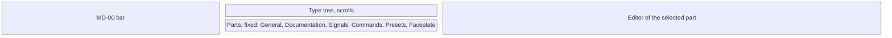

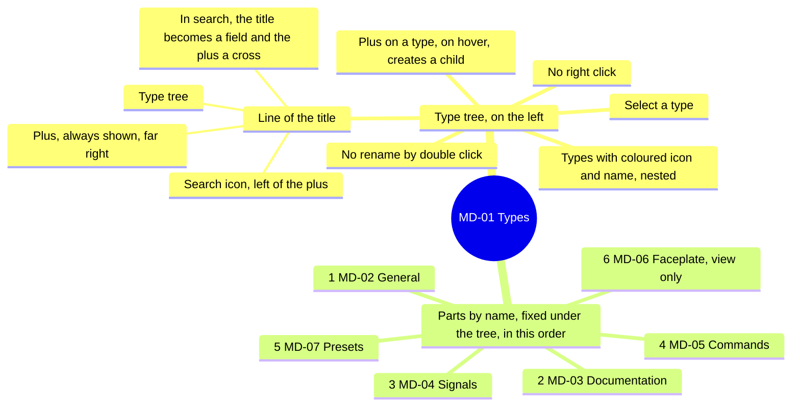

| ID | Element | Kind | Values and behaviour | Status | Source |
| --- | --- | --- | --- | --- | --- |
| MD-01.1 | Type tree | Tree | On the left. Shows each type with its icon, in its colour, and its name; types nest at any depth. A click selects the type. Validated (2026-11-16). | Decided | [Types](../metadata/01-types.md), [Icons](../metadata/02-icons.md) |
| MD-01.2 | Double click on a type | — | Does **not** rename: the name changes in General only. | Decided | [Types](../metadata/01-types.md) |
| MD-01.3 | Create a child type | Button (+), on hover | On the right of each type, shown when the mouse is over it; creates a type inside it, with a default name. Always shown in a light colour: thought of, then dropped as too loaded (2026-11-16). | Decided | [Types](../metadata/01-types.md) |
| MD-01.3b | Create a root type | Button (+), always shown | On the line of the title "Type tree", always on the far right. | Decided | [Types](../metadata/01-types.md) |
| MD-01.4 | Delete a type | — | Removed from the tree (2026-11-16): no right click in Metadata; the type is deleted in General ([MD-02.8](#md-02--general)). | Decided | [Types](../metadata/01-types.md) |
| MD-01.5 | Parts of the type | List of names | In the column of the type tree, under it, fixed at the bottom: it never moves when the tree grows. The names in whole words, in this order: General, Documentation, Signals, Commands, Presets, Faceplate (proposal B, 2026-11-16, replacing the strip of icons of proposal C; moved above the tree for a while the same day, then back under it). | Decided | [Types](../metadata/01-types.md#the-parts-of-a-type-a-list-fixed-under-the-tree) |
| MD-01.6 | Search | Button (icon) on the line of the title, left of the + | A click turns the title into a search field; typing filters the tree; the + becomes a cross that closes the search and brings the title back (2026-11-16). It replaces the field under the title. | Decided | [Types](../metadata/01-types.md#the-type-tree-search-create-delete-product-owner-2026-11-16) |
| MD-01.6b | Search field | Text field | In place of the title "Type tree", while searching. | Decided | [Types](../metadata/01-types.md#the-type-tree-search-create-delete-product-owner-2026-11-16) |
| MD-01.6c | Close the search | Button (×) | In place of the + while searching. | Decided | [Types](../metadata/01-types.md#the-type-tree-search-create-delete-product-owner-2026-11-16) |

Gaps:

- Does the filtered tree keep the parents of a type that matches?
- Fold arrows on the branches: drawn, never said.
- How the selected part is marked in the list (to choose with the design system).

## MD-02 · General

Path: Metadata › Types › a type › General. Complete: nothing more is needed (Product Owner, 2026-11-11, confirmed on 2026-11-16).

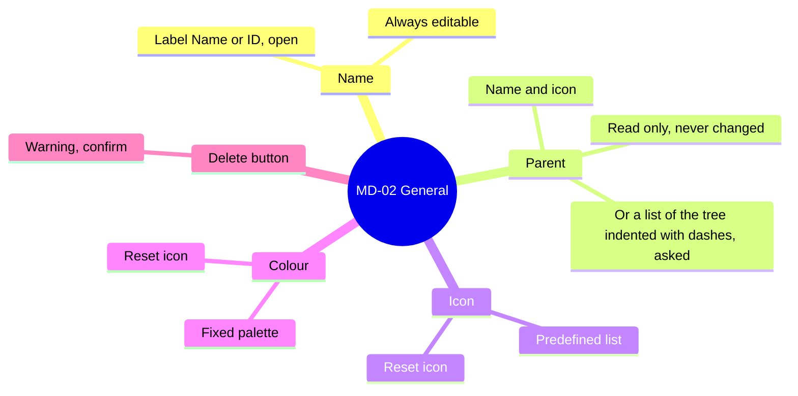

| ID | Element | Kind | Values and behaviour | Status | Source |
| --- | --- | --- | --- | --- | --- |
| MD-02.1 | Name | Text field | Always editable (2026-11-16). The model identifier, readable (`centrifugal_pump`). A rename shows on [MD-11](#md-11--versions). | Decided | [Types](../metadata/01-types.md) |
| MD-02.2 | Edit | — | Removed (2026-11-16): everything is editable all the time. | Decided | [Versions](../metadata/13-versions.md) |
| MD-02.3 | Save | — | Removed (2026-11-16): changes are checked on the Versions page. | Decided | [Versions](../metadata/13-versions.md) |
| MD-02.4 | Parent | Read only: name and icon | Set at creation, never changed (2026-11-16, decision 0013). A wrong parent: delete the type and create it again. The Product Owner then described it as a select showing the whole tree, indented with dashes: asked. | Decided (read only), Open (select) | [Types](../metadata/01-types.md#a-list-of-types-shows-the-tree-indented) |
| MD-02.5 | Icon | List of icons | One icon of the predefined SVG list. No import. Validated (2026-11-16). | Decided | [Icons](../metadata/02-icons.md) |
| MD-02.6 | Colour | Colour (palette only) | One colour of a fixed palette; no free colour. Validated (2026-11-16). | Decided | [Icons](../metadata/02-icons.md) |
| MD-02.7 | Reset icon, reset colour | Button (icon) | Shown when the type overrides its parent's choice; makes it follow the parent again. An icon, no text label (2026-11-16). | Decided | [Icons](../metadata/02-icons.md) |
| MD-02.8 | Delete the type | Button, then a warning (dialog) | In General (2026-11-16): the only way to delete a type. A click opens a warning that asks to confirm. | Decided | [Types](../metadata/01-types.md#the-type-tree-search-create-delete-product-owner-2026-11-16) |

Gaps:

- Which icons for Reset (to choose with the design system).
- The label of the name: "Name" or "ID" (open).
- The palette and the icons may take several lines: where the reset buttons go then.
- The wording of the warning.

## MD-03 · Documentation

Path: Metadata › Types › a type › Documentation.

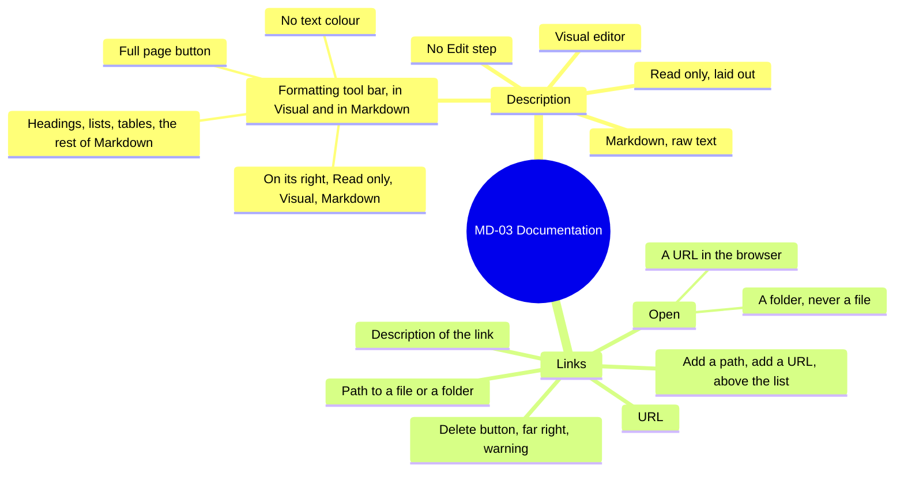

| ID | Element | Kind | Values and behaviour | Status | Source |
| --- | --- | --- | --- | --- | --- |
| MD-03.1 | Description, read only | Editor (laid out, read only) | Kept (Product Owner, 2026-11-16, correcting his removal of the same day). Which mode opens first: open. | Decided (mode), Open (first) | [Documentation](../metadata/03-documentation.md) |
| MD-03.2 | Description, visual editor | Editor (visual) | A "what you see is what you get" editor with a formatting tool bar. | Decided | [Documentation](../metadata/03-documentation.md) |
| MD-03.3 | Description, Markdown | Editor (raw text) | For those who write Markdown faster; the user switches between the three modes at any time. | Decided | [Documentation](../metadata/03-documentation.md) |
| MD-03.4 | Go to edit, Save | — | None: switching mode is not an Edit step, nothing to save or confirm (2026-11-16). | Decided | [Versions](../metadata/13-versions.md) |
| MD-03.4b | Read only, Visual, Markdown | Buttons (switch) | On the right of the formatting tool bar, on the same line (2026-11-16). | Decided | [Documentation](../metadata/03-documentation.md) |
| MD-03.4d | Formatting tool bar | Buttons | In Visual and in Markdown (2026-11-16). Like a word processor: heading levels, lists, tables and the rest of Markdown (proposed list in [Documentation](../metadata/03-documentation.md#the-formatting-tool-bar)); no text colour. | Decided (both modes), Proposed (content) | [Documentation](../metadata/03-documentation.md#the-formatting-tool-bar) |
| MD-03.4c | Full page | Button (icon), in the tool bar | The description takes the whole editing part; the links are hidden; the window, the menus of the application and the type tree stay. The same button brings the page back (2026-11-16). | Decided | [Documentation](../metadata/03-documentation.md) |
| MD-03.5 | Links | List | Each link: a path or a URL, and a description. | Decided | [Documentation](../metadata/03-documentation.md) |
| MD-03.6 | Add a path | Button + selection window | Above the list of links. The server opens a window; only the path is kept (`W:/...`). A file or a folder. | Decided | [Documentation](../metadata/03-documentation.md) |
| MD-03.7 | Add a URL | Button + text field | Above the list of links. Typed or pasted. | Decided | [Documentation](../metadata/03-documentation.md) |
| MD-03.8 | Description of a link | Text field | Plain text, not Markdown. | Decided | [Documentation](../metadata/03-documentation.md) |
| MD-03.9 | Open | Button (not said) | Always a folder: the one that contains the file, or the folder itself. Never launches a file or a program. A URL opens in the browser. | Decided | [Documentation](../metadata/03-documentation.md) |
| MD-03.10 | Delete a link | Button (icon), then a warning | In the last column of the line, on the far right; a click opens a warning (2026-11-16). No right click. | Decided | [Layout rules](README.md#delete-with-a-button-and-a-warning-in-metadata) |

Gaps:

- How is a link edited in place? Can links be reordered?
- The exact content of the formatting tool bar.

## MD-04 · Signals

Path: Metadata › Types › a type › Signals.

The signals are shown in **one table** that takes as much room as possible: one line per signal, one column per field (Product Owner, 2026-11-16). It replaces the list on the left and its panel on the right, drawn earlier the same day. The + that adds a signal sits above the table.

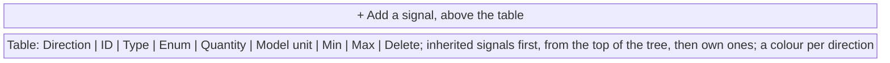

How the fields depend on each other: the type decides which fields exist; the quantity decides which units can be chosen.

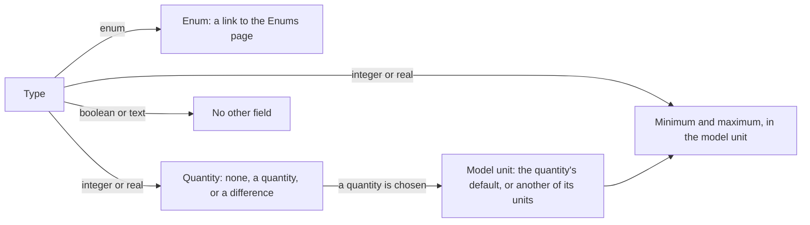

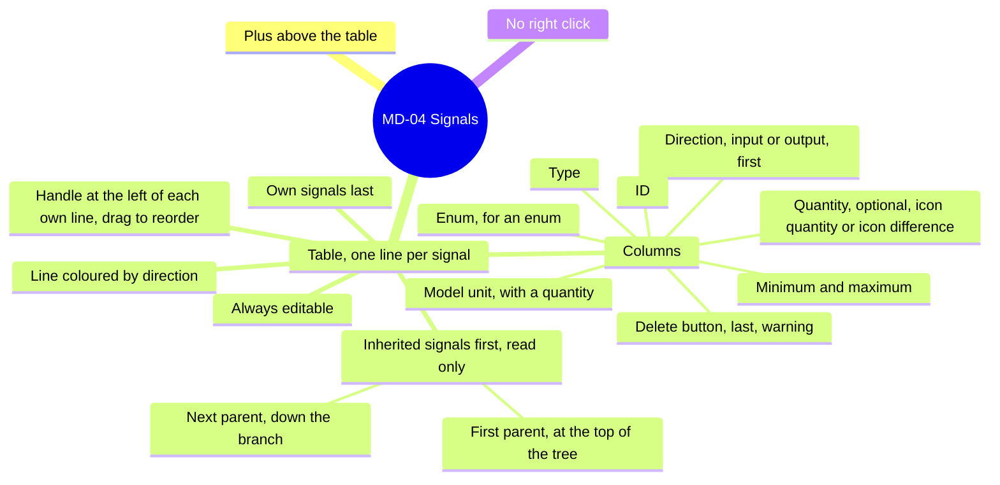

| ID | Element | Kind | Values and behaviour | Status | Source |
| --- | --- | --- | --- | --- | --- |
| MD-04.1 | Table of signals | Table | One line per signal, one column per field; takes as much room as possible. Own and inherited signals (2026-11-16). | Decided | [Signals](../metadata/04-signals.md#the-table-of-signals) |
| MD-04.2 | Enum on a signal line | — | The line shows the enum's name. A bubble listing its items when the mouse rests on the name: open. | Decided (bubble: Open) | [Signals](../metadata/04-signals.md) |
| MD-04.3 | Inherited signals | Lines of the table | First, read only: the signals of the first parent at the top of the tree, then of the next parent, then the type's own (2026-11-16). Edited in the type that declares them. Their look (greyed, with the parent's name) is not said. | Decided (order), Open (look) | [Signals](../metadata/04-signals.md#the-table-of-signals) |
| MD-04.4 | Add a signal | Button (+) | Above the table ([layout rules](README.md#add-buttons-above-the-list)). | Decided | [Layout rules](README.md#add-buttons-above-the-list) |
| MD-04.5 | Edit, Save | — | Removed (2026-11-16): the table is always editable; changes are checked on [MD-11](#md-11--versions). | Decided | [Versions](../metadata/13-versions.md) |
| MD-04.5b | Colour of a line | Background of the line | One colour for an input, another for an output (2026-11-16). The colours: with the design system. | Decided | [Signals](../metadata/04-signals.md#the-table-of-signals) |
| MD-04.6 | ID | Column, text field | Second column, after Direction. Model identifier; header "ID" (2026-11-16). A sub-type cannot reuse an inherited ID. | Decided | [Signals](../metadata/04-signals.md) |
| MD-04.6b | Display name | — | Removed (2026-11-16), confirmed while reviewing the wireframes: the name people see is written in the faceplate builder of the preset ([MD-07](#md-07--presets)). | Decided | [Presets](../metadata/09-presets.md#mode-faceplate-the-faceplate-builder) |
| MD-04.7 | Type | Column, select | Integer, real (64-bit double), boolean, text, enum. | Decided | [Signals](../metadata/04-signals.md) |
| MD-04.8 | Enum | Column, select | Only for the type enum: an enum of the Enums page, as a link. Empty otherwise. | Decided | [Enums](../metadata/06-enums.md) |
| MD-04.9 | Quantity | Column, select | Optional, integer and real only. From the read-only catalogue. The same list offers "pressure (quantity)" and "pressure (difference)", in this one column; only the quantities whose conversion changes have the two items (2026-11-16). An icon before the name: one for a quantity, one for a difference (2026-11-16). Header "Quantity" or "Quantity / difference": open. | Decided (icons), Open (header) | [Units](../metadata/05-units.md#value-or-difference-chosen-in-the-signal) |
| MD-04.10 | Model unit | Column, select | Only with a quantity. Default: the quantity's model unit; another unit of the same quantity can be chosen. | Decided | [Units](../metadata/05-units.md) |
| MD-04.11 | Minimum, maximum | Columns, number fields | Integer and real only; indicative; in the model unit. | Decided | [Signals](../metadata/04-signals.md) |
| MD-04.12 | Direction | Column, select | First column (2026-11-16). Input or output of the model. | Decided | [Signals](../metadata/04-signals.md) |
| MD-04.13 | Delete a signal | Button (icon), then a warning | Last column, on the far right of each own line; a click opens a warning (2026-11-16). No right click ([layout rules](README.md#delete-with-a-button-and-a-warning-in-metadata)). | Decided | [Signals](../metadata/04-signals.md#the-table-of-signals) |
| MD-04.14 | Handle of a line | Grip, dragged | At the very left of each own line, before Direction: held and dragged to move the line; the order chosen is kept (2026-11-16). Inherited lines have none. A new signal goes at the end: to confirm. Its look: with the design system. | Decided | [Signals](../metadata/04-signals.md#the-order-of-the-lines) |

Gaps:

- Width of the window: what happens when the nine columns do not fit (scroll sideways, narrower columns)?
- Whether the table shows which parent an inherited line comes from.

## MD-05 · Commands

Path: Metadata › Types › a type › Commands.

As for the signals, the commands are shown in **one table**, the kind in the first column (Product Owner, 2026-11-16). The + that adds a command sits above the table.

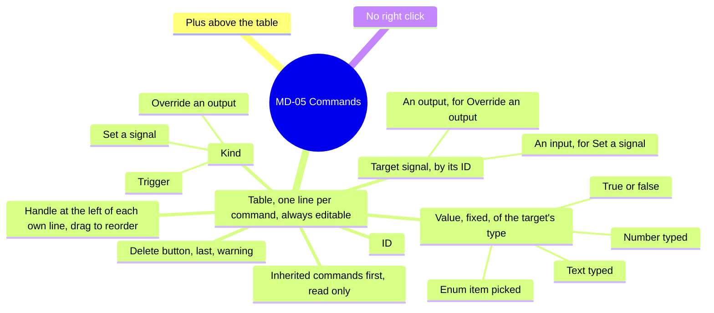

| ID | Element | Kind | Values and behaviour | Status | Source |
| --- | --- | --- | --- | --- | --- |
| MD-05.1 | Table of commands | Table | One line per command; kind, ID, target signal, value; always editable (2026-11-16). | Decided | [Commands](../metadata/07-commands.md#the-table-of-commands) |
| MD-05.2 | Add a command | Button (+) | Above the table ([layout rules](README.md#add-buttons-above-the-list)). | Decided | [Layout rules](README.md#add-buttons-above-the-list) |
| MD-05.3 | ID | Column, text field | The command's identifier, called ID as for the signals, never "name" (2026-11-16). For a trigger, all it has. Symbols follow a change (internal identifier). | Decided | [Commands](../metadata/07-commands.md) |
| MD-05.4 | Kind | Column, select | First column. Set a signal, Trigger, or Override an output (2026-11-16). | Decided | [Commands](../metadata/07-commands.md) |
| MD-05.5 | Target signal | Column, select | Picked by its ID. "Set a signal": the inputs of the model only; "Override an output": the outputs only (2026-11-16); empty for a trigger. | Decided | [Commands](../metadata/07-commands.md) |
| MD-05.6 | Value: fixed or typed | — | Removed (2026-11-16): the value is always fixed. | Decided | [Commands](../metadata/07-commands.md#the-value-is-always-fixed) |
| MD-05.7 | Value | Column, field of the target signal's type | Fixed, written in Metadata: a number, true or false, a text, or an item of the enum. Empty for a trigger. | Decided | [Commands](../metadata/07-commands.md#the-value-is-always-fixed) |
| MD-05.8 | Typed value | — | Removed (2026-11-16): a person types a value in the faceplate, for a signal set to write in the preset. | Decided | [Presets](../metadata/09-presets.md#typing-a-value) |
| MD-05.9 | Delete a command | Button (icon), then a warning | Last column, on the far right of each own line; a click opens a warning (2026-11-16). No right click. | Decided | [Commands](../metadata/07-commands.md#the-table-of-commands) |
| MD-05.10 | Handle of a line | Grip, dragged | At the very left of each own line, before Kind; same behaviour as [MD-04.14](#md-04--signals) (2026-11-16). | Decided | [Commands](../metadata/07-commands.md#the-table-of-commands) |
| MD-05.11 | Inherited commands | Lines of the table | First, read only, from the first parent at the top of the tree down; then the type's own (2026-11-16, as for the signals). | Decided | [Commands](../metadata/07-commands.md#the-table-of-commands) |

Gaps:

- Override an output: who applies it and how it ends, open (see [Commands](../metadata/07-commands.md#open-questions)).

## MD-06 · Faceplate: a view only

Path: Metadata › Types › a type › Faceplate, the last part, after Presets.

The settings of the faceplate were merged into the Presets on 2026-11-16 ("les presets ne servent qu'à la faceplate"). Later that day the Product Owner made the Faceplate a part again, but only to **show** it: "sans configuration possible, juste du visuel". It replaces the button "Show the faceplate" of MD-07. The identifier MD-06 keeps its first meaning, the faceplate.

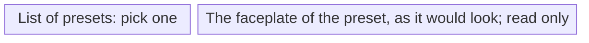

| ID | Element | Kind | Values and behaviour | Status | Source |
| --- | --- | --- | --- | --- | --- |
| MD-06.1 | List of presets | List, select one | On the left, like MD-07.1; no +, no delete here: presets are made in MD-07. Which one is selected when the page opens: open. | Decided (list), Open (first selected) | [Presets](../metadata/09-presets.md#the-faceplate-part) |
| MD-06.2 | Faceplate shown | Faceplate, read only | On the right: the faceplate built in the preset's builder (title, description, groups, signals, commands), in the order of the builder. Nothing can be typed or clicked. | Decided | [Presets](../metadata/09-presets.md#the-faceplate-part) |

Gaps:

- Is this part kept, now that the preset has a faceplate builder? The Product Owner said "Faceplate, on peut le dégager" (2026-11-16): asked.
- The faceplate itself (its controls, its size) is drawn with the synoptic part.

## MD-07 · Presets

Path: Metadata › Types › a type › Presets.

The list of presets is on the left. The selected preset is on the right: a **switch** between its two modes, then its name, then the mode chosen (Product Owner, 2026-11-16, while reviewing the wireframes):

- **Values**: one table with every signal of the type, for its display unit, decimals and default value; no command;
- **Faceplate**: the faceplate builder, a list of elements added one by one with +.

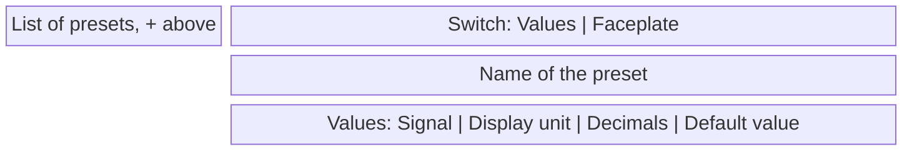

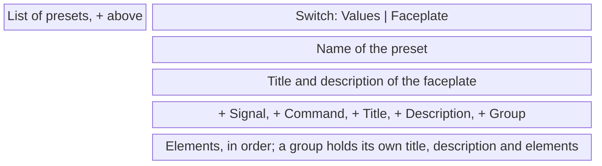

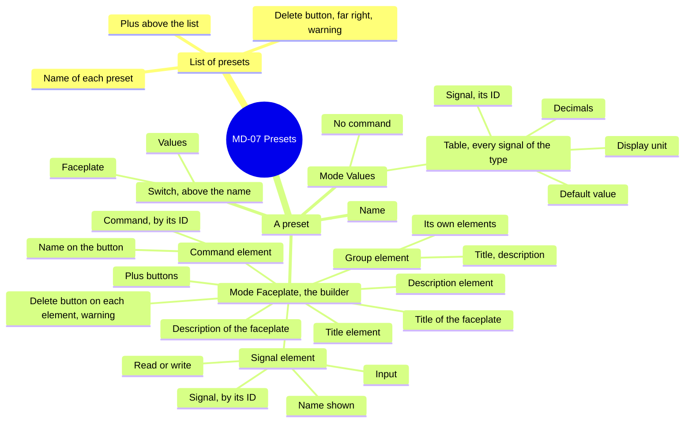

| ID | Element | Kind | Values and behaviour | Status | Source |
| --- | --- | --- | --- | --- | --- |
| MD-07.1 | List of presets | List | At least one is needed to use the type in a symbol; none is created automatically. | Decided | [Presets](../metadata/09-presets.md) |
| MD-07.2 | Create a preset | Button (+) | Above the list of presets ([layout rules](README.md#add-buttons-above-the-list)). | Decided (place), Implied (button) | [Presets](../metadata/09-presets.md) |
| MD-07.2b | Switch of the modes | Switch (two buttons) | Above the name of the preset: Values or Faceplate (2026-11-16). Labels proposed by the assistant, to confirm. | Decided (switch), Proposed (labels) | [Presets](../metadata/09-presets.md#two-modes-chosen-by-a-switch) |
| MD-07.3 | Name of the preset | Text field | A preset has a name (2026-11-16). Under the switch, the same in both modes. | Decided | [Presets](../metadata/09-presets.md) |
| MD-07.4 | Faceplate title | Text field | In the builder, at the top; optional; plain text. Can be changed on each symbol placed in a synoptic. No longer a field next to the name (2026-11-16). | Decided | [Presets](../metadata/09-presets.md#mode-faceplate-the-faceplate-builder) |
| MD-07.5 | Faceplate description | Text field, multi-line | In the builder, at the top; optional; plain text, line breaks kept. | Decided | [Presets](../metadata/09-presets.md#mode-faceplate-the-faceplate-builder) |
| MD-07.6 | Show the faceplate | — | Removed (2026-11-16): the faceplate is seen in [MD-06](#md-06--faceplate-a-view-only), itself perhaps removed (asked). | Decided | [Presets](../metadata/09-presets.md#the-faceplate-part) |
| MD-07.7 | Table of values | Table | Mode Values: every signal of the type, own and inherited, in the order of Signals; one line each; no "add an entry"; no command (2026-11-16). | Decided | [Presets](../metadata/09-presets.md#mode-values-one-table-of-the-signals) |
| MD-07.8 | Shown | — | Removed (2026-11-16): what is in the builder is shown. | Decided | [Presets](../metadata/09-presets.md#mode-faceplate-the-faceplate-builder) |
| MD-07.9 | Signal | Column, read only | Mode Values: the ID of the signal. | Decided | [Presets](../metadata/09-presets.md#mode-values-one-table-of-the-signals) |
| MD-07.12 | Display unit | Column, select | Mode Values. Only with a quantity; starts as the model unit. | Decided | [Presets](../metadata/09-presets.md#mode-values-one-table-of-the-signals) |
| MD-07.13 | Decimals | Column, number field | Mode Values. Integers and reals; starts as the quantity's default. Display only. | Decided | [Units](../metadata/05-units.md#decimal-places) |
| MD-07.14 | Default value | Column, field of the signal's type | Mode Values. The value the symbol starts with: true or false, a number, a text, or an enum item. | Decided | [Presets](../metadata/09-presets.md#mode-values-one-table-of-the-signals) |
| MD-07.18 | Add an element | Buttons (+) | Mode Faceplate, above the list of elements: a signal, a command, a title, a description, a group (2026-11-16). One + per kind or one + with a menu: with the design. | Decided (kinds), Open (form) | [Presets](../metadata/09-presets.md#mode-faceplate-the-faceplate-builder) |
| MD-07.9b | Signal element | Element of the builder | The signal, picked by its ID; its name shown (plain text, never sent to the model; empty: the ID is shown); its input; read or write. | Decided | [Presets](../metadata/09-presets.md#mode-faceplate-the-faceplate-builder) |
| MD-07.10 | Input | Select, in a signal element | In read and in write. Enum: radio on one line, radio on several lines, select. Other types: fixed by the type (number field, true or false, text field), assistant's reading. | Decided (enum), Proposed (others) | [Presets](../metadata/09-presets.md#mode-faceplate-the-faceplate-builder) |
| MD-07.11 | Read or write | Radio, in a signal element | Write: a person types a value, checked against the bounds. Write is greyed for an output of the model (2026-11-16). | Decided | [Presets](../metadata/09-presets.md#typing-a-value) |
| MD-07.15 | Command element | Element of the builder | The command, picked by its ID; the name on its button (plain text). | Decided | [Presets](../metadata/09-presets.md#mode-faceplate-the-faceplate-builder) |
| MD-07.19 | Title element, description element | Text fields | A heading or a paragraph inside the faceplate. | Decided | [Presets](../metadata/09-presets.md#mode-faceplate-the-faceplate-builder) |
| MD-07.20 | Group element | Element of the builder | Its own title and description, then its own elements (signals, commands, titles, descriptions). A group in a group: open. | Decided (group), Open (depth) | [Presets](../metadata/09-presets.md#mode-faceplate-the-faceplate-builder) |
| MD-07.21 | Delete an element, delete a preset | Button (icon), then a warning | At the far right of the element or of the preset's line (2026-11-16). | Decided | [Layout rules](README.md#delete-with-a-button-and-a-warning-in-metadata) |
| MD-07.17 | Order | Rule | Mode Values: the order of Signals, no handle, no sort. Mode Faceplate: the order of the builder, moved with a handle (proposed). | Decided (Values), Proposed (builder) | [Presets](../metadata/09-presets.md#mode-faceplate-the-faceplate-builder) |
| MD-07.16 | Description per signal | — | Removed (2026-11-16): no description per signal or command; the builder has description elements instead. | Decided | [Presets](../metadata/09-presets.md) |

Gaps:

- Rename and duplicate a preset; what happens to the symbols that use a deleted preset?
- Does a sub-type see the presets of its parent?
- Can an element be added twice? What can a symbol or a synoptic change in the built faceplate?

## MD-08 · Units

Path: Metadata › Units (navigation bar).

The page goes from the list of quantities to a quantity, then to a family. Following the [layout rules](README.md#layout-rules), they sit in columns from left to right: the list, the selected quantity, the selected family.

**The whole page is read only** (Product Owner, 2026-11-16): the catalogue ships with the software, and contributors complete its files; no +, no field to change, no delete.

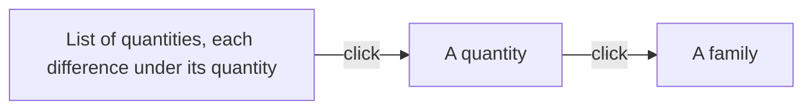

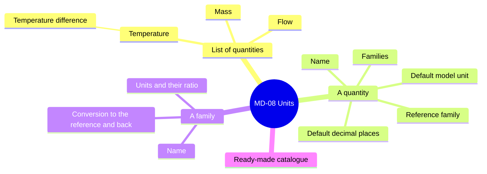

| ID | Element | Kind | Values and behaviour | Status | Source |
| --- | --- | --- | --- | --- | --- |
| MD-08.1 | List of quantities | List | Mass, volume, flow... Each difference is shown under its quantity, and stays a quantity of its own. | Decided | [Units](../metadata/05-units.md) |
| MD-08.2 | Add a quantity, a family, a unit | — | Removed (Product Owner, 2026-11-16): the page is read only; a missing unit is added by a contributor to the catalogue files. | Decided | [Units](../metadata/05-units.md#a-ready-made-catalogue-read-only) |
| MD-08.3 | Default model unit | Text, read only | From the catalogue. | Decided | [Units](../metadata/05-units.md) |
| MD-08.4 | Default decimal places | Text, read only | Fixed by the catalogue; a preset can change it for a signal (Product Owner, 2026-11-16). | Decided | [Units](../metadata/05-units.md#decimal-places) |
| MD-08.5 | Reference family | Text, read only | Every other family converts to it and back. | Decided | [Units](../metadata/05-units.md) |
| MD-08.6 | Families | List | A click opens the family. | Decided | [Units](../metadata/05-units.md) |
| MD-08.7 | Unit | Text, read only | Name with its variant (US gallon); ratio inside the family. Flat units (`m³/h` is one unit). | Decided | [Units](../metadata/05-units.md) |
| MD-08.8 | Conversion | Text, read only | Its form (proportional, affine, inverse, logarithmic, or a pair of expressions) and its parameters, going and back. | Decided | [Units](../metadata/05-units.md) |
| MD-08.9 | Parameters of the form | — | Merged into MD-08.8: shown, never typed. | Decided | [Units](../metadata/05-units.md) |
| MD-08.10 | Round-trip check | — | Done on the catalogue files, not by the user. | Decided | [Units](../metadata/05-units.md) |
| MD-08.11 | Ready-made catalogue | — | Every unit that can be imagined, in files of the software; source and licence open. | Decided, licence Open | [Units](../metadata/05-units.md#source-of-the-catalogue) |

Gaps:

- With every unit imaginable, the list is long: how does the user find a quantity or a unit (a search field)?
- How the catalogue files are checked when a contributor adds a unit (round trip, duplicates): to settle with the architecture.

## MD-09 · Enums

Path: Metadata › Enums (navigation bar).

The list of enums is on the left and the selected enum, with its items, on the right ([layout rules](README.md#layout-rules)).

| ID | Element | Kind | Values and behaviour | Status | Source |
| --- | --- | --- | --- | --- | --- |
| MD-09.1 | List of enums | List | A page of its own, not part of the signals. Enums can be made before any signal uses them. | Decided | [Enums](../metadata/06-enums.md) |
| MD-09.2 | Add an enum | Icon button (+) | On the line of the title "Enums", above the list (Product Owner, 2026-11-16: "au niveau des enums [...] avec une icône"; [layout rules](README.md#add-buttons-above-the-list)). | Decided | [Enums](../metadata/06-enums.md) |
| MD-09.3 | Name | Text field | — | Decided | [Enums](../metadata/06-enums.md) |
| MD-09.4 | Kind of key | — | Removed (Product Owner, 2026-11-16): a key is always a number, there are no string keys. | Decided | [Enums](../metadata/06-enums.md) |
| MD-09.5 | Items | List | Each item a key and a display text. | Decided | [Enums](../metadata/06-enums.md) |
| MD-09.6 | Key | Whole number field | Unique; what the model receives; whole numbers only (2026-11-16). Changing it is breaking for the model. | Decided | [Enums](../metadata/06-enums.md) |
| MD-09.7 | Display text | Text field | What the faceplate, the symbol texts and the test values show. Not breaking. | Decided | [Enums](../metadata/06-enums.md) |
| MD-09.8 | Add, delete an item | Button (+), delete button (icon) | The + above the list of items; the delete button at the far right of an item, then a warning (2026-11-16; [layout rules](README.md#delete-with-a-button-and-a-warning-in-metadata)). An enum is deleted the same way. | Decided | [Enums](../metadata/06-enums.md) |

Gaps:

- Must the display texts be unique too?
- Changing a key is breaking: no Edit or Save step (2026-11-16); it shows on [MD-11](#md-11--versions) and makes the version a major one (proposed).
- Order of the items: is it the order of the menu in the faceplate?
- Which signals use an enum: is it shown (a usage counter)?

## MD-10 · Libraries: removed

The libraries of types (Type Libs) were removed by the Product Owner on 2026-11-16. The identifier MD-10 is not reused.

## MD-11 · Versions

Path: Metadata › Versions (navigation bar), added by the Product Owner on 2026-11-16.

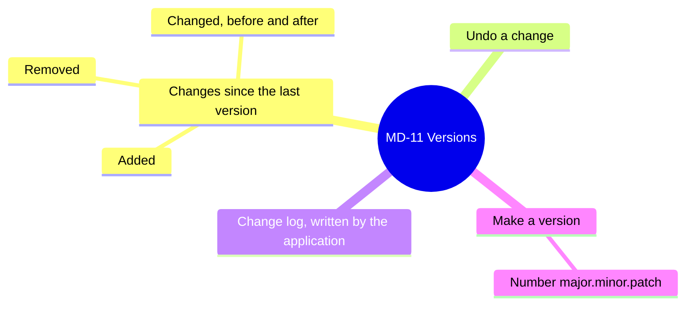

| ID | Element | Kind | Values and behaviour | Status | Source |
| --- | --- | --- | --- | --- | --- |
| MD-11.1 | Differences | List | Everything added, removed or changed in Metadata since the last version, with the value before and after. | Decided | [Versions](../metadata/13-versions.md) |
| MD-11.2 | Undo | Button (not said) | Takes a change back before a version is made. One change or all: open. | Decided (undo), Open (scope) | [Versions](../metadata/13-versions.md) |
| MD-11.3 | Change log | Text, read only | Written by the application from the differences. | Decided | [Versions](../metadata/13-versions.md) |
| MD-11.4 | Make a version | Button | When the user has finished; gives a number in semantic versioning. | Decided | [Versions](../metadata/13-versions.md) |
| MD-11.5 | Level of the version | not said | Major, minor or patch, from what the changes do to the contract with the model. Computed or chosen: open. | Proposed | [Versions](../metadata/13-versions.md#what-makes-a-version-major-minor-or-patch) |

Gaps:

- Where the list of past versions is shown, and whether one can be opened or restored.
- How a difference points back to the screen where the thing is edited.
