# Screens of Metadata

> [Home](../README.md) › [Screens](README.md) › Metadata

Status: draft, written by the assistant on 2026-11-11 from the validated [Metadata](../metadata/README.md) pages, then reviewed with the Product Owner the same day (tree on the left, order of the parts, General complete, description modes, links, signals, commands, enums, units), and on 2026-11-16 from the review of the wireframes (navigation bar, list on the left and panel on the right, libraries of types removed; then icon buttons in General, a fixed parent, a description always editable, add buttons above the lists, signals and commands in tables, commands with a fixed value only; then the faceplate merged into the presets, and an ID and a display name for each signal; then the parts of a type as a strip of icons, delete by right click everywhere, commands to inputs only, whole number enum keys, the type tree kept in full page; last, no Edit or Save step anywhere and a Versions page, the read-only mode of the description kept, the direction first in the table of signals, the name shown of a signal moved to the preset, three kinds of command with an ID). It adds no rule. Kinds, statuses and the [layout rules](README.md#layout-rules) are explained in the [guide of this folder](README.md).

## MD-00 · Navigation bar of Metadata

Path: on the far left of every screen of Metadata (Product Owner, 2026-11-16).

| ID | Element | Kind | Values and behaviour | Status | Source |
| --- | --- | --- | --- | --- | --- |
| MD-00.1 | Types | Button (icon) | Opens [MD-01](#md-01--types-the-tree-and-the-type-editor). | Decided | [Layout rules](README.md#layout-rules) |
| MD-00.2 | Units | Button (icon) | Opens [MD-08](#md-08--units). | Decided | [Layout rules](README.md#layout-rules) |
| MD-00.3 | Enums | Button (icon) | Opens [MD-09](#md-09--enums). | Decided | [Layout rules](README.md#layout-rules) |
| MD-00.4 | Versions | Button (icon) | Opens [MD-11](#md-11--versions). After Enums (2026-11-16). | Decided | [Versions](../metadata/13-versions.md) |

Gaps:

- Which icons (to choose with the design system). Going from Metadata to the symbol mode is done in the top bar (see the [layout rules](README.md#top-bar-of-the-window)).

## MD-01 · Types: the tree and the type editor

Path: Metadata › Types.

The tree is on the left, as in a code editor, just right of the navigation bar; the selected type is edited on the right, its parts in a fixed order.

```mermaid
block-beta
    columns 5
    rail["MD-00 bar"] tree["Type tree"] strip["Strip of 5 icons: General, Documentation, Signals, Commands, Presets"] editor["Editor of the selected part"]:2
```

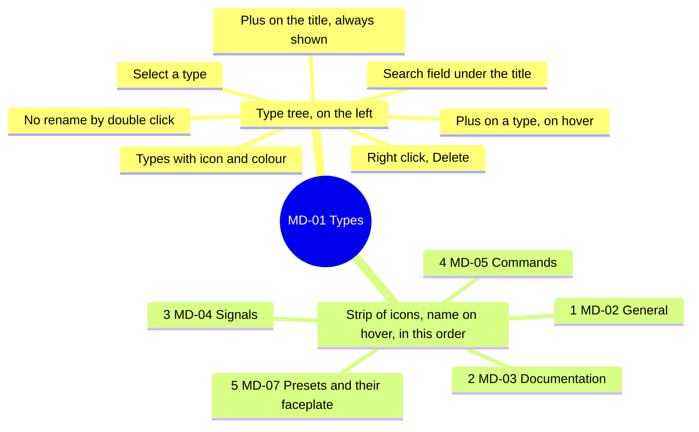

| ID | Element | Kind | Values and behaviour | Status | Source |
| --- | --- | --- | --- | --- | --- |
| MD-01.1 | Type tree | Tree | On the left. Shows each type with its icon and colour. A click selects the type. | Decided | [Types](../metadata/01-types.md), [Icons](../metadata/02-icons.md) |
| MD-01.2 | Double click on a type | — | Does **not** rename: the name changes in General only. | Decided | [Types](../metadata/01-types.md) |
| MD-01.3 | Create a child type | Button (+), on hover | On the right of each type, shown when the mouse is over it; creates a type under it, with a default name. | Decided | [Types](../metadata/01-types.md) |
| MD-01.3b | Create a root type | Button (+), always shown | On the title "Type tree". Its look worries the Product Owner; kept. | Decided (look: Open) | [Types](../metadata/01-types.md) |
| MD-01.4 | Delete a type | Right click › menu › Delete | A menu of options opens on a right click; Delete is one of them. | Decided | [Types](../metadata/01-types.md) |
| MD-01.5 | Parts of the type | Strip of icons, in a column | Between the tree and the editor; one icon per part, in this order: General, Documentation, Signals, Commands, Presets; the name shown on hover (proposal C, 2026-11-16). | Decided (look: to work on) | [Types](../metadata/01-types.md#the-parts-of-a-type-a-strip-of-icons) |
| MD-01.6 | Search | Text field | Under the title "Type tree". | Decided | [Types](../metadata/01-types.md) |

Gaps:

- Which other options the right-click menu holds (duplicate, rename?). No warning on a delete (2026-11-16).
- Fold arrows on the branches: drawn, never said.
- The icons of the five parts (to choose with the design system). The wireframes MD-02 to MD-07 still show tabs in a row until they are redrawn with the strip.

## MD-02 · General

Path: Metadata › Types › a type › General. Complete: nothing more is needed (Product Owner, 2026-11-11, confirmed on 2026-11-16).

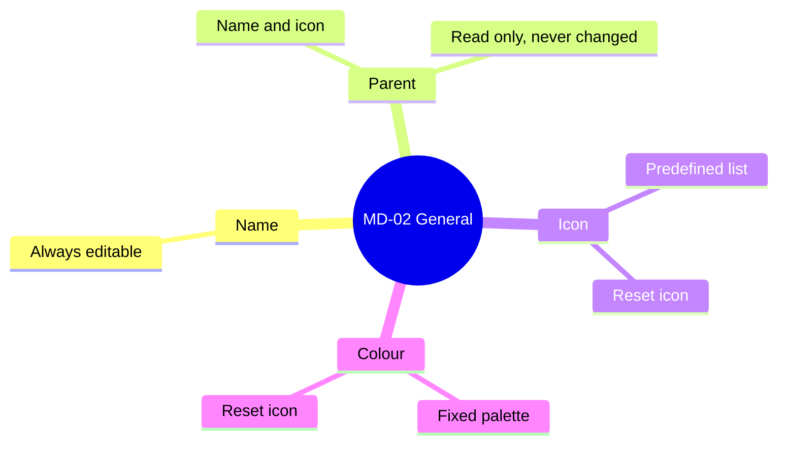

| ID | Element | Kind | Values and behaviour | Status | Source |
| --- | --- | --- | --- | --- | --- |
| MD-02.1 | Name | Text field | Always editable (2026-11-16). The model identifier, readable (`centrifugal_pump`). A rename shows on [MD-11](#md-11--versions). | Decided | [Types](../metadata/01-types.md) |
| MD-02.2 | Edit | — | Removed (2026-11-16): everything is editable all the time. | Decided | [Versions](../metadata/13-versions.md) |
| MD-02.3 | Save | — | Removed (2026-11-16): changes are checked on the Versions page. | Decided | [Versions](../metadata/13-versions.md) |
| MD-02.4 | Parent | Read only: name and icon | Set at creation, never changed (2026-11-16). A wrong parent: delete the type and create it again. | Decided | [Types](../metadata/01-types.md) |
| MD-02.5 | Icon | not said (list of icons) | One icon of the predefined SVG list. No import. | Decided | [Icons](../metadata/02-icons.md) |
| MD-02.6 | Colour | Colour (palette only) | One colour of a fixed palette; no free colour. | Decided | [Icons](../metadata/02-icons.md) |
| MD-02.7 | Reset icon, reset colour | Button (icon) | Shown when the type overrides its parent's choice; makes it follow the parent again. An icon, no text label (2026-11-16). | Decided | [Icons](../metadata/02-icons.md) |

Gaps:

- Which icons for Reset (to choose with the design system).

## MD-03 · Documentation

Path: Metadata › Types › a type › Documentation.

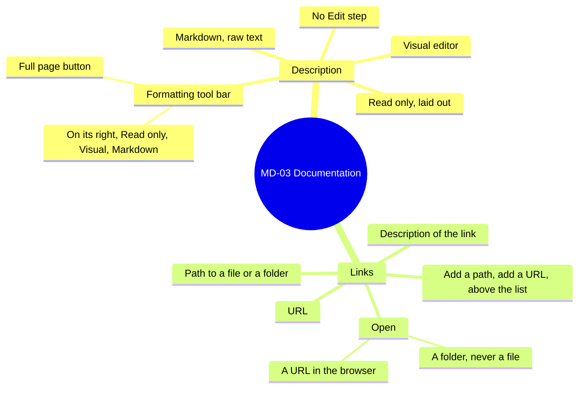

| ID | Element | Kind | Values and behaviour | Status | Source |
| --- | --- | --- | --- | --- | --- |
| MD-03.1 | Description, read only | Editor (laid out, read only) | Kept (Product Owner, 2026-11-16, correcting his removal of the same day). Which mode opens first: open. | Decided (mode), Open (first) | [Documentation](../metadata/03-documentation.md) |
| MD-03.2 | Description, visual editor | Editor (visual) | A "what you see is what you get" editor with a formatting tool bar. | Decided | [Documentation](../metadata/03-documentation.md) |
| MD-03.3 | Description, Markdown | Editor (raw text) | For those who write Markdown faster; the user switches between the three modes at any time. | Decided | [Documentation](../metadata/03-documentation.md) |
| MD-03.4 | Go to edit, Save | — | None: switching mode is not an Edit step, nothing to save or confirm (2026-11-16). | Decided | [Versions](../metadata/13-versions.md) |
| MD-03.4b | Read only, Visual, Markdown | Buttons (switch) | On the right of the formatting tool bar, on the same line (2026-11-16). | Decided | [Documentation](../metadata/03-documentation.md) |
| MD-03.4c | Full page | Button (icon), in the tool bar | The description takes the whole editing part; the links are hidden; the window, the menus of the application and the type tree stay. The same button brings the page back (2026-11-16). | Decided | [Documentation](../metadata/03-documentation.md) |
| MD-03.5 | Links | List | Each link: a path or a URL, and a description. | Decided | [Documentation](../metadata/03-documentation.md) |
| MD-03.6 | Add a path | Button + selection window | Above the list of links. The server opens a window; only the path is kept (`W:/...`). A file or a folder. | Decided | [Documentation](../metadata/03-documentation.md) |
| MD-03.7 | Add a URL | Button + text field | Above the list of links. Typed or pasted. | Decided | [Documentation](../metadata/03-documentation.md) |
| MD-03.8 | Description of a link | Text field | Plain text, not Markdown. | Decided | [Documentation](../metadata/03-documentation.md) |
| MD-03.9 | Open | Button (not said) | Always a folder: the one that contains the file, or the folder itself. Never launches a file or a program. A URL opens in the browser. | Decided | [Documentation](../metadata/03-documentation.md) |
| MD-03.10 | Remove a link | Right click › Delete | No delete button on the line ([layout rules](README.md#delete-by-right-click-in-metadata)). | Decided | [Layout rules](README.md#delete-by-right-click-in-metadata) |

Gaps:

- How is a link edited? Can links be reordered?

## MD-04 · Signals

Path: Metadata › Types › a type › Signals.

The signals are shown in **one table** that takes as much room as possible: one line per signal, one column per field (Product Owner, 2026-11-16). It replaces the list on the left and its panel on the right, drawn earlier the same day. The + that adds a signal sits above the table.

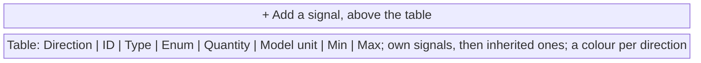

How the fields depend on each other: the type decides which fields exist; the quantity decides which units can be chosen.

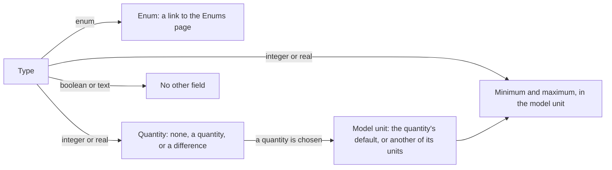

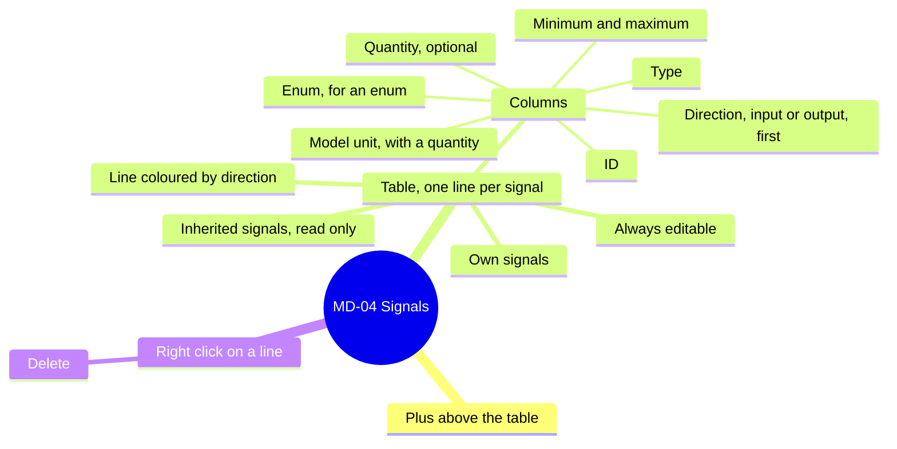

| ID | Element | Kind | Values and behaviour | Status | Source |
| --- | --- | --- | --- | --- | --- |
| MD-04.1 | Table of signals | Table | One line per signal, one column per field; takes as much room as possible. Own and inherited signals (2026-11-16). | Decided | [Signals](../metadata/04-signals.md#the-table-of-signals) |
| MD-04.2 | Enum on a signal line | — | The line shows the enum's name. A bubble listing its items when the mouse rests on the name: open. | Decided (bubble: Open) | [Signals](../metadata/04-signals.md) |
| MD-04.3 | Inherited signals | Lines of the table | Read only here; edited in the type that declares them. Their look (greyed, with the parent's name) is not said. | Implied | [Signals](../metadata/04-signals.md) |
| MD-04.4 | Add a signal | Button (+) | Above the table ([layout rules](README.md#add-buttons-above-the-list)). | Decided | [Layout rules](README.md#add-buttons-above-the-list) |
| MD-04.5 | Edit, Save | — | Removed (2026-11-16): the table is always editable; changes are checked on [MD-11](#md-11--versions). | Decided | [Versions](../metadata/13-versions.md) |
| MD-04.5b | Colour of a line | Background of the line | One colour for an input, another for an output (2026-11-16). The colours: with the design system. | Decided | [Signals](../metadata/04-signals.md#the-table-of-signals) |
| MD-04.6 | ID | Column, text field | Second column, after Direction. Model identifier; header "ID" (2026-11-16). A sub-type cannot reuse an inherited ID. | Decided | [Signals](../metadata/04-signals.md) |
| MD-04.6b | Display name | — | Removed (2026-11-16): the name people see is written in the preset ([MD-07.9b](#md-07--presets-and-their-faceplate)). | Decided | [Presets](../metadata/09-presets.md#the-table-of-a-preset) |
| MD-04.7 | Type | Column, select | Integer, real (64-bit double), boolean, text, enum. | Decided | [Signals](../metadata/04-signals.md) |
| MD-04.8 | Enum | Column, select | Only for the type enum: an enum of the Enums page, as a link. Empty otherwise. | Decided | [Enums](../metadata/06-enums.md) |
| MD-04.9 | Quantity | Column, select | Optional, integer and real only. A quantity or a difference (a difference sits under its quantity). | Decided | [Units](../metadata/05-units.md) |
| MD-04.10 | Model unit | Column, select | Only with a quantity. Default: the quantity's model unit; another unit of the same quantity can be chosen. | Decided | [Units](../metadata/05-units.md) |
| MD-04.11 | Minimum, maximum | Columns, number fields | Integer and real only; indicative; in the model unit. | Decided | [Signals](../metadata/04-signals.md) |
| MD-04.12 | Direction | Column, select | First column (2026-11-16). Input or output of the model. | Decided | [Signals](../metadata/04-signals.md) |
| MD-04.13 | Delete a signal | Right click › Delete | No button on the lines ([layout rules](README.md#delete-by-right-click-in-metadata)). | Decided | [Signals](../metadata/04-signals.md#the-table-of-signals) |

Gaps:

- Order of the signals: by creation, by name, or chosen by the user?
- Width of the window: what happens when the eight columns do not fit (scroll sideways, narrower columns)?

## MD-05 · Commands

Path: Metadata › Types › a type › Commands.

As for the signals, the commands are shown in **one table**, the kind in the first column (Product Owner, 2026-11-16). The + that adds a command sits above the table.

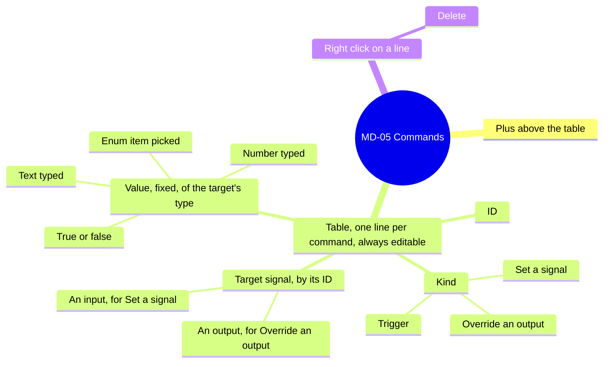

| ID | Element | Kind | Values and behaviour | Status | Source |
| --- | --- | --- | --- | --- | --- |
| MD-05.1 | Table of commands | Table | One line per command; kind, ID, target signal, value; always editable (2026-11-16). | Decided | [Commands](../metadata/07-commands.md#the-table-of-commands) |
| MD-05.2 | Add a command | Button (+) | Above the table ([layout rules](README.md#add-buttons-above-the-list)). | Decided | [Layout rules](README.md#add-buttons-above-the-list) |
| MD-05.3 | ID | Column, text field | The command's identifier, called ID as for the signals, never "name" (2026-11-16). For a trigger, all it has. Symbols follow a change (internal identifier). | Decided | [Commands](../metadata/07-commands.md) |
| MD-05.4 | Kind | Column, select | First column. Set a signal, Trigger, or Override an output (2026-11-16). | Decided | [Commands](../metadata/07-commands.md) |
| MD-05.5 | Target signal | Column, select | Picked by its ID. "Set a signal": the inputs of the model only; "Override an output": the outputs only (2026-11-16); empty for a trigger. | Decided | [Commands](../metadata/07-commands.md) |
| MD-05.6 | Value: fixed or typed | — | Removed (2026-11-16): the value is always fixed. | Decided | [Commands](../metadata/07-commands.md#the-value-is-always-fixed) |
| MD-05.7 | Value | Column, field of the target signal's type | Fixed, written in Metadata: a number, true or false, a text, or an item of the enum. Empty for a trigger. | Decided | [Commands](../metadata/07-commands.md#the-value-is-always-fixed) |
| MD-05.8 | Typed value | — | Removed (2026-11-16): a person types a value in the faceplate, for a signal set to write in the preset. | Decided | [Presets](../metadata/09-presets.md#typing-a-value) |
| MD-05.9 | Delete a command | Right click › Delete | No button on the lines ([layout rules](README.md#delete-by-right-click-in-metadata)). | Decided | [Commands](../metadata/07-commands.md#the-table-of-commands) |

Gaps:

- Override an output: who applies it and how it ends, open (see [Commands](../metadata/07-commands.md#open-questions)).

## MD-06 · Faceplate: merged into MD-07

The Faceplate part was merged into the Presets by the Product Owner on 2026-11-16 ("les presets ne servent qu'à la faceplate"). Its controls are now in [MD-07](#md-07--presets-and-their-faceplate). The identifier MD-06 is not reused.

## MD-07 · Presets and their faceplate

Path: Metadata › Types › a type › Presets.

The list of presets is on the left. The selected preset is on the right: its name, the title and description of its faceplate, a button that shows the faceplate, then **one table** with every signal and every command of the type (Product Owner, 2026-11-16).

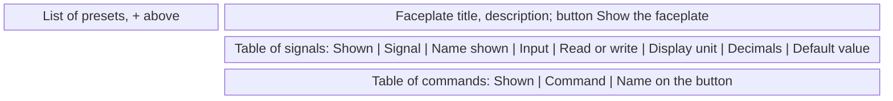

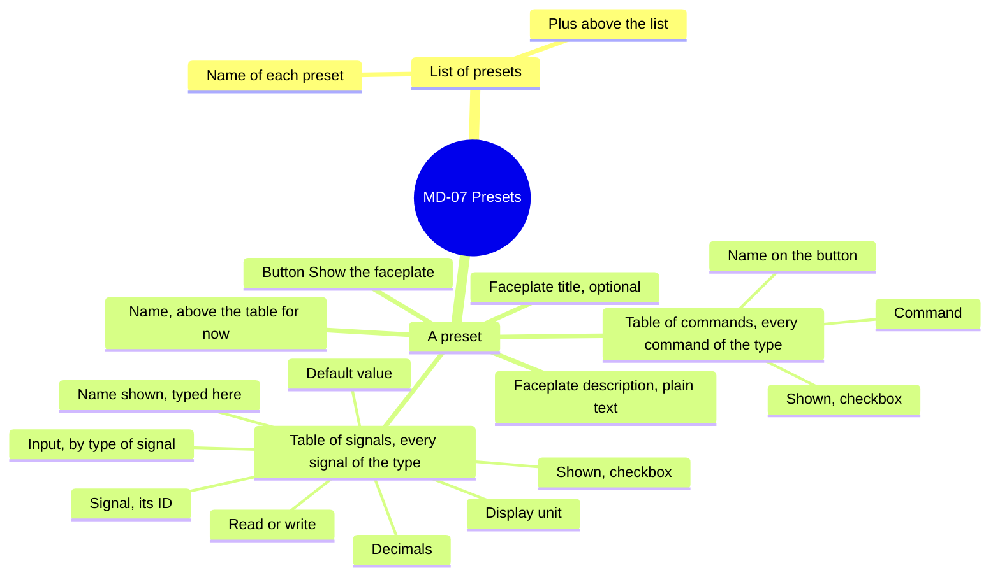

| ID | Element | Kind | Values and behaviour | Status | Source |
| --- | --- | --- | --- | --- | --- |
| MD-07.1 | List of presets | List | At least one is needed to use the type in a symbol; none is created automatically. | Decided | [Presets](../metadata/09-presets.md) |
| MD-07.2 | Create a preset | Button (+) | Above the list of presets ([layout rules](README.md#add-buttons-above-the-list)). | Decided (place), Implied (button) | [Presets](../metadata/09-presets.md) |
| MD-07.3 | Name of the preset | Text field | A preset has a name (2026-11-16). Above the table for now ("pas mal"); its place is looked at again later. | Decided (name), Open (place, later) | [Presets](../metadata/09-presets.md) |
| MD-07.4 | Faceplate title | Text field | Optional; plain text. Can be changed on each symbol placed in a synoptic. | Decided | [Presets](../metadata/09-presets.md#title-and-description-of-the-faceplate) |
| MD-07.5 | Faceplate description | Text field, multi-line | Optional; plain text, line breaks kept. | Decided | [Presets](../metadata/09-presets.md#title-and-description-of-the-faceplate) |
| MD-07.6 | Show the faceplate | Button | Opens the faceplate as it would look, built from the table (2026-11-16). | Decided | [Presets](../metadata/09-presets.md#show-the-faceplate) |
| MD-07.7 | Table of signals | Table | Every signal of the type, own and inherited; one line each; no "add an entry". | Decided | [Presets](../metadata/09-presets.md#the-table-of-a-preset) |
| MD-07.8 | Shown | Checkbox, per line | Shown in the faceplate at the start; an unticked line stays available in a symbol and a synoptic. | Decided | [Presets](../metadata/09-presets.md#the-table-of-a-preset) |
| MD-07.9 | Signal | Column, read only | The ID of the signal. | Decided | [Presets](../metadata/09-presets.md#the-table-of-a-preset) |
| MD-07.9b | Name shown | Column, text field | The name people see for the signal in the faceplate; plain text, never sent to the model; empty: the ID is shown (2026-11-16). | Decided | [Presets](../metadata/09-presets.md#the-table-of-a-preset) |
| MD-07.10 | Input | Column, select for an enum | In read and in write. Enum: radio on one line, radio on several lines, select. Other types: fixed by the type (number field, true or false, text field), assistant's reading. | Decided (enum), Proposed (others) | [Presets](../metadata/09-presets.md#the-table-of-a-preset) |
| MD-07.11 | Read or write | Column, radio | Write: a person types a value, checked against the bounds. Write is greyed for an output of the model (2026-11-16). | Decided | [Presets](../metadata/09-presets.md#typing-a-value) |
| MD-07.12 | Display unit | Column, select | Only with a quantity; starts as the model unit. | Decided | [Presets](../metadata/09-presets.md) |
| MD-07.13 | Decimals | Column, number field | Integers and reals; starts as the quantity's default. Display only. | Decided | [Units](../metadata/05-units.md#decimal-places) |
| MD-07.14 | Default value | Column, field of the signal's type | The value the symbol starts with: true or false, a number, a text, or an enum item. | Decided | [Presets](../metadata/09-presets.md) |
| MD-07.15 | Table of commands | Table | Every command of the type: Shown (checkbox), Command (its ID, read only), Name on the button (text field). | Decided | [Presets](../metadata/09-presets.md#the-table-of-a-preset) |
| MD-07.16 | Description per signal | — | Removed (2026-11-16): no description per signal or command. | Decided | [Presets](../metadata/09-presets.md) |

Gaps:

- Rename, duplicate and delete a preset; what happens to the symbols that use a deleted preset?
- Does a sub-type see the presets of its parent?
- Order of the lines: the order of the signals, or chosen in the preset? Groups or separators in the faceplate?
- Where the faceplate opens when the button is clicked (a floating window, a panel), and how it is closed.
- Width: what happens when the eight columns do not fit.

## MD-08 · Units

Path: Metadata › Units (navigation bar).

The page goes from the list of quantities to a quantity, then to a family. Following the [layout rules](README.md#layout-rules), they sit in columns from left to right: the list, the selected quantity, the selected family.

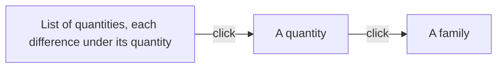

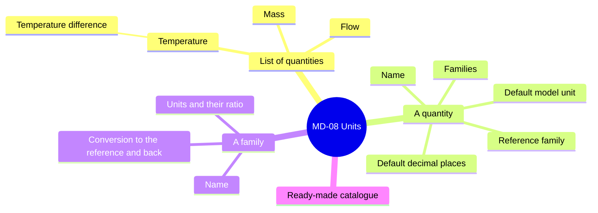

| ID | Element | Kind | Values and behaviour | Status | Source |
| --- | --- | --- | --- | --- | --- |
| MD-08.1 | List of quantities | List | Mass, volume, flow... Each difference is shown under its quantity, and stays a quantity of its own. | Decided | [Units](../metadata/05-units.md) |
| MD-08.2 | Add a quantity, a family, a unit | Button (+) | Above each list ([layout rules](README.md#add-buttons-above-the-list)). The user can add and change quantities, families and units. | Decided | [Units](../metadata/05-units.md) |
| MD-08.3 | Default model unit | Select | Among the units of the quantity. | Decided | [Units](../metadata/05-units.md) |
| MD-08.4 | Default decimal places | Number field | The global setting for display. | Decided | [Units](../metadata/05-units.md) |
| MD-08.5 | Reference family | Select | Every other family converts to it and back. | Decided | [Units](../metadata/05-units.md) |
| MD-08.6 | Families | List | A click opens the family. | Decided | [Units](../metadata/05-units.md) |
| MD-08.7 | Unit | Text field + number field | Name with its variant (US gallon); ratio inside the family. Flat units (`m³/h` is one unit). | Decided | [Units](../metadata/05-units.md) |
| MD-08.8 | Conversion form | not said (select) | Proportional, affine, inverse, logarithmic, or a pair of free expressions (going and back). | Decided | [Units](../metadata/05-units.md) |
| MD-08.9 | Parameters of the form | Number fields | a, b, k, x₀, base, depending on the form. | Implied | [Units](../metadata/05-units.md) |
| MD-08.10 | Round-trip check | — | The application checks that a pair of expressions comes back. | Decided | [Units](../metadata/05-units.md) |
| MD-08.11 | Ready-made catalogue | — | Loaded at the first launch; source and licence open. | Decided, licence Open | [Units](../metadata/05-units.md) |

Gaps:

- How is a difference created: from its quantity ("add a difference"), or as any quantity then attached?
- What does the user see when the round-trip check fails?
- Delete a quantity or a unit that signals use.

## MD-09 · Enums

Path: Metadata › Enums (navigation bar).

The list of enums is on the left and the selected enum, with its items, on the right ([layout rules](README.md#layout-rules)).

| ID | Element | Kind | Values and behaviour | Status | Source |
| --- | --- | --- | --- | --- | --- |
| MD-09.1 | List of enums | List | A page of its own, not part of the signals. Enums can be made before any signal uses them. | Decided | [Enums](../metadata/06-enums.md) |
| MD-09.2 | Add an enum | Button (+) | Above the list of enums ([layout rules](README.md#add-buttons-above-the-list)). | Decided (place), Implied (button) | [Enums](../metadata/06-enums.md) |
| MD-09.3 | Name | Text field | — | Decided | [Enums](../metadata/06-enums.md) |
| MD-09.4 | Kind of key | — | Removed (Product Owner, 2026-11-16): a key is always a number, there are no string keys. | Decided | [Enums](../metadata/06-enums.md) |
| MD-09.5 | Items | List | Each item a key and a display text. | Decided | [Enums](../metadata/06-enums.md) |
| MD-09.6 | Key | Whole number field | Unique; what the model receives; whole numbers only (2026-11-16). Changing it is breaking for the model. | Decided | [Enums](../metadata/06-enums.md) |
| MD-09.7 | Display text | Text field | What the faceplate, the symbol texts and the test values show. Not breaking. | Decided | [Enums](../metadata/06-enums.md) |
| MD-09.8 | Add, remove an item | Button (+), right click › Delete | The + above the list of items; remove by right click ([layout rules](README.md#delete-by-right-click-in-metadata)). | Decided | [Enums](../metadata/06-enums.md) |

Gaps:

- Must the display texts be unique too?
- Changing a key is breaking: no Edit or Save step (2026-11-16); it shows on [MD-11](#md-11--versions) and makes the version a major one (proposed).
- Order of the items: is it the order of the menu in the faceplate?
- Which signals use an enum: is it shown (a usage counter)?

## MD-10 · Libraries: removed

The libraries of types (Type Libs) were removed by the Product Owner on 2026-11-16. The identifier MD-10 is not reused.

## MD-11 · Versions

Path: Metadata › Versions (navigation bar), added by the Product Owner on 2026-11-16.

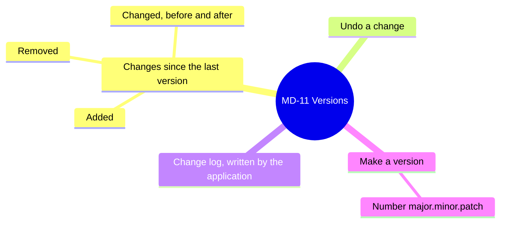

| ID | Element | Kind | Values and behaviour | Status | Source |
| --- | --- | --- | --- | --- | --- |
| MD-11.1 | Differences | List | Everything added, removed or changed in Metadata since the last version, with the value before and after. | Decided | [Versions](../metadata/13-versions.md) |
| MD-11.2 | Undo | Button (not said) | Takes a change back before a version is made. One change or all: open. | Decided (undo), Open (scope) | [Versions](../metadata/13-versions.md) |
| MD-11.3 | Change log | Text, read only | Written by the application from the differences. | Decided | [Versions](../metadata/13-versions.md) |
| MD-11.4 | Make a version | Button | When the user has finished; gives a number in semantic versioning. | Decided | [Versions](../metadata/13-versions.md) |
| MD-11.5 | Level of the version | not said | Major, minor or patch, from what the changes do to the contract with the model. Computed or chosen: open. | Proposed | [Versions](../metadata/13-versions.md#what-makes-a-version-major-minor-or-patch) |

Gaps:

- Where the list of past versions is shown, and whether one can be opened or restored.
- How a difference points back to the screen where the thing is edited.
