# Screens of Metadata

> [Home](../README.md) › [Screens](README.md) › Metadata

Status: draft, written by the assistant on 2026-11-11 from the validated [Metadata](../metadata/README.md) pages. It adds no rule. Kinds and statuses are explained in the [guide of this folder](README.md).

## MD-01 · Types: the tree and the type editor

Path: Metadata › Types.

The screen holds the type tree on the right and, for the selected type, its six parts.

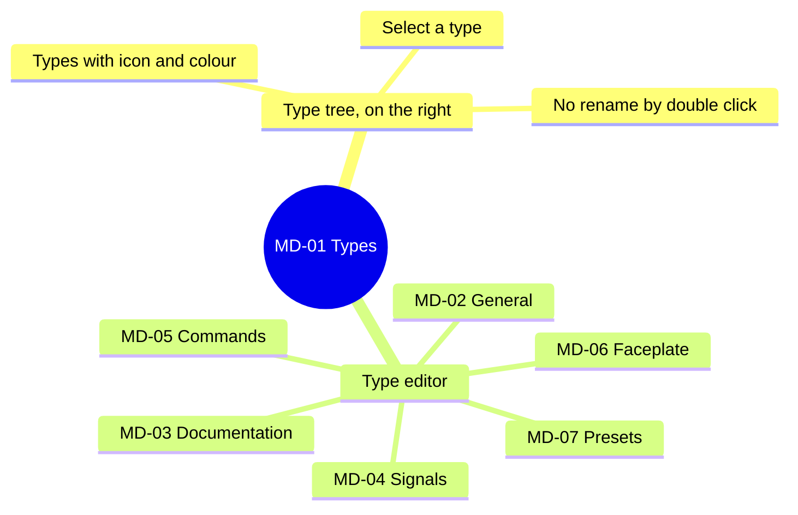

| ID | Element | Kind | Values and behaviour | Status | Source |
| --- | --- | --- | --- | --- | --- |
| MD-01.1 | Type tree | Tree | On the right. Shows each type with its icon and colour. A click selects the type. | Decided | [Types](../metadata/01-types.md), [Icons](../metadata/02-icons.md) |
| MD-01.2 | Double click on a type | — | Does **not** rename: the name changes in General only. | Decided | [Types](../metadata/01-types.md) |
| MD-01.3 | Create a type | Button (not said) | A type is created with a name and a parent. | Implied | [Types](../metadata/01-types.md) |
| MD-01.4 | Delete a type | not said | Deleting is mentioned only for its effect on symbols (their link breaks). | Implied | [Libraries and symbols](../symbols/01-libraries-and-symbols.md) |
| MD-01.5 | Parts of the type | not said (tabs or sections) | General, Documentation, Signals, Commands, Faceplate, Presets. | Decided (the parts), Implied (how they are shown) | [Types](../metadata/01-types.md) |

Gaps:

- How is a type created, and where (a button above the tree, a right click)? How is it deleted, and is the user warned that symbols will break?
- Does the type tree have a search field, as the library screen has?
- Fold and unfold arrows in this tree: said for the library screen only.

## MD-02 · General

Path: Metadata › Types › a type › General.

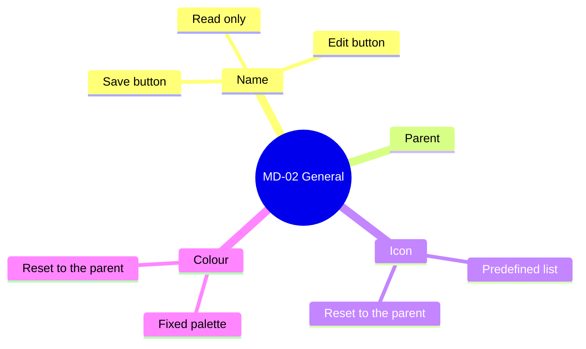

| ID | Element | Kind | Values and behaviour | Status | Source |
| --- | --- | --- | --- | --- | --- |
| MD-02.1 | Name | Text field | Read only until Edit is clicked. The model identifier, readable (`centrifugal_pump`). | Decided | [Types](../metadata/01-types.md) |
| MD-02.2 | Edit | Button | Makes the name editable. | Decided | [Types](../metadata/01-types.md) |
| MD-02.3 | Save | Button | Saves the new name. No warning, no confirmation dialog. | Decided | [Types](../metadata/01-types.md) |
| MD-02.4 | Parent | not said (select or tree) | Changed here only. | Decided | [Types](../metadata/01-types.md) |
| MD-02.5 | Icon | not said (list of icons) | One icon of the predefined SVG list. No import. | Decided | [Icons](../metadata/02-icons.md) |
| MD-02.6 | Colour | Colour (palette only) | One colour of a fixed palette; no free colour. | Decided | [Icons](../metadata/02-icons.md) |
| MD-02.7 | Reset icon, reset colour | Button | Shown when the type overrides its parent's choice; makes it follow the parent again. | Decided | [Icons](../metadata/02-icons.md) |
| MD-02.8 | Internal identifier | — | Exists, never shown in the specs. | Implied | [Types](../metadata/01-types.md) |

Gaps:

- Does the parent change follow the same Edit and Save steps as the name?
- Is the inherited icon or colour shown differently from a chosen one?

## MD-03 · Documentation

Path: Metadata › Types › a type › Documentation.

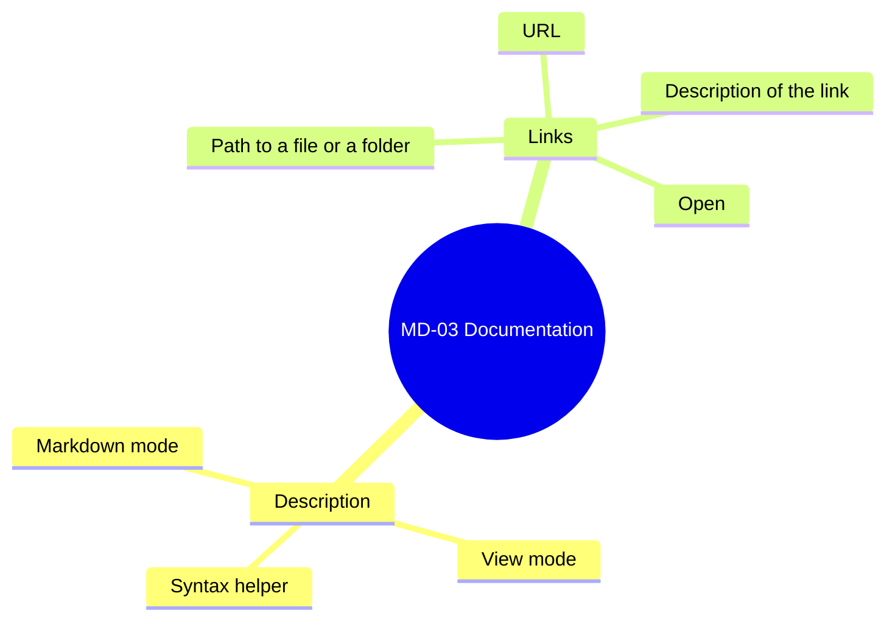

| ID | Element | Kind | Values and behaviour | Status | Source |
| --- | --- | --- | --- | --- | --- |
| MD-03.1 | Description | Editor (Markdown) | Edited in Markdown or in the rendered view; shown in library tiles. | Decided | [Documentation](../metadata/03-documentation.md) |
| MD-03.2 | Markdown / View | Toggle | Switches between the source and the rendered view, at any time. | Decided | [Documentation](../metadata/03-documentation.md) |
| MD-03.3 | Syntax helper | not said (small tool bar) | Inserts Markdown syntax. | Decided | [Documentation](../metadata/03-documentation.md) |
| MD-03.4 | Links | List | Each link: a path or a URL, and a description. | Decided | [Documentation](../metadata/03-documentation.md) |
| MD-03.5 | Add a path | Button + selection window | The server opens a window; only the path is kept (`W:/...`). | Decided | [Documentation](../metadata/03-documentation.md) |
| MD-03.6 | Add a URL | Text field | Typed or pasted. | Decided | [Documentation](../metadata/03-documentation.md) |
| MD-03.7 | Description of a link | Text field | Plain text, not Markdown. | Decided | [Documentation](../metadata/03-documentation.md) |
| MD-03.8 | Open | Button (not said) | A path opens the folder that holds it; a URL opens in the browser. | Decided | [Documentation](../metadata/03-documentation.md) |
| MD-03.9 | Edit or remove a link | not said | — | Implied | — |

Gaps:

- How is a link edited or removed? Can links be reordered?

## MD-04 · Signals

Path: Metadata › Types › a type › Signals.

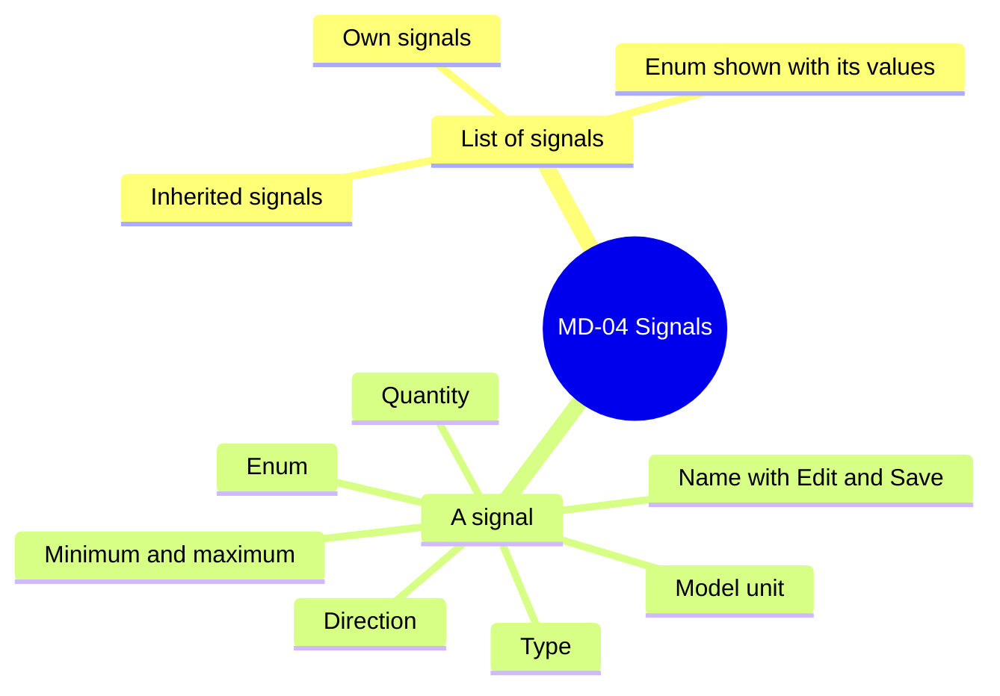

| ID | Element | Kind | Values and behaviour | Status | Source |
| --- | --- | --- | --- | --- | --- |
| MD-04.1 | List of signals | List | An enum signal shows its type and, next to it, its enum with its values. | Decided | [Signals](../metadata/04-signals.md) |
| MD-04.2 | Inherited signals | not said | A type has the signals of its parents; how they look in the list is not said. | Implied | [Signals](../metadata/04-signals.md) |
| MD-04.3 | Add a signal | not said (button) | — | Implied | [Signals](../metadata/04-signals.md) |
| MD-04.4 | Name | Text field + Edit and Save | Model identifier; renamed like a type, no warning. A sub-type cannot reuse an inherited name. | Decided | [Signals](../metadata/04-signals.md) |
| MD-04.5 | Type | not said (select) | Integer, real (64-bit double), boolean, text, enum. | Decided | [Signals](../metadata/04-signals.md) |
| MD-04.6 | Enum | not said (select) | Only for the type enum: an enum of the Enums page, as a link. | Decided | [Enums](../metadata/06-enums.md) |
| MD-04.7 | Quantity | not said (select) | Only for integer and real: a quantity of the Units page. | Decided | [Units](../metadata/05-units.md) |
| MD-04.8 | Model unit | not said (select) | Default: the model unit of the quantity; can be overridden by another unit of the same quantity. | Decided | [Units](../metadata/05-units.md) |
| MD-04.9 | Minimum, maximum | Number field | Integer and real only; indicative; in the model unit. | Decided | [Signals](../metadata/04-signals.md) |
| MD-04.10 | Direction | not said (radio) | Input or output of the model. | Decided | [Signals](../metadata/04-signals.md) |
| MD-04.11 | Delete a signal | not said | Its effect on symbols is written; the control is not. | Implied | [Libraries and symbols](../symbols/01-libraries-and-symbols.md) |

Gaps:

- How are inherited signals shown (greyed, with the parent's name, in a group)? Can they be opened read-only?
- Are the fields edited in the list (a table) or in a panel for the selected signal?
- Are the fields that do not apply hidden or greyed (quantity for a boolean, enum for a real)?
- Order of the signals: by creation, by name, or chosen by the user?

## MD-05 · Commands

Path: Metadata › Types › a type › Commands.

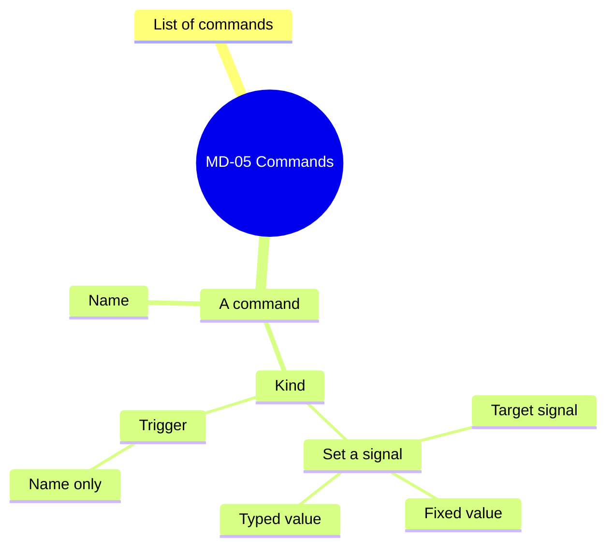

| ID | Element | Kind | Values and behaviour | Status | Source |
| --- | --- | --- | --- | --- | --- |
| MD-05.1 | List of commands | List | — | Implied | [Commands](../metadata/07-commands.md) |
| MD-05.2 | Add a command | not said (button) | — | Implied | [Commands](../metadata/07-commands.md) |
| MD-05.3 | Name | Text field | Has an internal identifier: symbols follow a rename. | Decided | [Commands](../metadata/07-commands.md) |
| MD-05.4 | Kind | not said (radio) | Set a signal, or Trigger. | Decided | [Commands](../metadata/07-commands.md) |
| MD-05.5 | Target signal | not said (select) | For "Set a signal". | Decided | [Commands](../metadata/07-commands.md) |
| MD-05.6 | Value: fixed or typed | not said (radio) | Typed: number signals only. | Decided | [Commands](../metadata/07-commands.md) |
| MD-05.7 | Fixed value | Field of the signal's type | The value sent (example: `running` = `true`). | Decided | [Commands](../metadata/07-commands.md) |
| MD-05.8 | Delete a command | not said | Its effect on symbols is written; the control is not. | Implied | [Libraries and symbols](../symbols/01-libraries-and-symbols.md) |

Gaps:

- Is a command renamed with Edit and Save, like a signal?
- A typed-value command can use "a display that becomes an input", "the faceplate", or both: is that chosen here, or by where the command is used (a text of the symbol, a faceplate entry)?
- Can a command target a signal of any direction, or only an input?

## MD-06 · Faceplate

Path: Metadata › Types › a type › Faceplate.

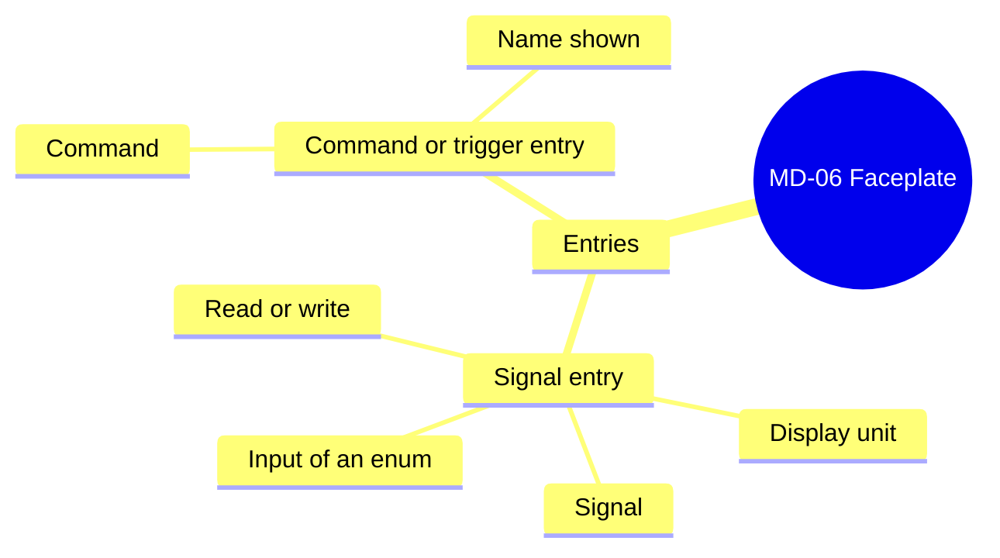

| ID | Element | Kind | Values and behaviour | Status | Source |
| --- | --- | --- | --- | --- | --- |
| MD-06.1 | Entries | List | Signal entries and command or trigger entries. | Decided | [Faceplates](../metadata/08-faceplates.md) |
| MD-06.2 | Add a signal entry | not said (button) | — | Implied | [Faceplates](../metadata/08-faceplates.md) |
| MD-06.3 | Signal | not said (select) | The signal shown. | Decided | [Faceplates](../metadata/08-faceplates.md) |
| MD-06.4 | Read or write | not said (radio) | — | Decided | [Faceplates](../metadata/08-faceplates.md) |
| MD-06.5 | Display unit | Select | Units of the signal's quantity. | Decided | [Faceplates](../metadata/08-faceplates.md) |
| MD-06.6 | Input of an enum | Select | Radio on one line, radio on several lines, select, "and so on"; in read and in write. | Decided (list open: "and so on") | [Faceplates](../metadata/08-faceplates.md) |
| MD-06.7 | Add a command or trigger entry | not said (button) | — | Implied | [Faceplates](../metadata/08-faceplates.md) |
| MD-06.8 | Name shown | Text field | The name of the command button in the faceplate. | Decided | [Faceplates](../metadata/08-faceplates.md) |

Gaps:

- Order of the entries: can the user reorder them? Groups or separators?
- Full list of enum inputs ("and so on").
- Can the same signal appear twice (read and write)?
- A preview of the faceplate while editing?
- Remove an entry.

## MD-07 · Presets

Path: Metadata › Types › a type › Presets.

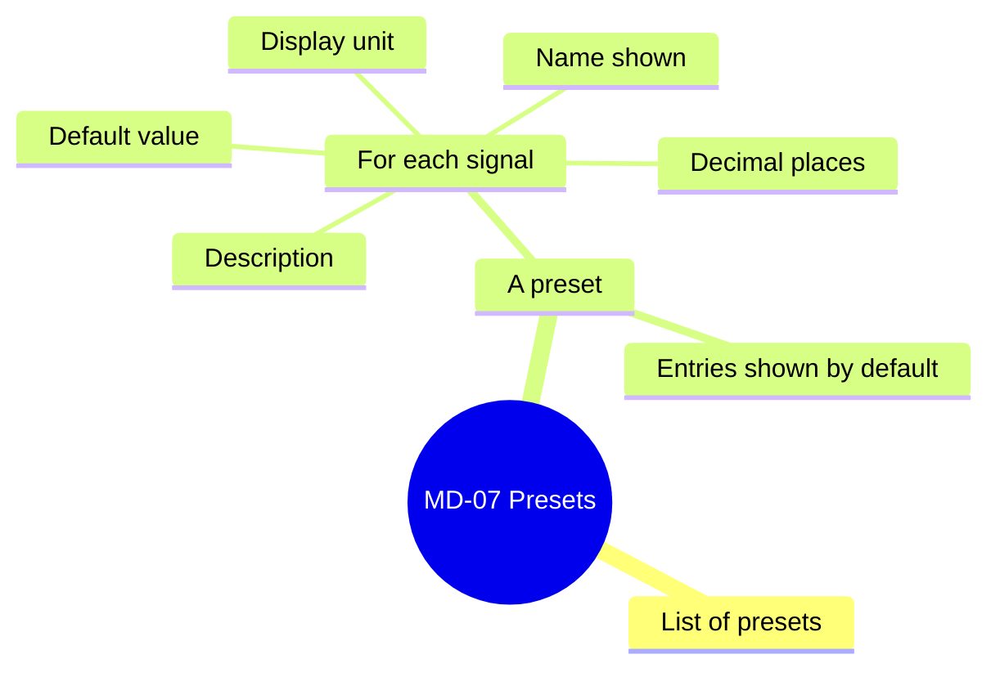

| ID | Element | Kind | Values and behaviour | Status | Source |
| --- | --- | --- | --- | --- | --- |
| MD-07.1 | List of presets | List | At least one is needed to use the type in a symbol; none is created automatically. | Decided | [Presets](../metadata/09-presets.md) |
| MD-07.2 | Create a preset | not said (button) | — | Implied | [Presets](../metadata/09-presets.md) |
| MD-07.3 | Name of the preset | not said | Never mentioned. | Implied | — |
| MD-07.4 | Default value | Field of the signal's type | One per signal. | Decided | [Presets](../metadata/09-presets.md) |
| MD-07.5 | Display unit | Select | Starts as the model unit. | Decided | [Presets](../metadata/09-presets.md) |
| MD-07.6 | Decimal places | Number field | Starts as the quantity's default. | Decided | [Presets](../metadata/09-presets.md) |
| MD-07.7 | Name shown | Text field | Plain text; shown instead of the signal's name. | Decided | [Presets](../metadata/09-presets.md) |
| MD-07.8 | Description | Text field, multi-line | Plain text; line breaks kept. | Decided | [Faceplates](../metadata/08-faceplates.md) |
| MD-07.9 | Entries shown by default | Checkbox per entry | Unticked entries stay available in a symbol and a synoptic. | Decided | [Presets](../metadata/09-presets.md) |

Gaps:

- A preset has no name in the specs: how does the user tell two presets apart?
- Rename, duplicate and delete a preset; what happens to the symbols that use a deleted preset?
- Does a sub-type see the presets of its parent?

## MD-08 · Units

Path: Metadata › Units.

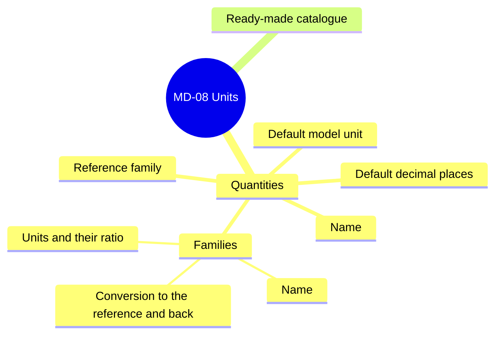

| ID | Element | Kind | Values and behaviour | Status | Source |
| --- | --- | --- | --- | --- | --- |
| MD-08.1 | Quantities | List | Mass, volume, flow... A temperature difference is its own quantity. | Decided | [Units](../metadata/05-units.md) |
| MD-08.2 | Add a quantity | not said (button) | The user can add and change quantities, families and units. | Decided (control not said) | [Units](../metadata/05-units.md) |
| MD-08.3 | Default model unit | Select | Among the units of the quantity. | Decided | [Units](../metadata/05-units.md) |
| MD-08.4 | Default decimal places | Number field | The global setting for display. | Decided | [Units](../metadata/05-units.md) |
| MD-08.5 | Reference family | Select | Every other family converts to it and back. | Decided | [Units](../metadata/05-units.md) |
| MD-08.6 | Families | List | Each one a table of units. | Decided | [Units](../metadata/05-units.md) |
| MD-08.7 | Unit | Text field + number field | Name with its variant (US gallon); ratio inside the family. Flat units (`m³/h` is one unit). | Decided | [Units](../metadata/05-units.md) |
| MD-08.8 | Conversion form | not said (select) | Proportional, affine, inverse, logarithmic, or a pair of free expressions (going and back). | Decided | [Units](../metadata/05-units.md) |
| MD-08.9 | Parameters of the form | Number fields | a, b, k, x₀, base, depending on the form. | Implied | [Units](../metadata/05-units.md) |
| MD-08.10 | Round-trip check | — | The application checks that a pair of expressions comes back. | Decided | [Units](../metadata/05-units.md) |
| MD-08.11 | Ready-made catalogue | — | Loaded at the first launch; source and licence open. | Decided, licence Open | [Units](../metadata/05-units.md) |

Gaps:

- What does the user see when the round-trip check fails?
- Delete a quantity or a unit that signals use.
- Is the catalogue updated later, and how are the user's changes kept?

## MD-09 · Enums

Path: Metadata › Enums.

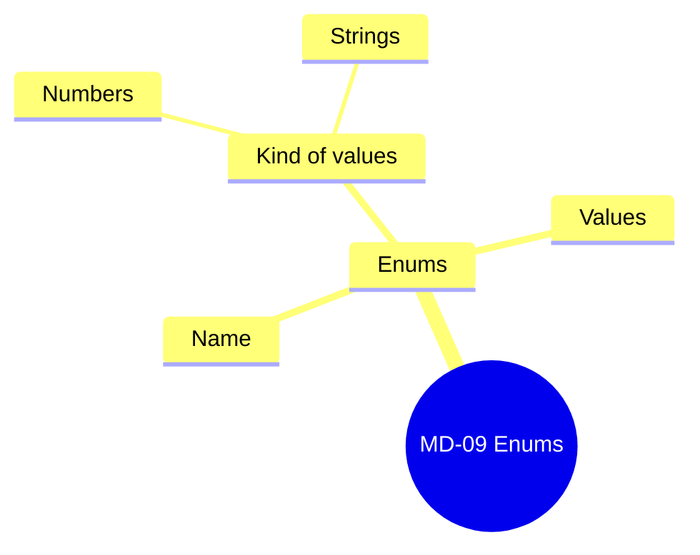

| ID | Element | Kind | Values and behaviour | Status | Source |
| --- | --- | --- | --- | --- | --- |
| MD-09.1 | Enums | List | Can be filled before any signal uses them. | Decided | [Enums](../metadata/06-enums.md) |
| MD-09.2 | Add an enum | not said (button) | — | Implied | [Enums](../metadata/06-enums.md) |
| MD-09.3 | Name | Text field | — | Decided | [Enums](../metadata/06-enums.md) |
| MD-09.4 | Numbers or strings | not said (radio) | An enum is a list of numbers or a list of strings. | Decided | [Enums](../metadata/06-enums.md) |
| MD-09.5 | Values | List | Unique; a value alone, no separate name. Changing them is breaking for the model. | Decided | [Enums](../metadata/06-enums.md) |
| MD-09.6 | Add, remove a value | not said | — | Implied | [Enums](../metadata/06-enums.md) |

Gaps:

- Changing a value is breaking: is there the same Edit and Save step as for a name, or nothing?
- Which signals use an enum: is it shown (a usage counter)?
- Order of the values: is it the order of the menu in the faceplate?

## MD-10 · Libraries (Type Libs)

Path: Metadata › Libraries.

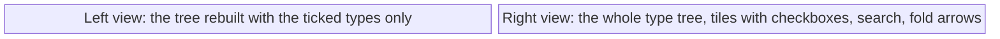

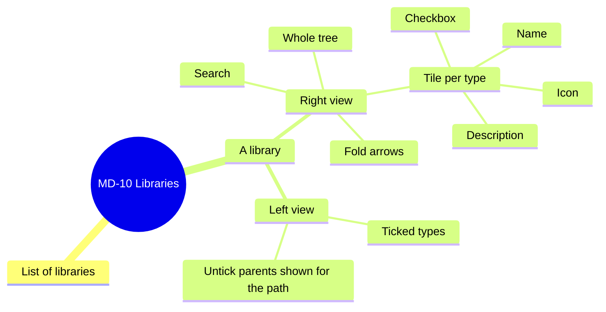

| ID | Element | Kind | Values and behaviour | Status | Source |
| --- | --- | --- | --- | --- | --- |
| MD-10.1 | List of libraries | List | Flat; no library inside a library. | Decided | [Libraries](../metadata/10-libraries.md) |
| MD-10.2 | Create a library | not said (button) | Created empty. | Decided (control not said) | [Libraries](../metadata/10-libraries.md) |
| MD-10.3 | Name of the library | not said | Never mentioned. | Implied | — |
| MD-10.4 | Tile of a type | Checkbox | Icon, model identifier, description; a click ticks it, it turns green. | Decided | [Libraries](../metadata/10-libraries.md) |
| MD-10.5 | Search | Text field | Filters the tree. | Decided | [Libraries](../metadata/10-libraries.md) |
| MD-10.6 | Fold arrows | Button | Fold or unfold a branch. | Decided | [Libraries](../metadata/10-libraries.md) |
| MD-10.7 | Left view | Tree | The ticked types; a parent not ticked is shown for the path. | Decided | [Libraries](../metadata/10-libraries.md) |

Gaps:

- A library has no name in the specs; rename and delete are not described.
- Is there a "tick a whole branch" action?
- Which Symbol Libs use a library: is it shown?
