# Screens of Metadata

> [Home](../README.md) › [Screens](README.md) › Metadata

Status: draft, written by the assistant on 2026-11-11 from the validated [Metadata](../metadata/README.md) pages, then reviewed with the Product Owner the same day (tree on the left, order of the parts, General complete, description modes, links, signals, commands, enums, units), and on 2026-11-16 from the review of the wireframes (navigation bar, list on the left and panel on the right, libraries of types removed; then icon buttons in General, a fixed parent, a description always editable, add buttons above the lists, signals and commands in tables, commands with a fixed value only; then the faceplate merged into the presets, and an ID and a display name for each signal; then the parts of a type as a strip of icons, delete by right click everywhere, commands to inputs only, whole number enum keys, the type tree kept in full page; last, no Edit or Save step anywhere and a Versions page, the read-only mode of the description kept, the direction first in the table of signals, the name shown of a signal moved to the preset, three kinds of command with an ID; then quantity or difference in the one column Quantity, and the parts of a type listed by name, fixed under the tree, replacing the strip of icons; last, the list moved above the tree then back under it, and a Faceplate part, a view only, replacing the button that showed the faceplate; at the end of the day, the tree validated with its search behind an icon, no right click anywhere (a delete button with a warning), inherited lines first, icons for a quantity and a difference, the formatting tool bar in both modes, and a preset in two modes, Values and the faceplate builder; last, the Faceplate part removed, the model unit removed from the signals, an icon alone for a quantity or a difference, a description for each enum item, handles on the links and the commands, a small + on the right of the title of each list, and no header on the columns of buttons); on 2026-11-17, the minimum and the maximum removed from the signal (a bound is a plain signal, usually an input), the header "Quantity / Difference", no decimals on the signal and no bubble on an enum name; later the same day, the Units page reviewed (default unit, converter, formula per unit), the display name before the description of an enum item, the Flags page completed and moved after Commands, and the icons at the top of a group of the faceplate builder confirmed; on 2026-11-21, the Versions page removed (decision 0053), the display name of an enum item renamed and the signal of a bound limited to inputs of the same quantity (decision 0056). It adds no rule. Kinds, statuses and the [layout rules](README.md#layout-rules) are explained in the [guide of this folder](README.md).

## MD-00 · Navigation bar of Metadata

Path: on the far left of every screen of Metadata (Product Owner, 2026-11-16).

| ID | Element | Kind | Values and behaviour | Status | Source |
| --- | --- | --- | --- | --- | --- |
| MD-00.1 | Types | Button (icon) | Opens [MD-01](#md-01--types-the-tree-and-the-type-editor). | Decided | [Layout rules](README.md#layout-rules) |
| MD-00.2 | Units | Button (icon) | Opens [MD-08](#md-08--units). | Decided | [Layout rules](README.md#layout-rules) |
| MD-00.3 | Enums | Button (icon) | Opens [MD-09](#md-09--enums). | Decided | [Layout rules](README.md#layout-rules) |
| MD-00.4 | Versions | — | Removed (2026-11-21, decision 0053): no versions in the application, the JSON files are versioned with Git by the user. | Decided | [Always editable, no versions](../metadata/draft.md#always-editable-no-versions) |
| MD-00.5 | Flags | — | Removed (2026-11-17): flags are a part of the type, not a page of the bar (see [MD-12](#md-12--flags-a-part-of-the-type)). | Decided | [Flags](../metadata/draft.md#flags) |
| MD-00.6 | Identifiers | Button (icon) | Opens [MD-13](#md-13--identifiers). A page of the bar, like Units and Enums (2026-11-18: "C'est une page de type unit enum version"). Last, after Enums: assistant's reading. Working name. | Decided (page of the bar), Proposed (place, name) | [Identifiers](../metadata/draft.md#identifiers) |

Gaps:

- Which icons (to choose with the design system). Going from Metadata to the symbol mode is done in the top bar (see the [layout rules](README.md#top-bar-of-the-window)).

## MD-01 · Types: the tree and the type editor

Path: Metadata › Types.

The tree is on the left, as in a code editor, just right of the navigation bar; the parts of the selected type are listed by name under the tree, in the same column, fixed; the selected part is edited on the right.

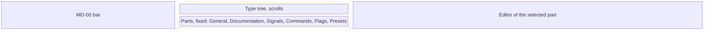

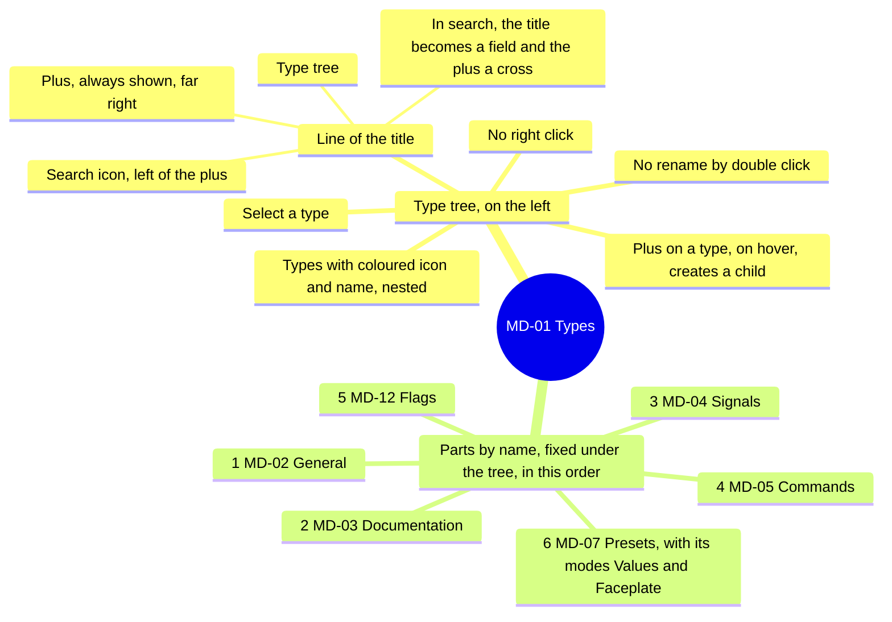

| ID | Element | Kind | Values and behaviour | Status | Source |
| --- | --- | --- | --- | --- | --- |
| MD-01.1 | Type tree | Tree | On the left. Shows each type with its icon, in its colour, and its name; types nest at any depth. A click selects the type. Validated (2026-11-16). | Decided | [Types](../metadata/draft.md#types), [Icons](../metadata/draft.md#type-icons) |
| MD-01.2 | Double click on a type | — | Does **not** rename: the name changes in General only. | Decided | [Types](../metadata/draft.md#types) |
| MD-01.3 | Create a child type | Button (+), on hover | On the right of each type, shown when the mouse is over it; creates a type inside it, with a default name. Always shown in a light colour: thought of, then dropped as too loaded (2026-11-16). | Decided | [Types](../metadata/draft.md#types) |
| MD-01.3b | Create a root type | Button (+), always shown | On the line of the title "Type tree", always on the far right. | Decided | [Types](../metadata/draft.md#types) |
| MD-01.4 | Delete a type | — | Removed from the tree (2026-11-16): no right click in Metadata; the type is deleted in General ([MD-02.8](#md-02--general)). | Decided | [Types](../metadata/draft.md#types) |
| MD-01.5 | Parts of the type | List of names | In the column of the type tree, under it, fixed at the bottom: it never moves when the tree grows. The names in whole words, in this order: General, Documentation, Signals, Commands, Flags, Presets (Flags added on 2026-11-17; proposal B, 2026-11-16, replacing the strip of icons of proposal C; moved above the tree for a while the same day, then back under it). No Faceplate part (removed at the end of 2026-11-16). | Decided | [Types](../metadata/draft.md#the-parts-of-a-type-a-list-fixed-under-the-tree) |
| MD-01.6 | Search | Button (icon) on the line of the title, left of the + | A click turns the title into a search field; typing filters the tree; the + becomes a cross that closes the search and brings the title back (2026-11-16). It replaces the field under the title. | Decided | [Types](../metadata/draft.md#the-type-tree-search-create-delete-product-owner-2026-11-16) |
| MD-01.6b | Search field | Text field | In place of the title "Type tree", while searching. | Decided | [Types](../metadata/draft.md#the-type-tree-search-create-delete-product-owner-2026-11-16) |
| MD-01.6c | Close the search | Button (×) | In place of the + while searching. | Decided | [Types](../metadata/draft.md#the-type-tree-search-create-delete-product-owner-2026-11-16) |

Gaps:

- Does the filtered tree keep the parents of a type that matches?
- Fold arrows on the branches: drawn, never said.
- How the selected part is marked in the list (to choose with the design system).

## MD-02 · General

Path: Metadata › Types › a type › General. Complete: nothing more is needed (Product Owner, 2026-11-11, confirmed on 2026-11-16).

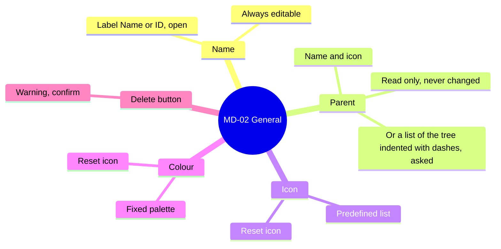

| ID | Element | Kind | Values and behaviour | Status | Source |
| --- | --- | --- | --- | --- | --- |
| MD-02.1 | Name | Text field | Always editable (2026-11-16). The model identifier, readable (`centrifugal_pump`). A rename breaks the model; nothing warns, it is seen in Git (2026-11-21). | Decided | [Types](../metadata/draft.md#types) |
| MD-02.2 | Edit | — | Removed (2026-11-16): everything is editable all the time. | Decided | [Always editable](../metadata/draft.md#always-editable-no-versions) |
| MD-02.3 | Save | — | Removed (2026-11-16): each change is kept as it is made. | Decided | [Always editable](../metadata/draft.md#always-editable-no-versions) |
| MD-02.4 | Parent | Read only: name and icon | Set at creation, never changed (2026-11-16, decision 0013). A wrong parent: delete the type and create it again. The Product Owner then described it as a select showing the whole tree, indented with dashes: asked. | Decided (read only), Open (select) | [Types](../metadata/draft.md#a-list-of-types-shows-the-tree-indented) |
| MD-02.5 | Icon | List of icons | One icon of the predefined SVG list. No import. Validated (2026-11-16). | Decided | [Icons](../metadata/draft.md#type-icons) |
| MD-02.6 | Colour | Colour (palette only) | One colour of a fixed palette; no free colour. Validated (2026-11-16). | Decided | [Icons](../metadata/draft.md#type-icons) |
| MD-02.7 | Reset icon, reset colour | Button (icon) | Shown when the type overrides its parent's choice; makes it follow the parent again. An icon, no text label (2026-11-16). | Decided | [Icons](../metadata/draft.md#type-icons) |
| MD-02.8 | Delete the type | Button, then a warning (dialog) | In General (2026-11-16): the only way to delete a type. A click opens a warning that asks to confirm. | Decided | [Types](../metadata/draft.md#the-type-tree-search-create-delete-product-owner-2026-11-16) |

Gaps:

- Which icons for Reset (to choose with the design system).
- The label of the name: "Name" or "ID" (open).
- The palette and the icons may take several lines: where the reset buttons go then.
- The wording of the warning.

## MD-03 · Documentation

Path: Metadata › Types › a type › Documentation.

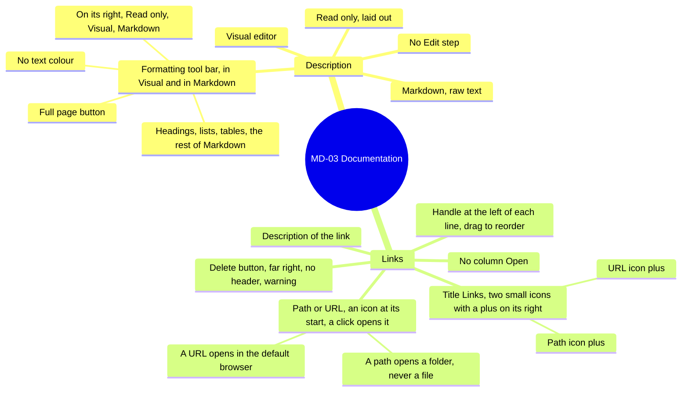

| ID | Element | Kind | Values and behaviour | Status | Source |
| --- | --- | --- | --- | --- | --- |
| MD-03.1 | Description, read only | Editor (laid out, read only) | Kept (Product Owner, 2026-11-16, correcting his removal of the same day). Which mode opens first: open. | Decided (mode), Open (first) | [Documentation](../metadata/draft.md#type-documentation) |
| MD-03.2 | Description, visual editor | Editor (visual) | A "what you see is what you get" editor with a formatting tool bar. | Decided | [Documentation](../metadata/draft.md#type-documentation) |
| MD-03.3 | Description, Markdown | Editor (raw text) | For those who write Markdown faster; the user switches between the three modes at any time. | Decided | [Documentation](../metadata/draft.md#type-documentation) |
| MD-03.4 | Go to edit, Save | — | None: switching mode is not an Edit step, nothing to save or confirm (2026-11-16). | Decided | [Always editable](../metadata/draft.md#always-editable-no-versions) |
| MD-03.4b | Read only, Visual, Markdown | Buttons (switch) | On the right of the formatting tool bar, on the same line (2026-11-16). | Decided | [Documentation](../metadata/draft.md#type-documentation) |
| MD-03.4d | Formatting tool bar | Buttons | In Visual and in Markdown (2026-11-16). Like a word processor: heading levels, lists, tables and the rest of Markdown (proposed list in [Documentation](../metadata/draft.md#the-formatting-tool-bar)); no text colour. | Decided (both modes), Proposed (content) | [Documentation](../metadata/draft.md#the-formatting-tool-bar) |
| MD-03.4c | Full page | Button (icon), in the tool bar | The description takes the whole editing part; the links are hidden; the window, the menus of the application and the type tree stay. The same button brings the page back (2026-11-16). | Decided | [Documentation](../metadata/draft.md#type-documentation) |
| MD-03.5 | Links | List | Each link: a path or a URL, and a description. | Decided | [Documentation](../metadata/draft.md#type-documentation) |
| MD-03.6 | Add a path | Button (icon with a small +) | On the right of the title "Links", first of two icons (2026-11-16). The server opens a selection window; only the path is kept (`W:/...`). A file or a folder. | Decided | [Layout rules](README.md#a-title-and-a-small--on-its-right) |
| MD-03.7 | Add a URL | Button (icon with a small +), then a text field | Next to MD-03.6 (2026-11-16): two icons, no menu, "clac-clac". Typed or pasted. | Decided | [Documentation](../metadata/draft.md#the-links) |
| MD-03.11 | Handle of a link | Grip, dragged, no header | At the very left of each link: moves it; the order is kept (2026-11-16). | Decided | [Documentation](../metadata/draft.md#the-links) |
| MD-03.8 | Description of a link | Text field | Plain text, not Markdown. | Decided | [Documentation](../metadata/draft.md#type-documentation) |
| MD-03.9 | Open | Click on the path or the URL, an icon at its start | No column Open (2026-11-16). A click on a path opens a folder: the one that contains the file, or the folder itself; never a file or a program. A click on a URL opens it in the default browser. The icon at the start says folder or link. | Decided | [Documentation](../metadata/draft.md#the-links) |
| MD-03.10 | Delete a link | Button (icon), then a warning | In the last column of the line, on the far right, with no header; a click opens a warning (2026-11-16). No right click. | Decided | [Layout rules](README.md#delete-with-a-button-and-a-warning-in-metadata) |

Gaps:

- How is a link edited in place, now that a click on its path or URL opens it?
- The exact content of the formatting tool bar.

## MD-04 · Signals

Path: Metadata › Types › a type › Signals.

The signals are shown in **one table** that takes as much room as possible: one line per signal, one column per field (Product Owner, 2026-11-16). It replaces the list on the left and its panel on the right, drawn earlier the same day. The + that adds a signal is a small icon on the right of the title "Signals".

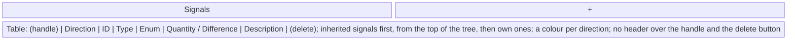

How the fields depend on each other: the type decides which fields exist. There is no model unit on the signal: it is one per quantity, set outside Metadata (2026-11-16). There is no minimum or maximum on the signal: a bound is a plain signal of its own, on a line of its own, usually an input (2026-11-17). There are no decimals on the signal (2026-11-17).

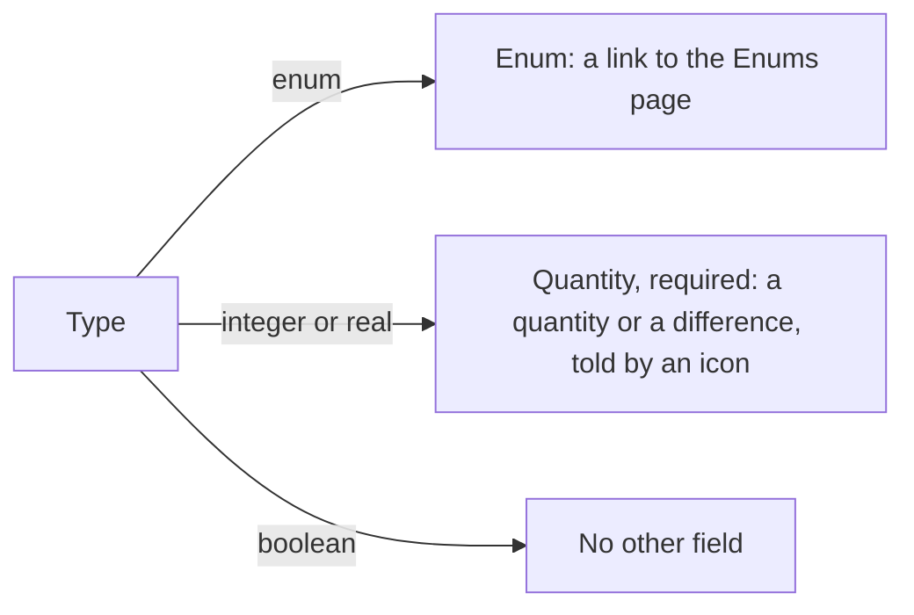

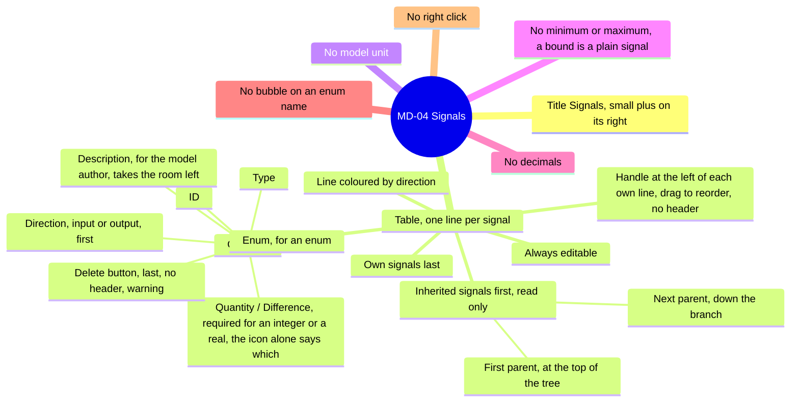

| ID | Element | Kind | Values and behaviour | Status | Source |
| --- | --- | --- | --- | --- | --- |
| MD-04.1 | Table of signals | Table | One line per signal, one column per field; takes as much room as possible. Own and inherited signals (2026-11-16). | Decided | [Signals](../metadata/draft.md#the-table-of-signals) |
| MD-04.2 | Enum on a signal line | — | The line shows the enum's name. No bubble listing its items when the mouse rests on the name (2026-11-17). | Decided | [Signals](../metadata/draft.md#the-table-of-signals) |
| MD-04.3 | Inherited signals | Lines of the table | First, read only: the signals of the first parent at the top of the tree, then of the next parent, then the type's own (2026-11-16). Edited in the type that declares them. Their look (greyed, with the parent's name) is not said. | Decided (order), Open (look) | [Signals](../metadata/draft.md#the-table-of-signals) |
| MD-04.4 | Add a signal | Button (+), small icon | On the right of the title "Signals", above the table (2026-11-16). | Decided | [Layout rules](README.md#a-title-and-a-small--on-its-right) |
| MD-04.5 | Edit, Save | — | Removed (2026-11-16): the table is always editable. | Decided | [Always editable](../metadata/draft.md#always-editable-no-versions) |
| MD-04.5b | Colour of a line | Background of the line | One colour for an input, another for an output (2026-11-16). The colours: with the design system. | Decided | [Signals](../metadata/draft.md#the-table-of-signals) |
| MD-04.6 | ID | Column, text field | Second column, after Direction. Model identifier; header "ID" (2026-11-16). A sub-type cannot reuse an inherited ID. | Decided | [Signals](../metadata/draft.md#signals) |
| MD-04.6b | Display name | — | Removed (2026-11-16), confirmed while reviewing the wireframes: the name people see is written in the faceplate builder of the preset ([MD-07](#md-07--presets)). | Decided | [Presets](../metadata/draft.md#mode-faceplate-the-faceplate-builder) |
| MD-04.7 | Type | Column, select | Integer, real (64-bit double), boolean, enum. No text (2026-11-18). | Decided | [Signals](../metadata/draft.md#signals) |
| MD-04.8 | Enum | Column, select | Only for the type enum: an enum of the Enums page, global or template (2026-11-17), as a link. Empty otherwise. | Decided | [Enums](../metadata/draft.md#enums) |
| MD-04.9 | Quantity | Column, select | Integer and real only, and **required** for them (2026-11-19, decision 0051, replaces "optional"): a number that measures nothing physical takes "ratio" (1, %, ‰, ppm) or "count". From the read-only catalogue. The same list offers the pressure and the pressure difference, in this one column; only the quantities whose conversion changes have the two items (2026-11-16). An icon before the name, one for a quantity, one for a difference, and **the icon alone**: no "(quantity)" or "(difference)" written (2026-11-16). Header **"Quantity / Difference"** (2026-11-17). | Decided | [Units](../metadata/draft.md#value-or-difference-chosen-in-the-signal) |
| MD-04.10 | Model unit | — | Removed (2026-11-16, end of the day): one model unit per quantity, the same everywhere, set outside Metadata (the catalogue or the project: open). | Decided | [Units](../metadata/draft.md#model-unit-and-display-unit) |
| MD-04.11 | Minimum, maximum | — | Removed (2026-11-17): a bound is a plain signal of its own, on a line of its own, with no tie to the signal it bounds; its direction is chosen as for any signal, usually an input (example: `speed_setpoint_max`). | Decided | [Signals](../metadata/draft.md#rules-3) |
| MD-04.15 | Decimals | — | None (2026-11-17): the model takes the whole value; decimals, if needed, are set once for the project, outside Metadata. | Decided | [Signals](../metadata/draft.md#rules-3) |
| MD-04.12 | Direction | Column, select | First column (2026-11-16). Input or output of the model. | Decided | [Signals](../metadata/draft.md#signals) |
| MD-04.13 | Delete a signal | Button (icon), then a warning | Last column, on the far right of each own line, with no header and the least width; a click opens a warning (2026-11-16). No right click ([layout rules](README.md#delete-with-a-button-and-a-warning-in-metadata)). | Decided | [Signals](../metadata/draft.md#the-table-of-signals) |
| MD-04.14 | Handle of a line | Grip, dragged, no header | At the very left of each own line, before Direction: held and dragged to move the line; the order chosen is kept (2026-11-16). Inherited lines have none. A new signal goes at the end: to confirm. Its look: with the design system. | Decided | [Signals](../metadata/draft.md#the-order-of-the-lines) |
| MD-04.16 | Description | Column, text field, takes the room left | What the signal means, for the person who writes the model (2026-11-20, decision 0052). After Quantity / Difference, before the delete button: the long field last, as for flags and enum items (assistant's reading). Plain text: assistant's reading. Optional; written in the configuration files sent with the model (2026-11-20). | Decided (field, optional, in the files), Proposed (place, plain text) | [Signals](../metadata/draft.md#rules-3) |
| MD-04.17 | True / False | Column, two short text fields | Boolean only: the text of the true state and of the false state ("Running" / "Stopped"), shown in the faceplate for a signal in read (2026-11-21, decision 0054; never in a title, decision 0055). Empty otherwise. After Enum, header "True / False": assistant's reading. | Decided (field), Proposed (place, header, empty shows true / false) | [Signals](../metadata/draft.md#fields) |

Gaps:

- Width of the window: what happens when the columns do not fit (scroll sideways, narrower columns)?
- Whether the table shows which parent an inherited line comes from.

## MD-05 · Commands

Path: Metadata › Types › a type › Commands.

As for the signals, the commands are shown in **one table**, the kind in the first column (Product Owner, 2026-11-16). The + that adds a command is a small icon on the right of the title "Commands".

| ID | Element | Kind | Values and behaviour | Status | Source |
| --- | --- | --- | --- | --- | --- |
| MD-05.1 | Table of commands | Table | One line per command; kind, ID, target signal, value, description (2026-11-20); always editable (2026-11-16). | Decided | [Commands](../metadata/draft.md#the-table-of-commands) |
| MD-05.2 | Add a command | Button (+), small icon | On the right of the title "Commands", above the table (2026-11-16). | Decided | [Layout rules](README.md#a-title-and-a-small--on-its-right) |
| MD-05.3 | ID | Column, text field | The command's identifier, called ID as for the signals, never "name" (2026-11-16). For a trigger, all it has. Symbols follow a change (internal identifier). | Decided | [Commands](../metadata/draft.md#commands) |
| MD-05.4 | Kind | Column, select | First column. Set a signal, Trigger, or Override an output (2026-11-16). | Decided | [Commands](../metadata/draft.md#commands) |
| MD-05.5 | Target signal | Column, select | Picked by its ID. "Set a signal": the inputs of the model only; "Override an output": the outputs only (2026-11-16); empty for a trigger. | Decided | [Commands](../metadata/draft.md#commands) |
| MD-05.6 | Value: fixed or typed | — | Removed (2026-11-16): the value is always fixed. | Decided | [Commands](../metadata/draft.md#the-value-is-always-fixed) |
| MD-05.7 | Value | Column, field of the target signal's type | Fixed, written in Metadata: a number, true or false, or an item of the enum; never a text (2026-11-18, decision 0043). Empty for a trigger. A number is typed and kept in the default unit of the target signal's quantity (2026-11-19, decision 0051). | Decided | [Commands](../metadata/draft.md#the-value-is-always-fixed) |
| MD-05.8 | Typed value | — | Removed (2026-11-16): a person types a value in the faceplate, for a signal set to write in the preset. | Decided | [Presets](../metadata/draft.md#typing-a-value) |
| MD-05.9 | Delete a command | Button (icon), then a warning | Last column, on the far right of each own line, with no header; a click opens a warning (2026-11-16). No right click. | Decided | [Commands](../metadata/draft.md#the-table-of-commands) |
| MD-05.10 | Handle of a line | Grip, dragged, no header | At the very left of each own line, before Kind; same behaviour as [MD-04.14](#md-04--signals) (2026-11-16, confirmed at the end of the day). | Decided | [Commands](../metadata/draft.md#the-table-of-commands) |
| MD-05.11 | Inherited commands | Lines of the table | First, read only, from the first parent at the top of the tree down; then the type's own (2026-11-16, as for the signals). | Decided | [Commands](../metadata/draft.md#the-table-of-commands) |
| MD-05.12 | Description | Column, text field, takes the room left | What the command means, for the person who writes the model; for a trigger, what the model is expected to do (2026-11-20, decision 0052). After Value, before the delete button, as on [MD-04.16](#md-04--signals) (assistant's reading). Optional; written in the configuration files sent with the model (2026-11-20). | Decided (field, optional, in the files), Proposed (place, plain text) | [Commands](../metadata/draft.md#commands) |

Gaps:

- Override an output: who applies it and how it ends, open (see [Commands](../metadata/draft.md#open-questions-4)).

## MD-12 · Flags, a part of the type

Path: Metadata › Types › a type › Flags, fifth part of the type, between Commands and Presets. Described by the Product Owner on 2026-11-17; name and place given by him the same day ("flag, ça me va très bien"; "la page, elle fait partie des types"). An ID and a description per flag given by him the same day, then the rest of the page (description optional, internal identifier, no rule on an ID, handles, inheritance). Placed here, in the order of the parts, though its number comes after MD-07 (Product Owner, 2026-11-17: "c'est juste pour que, visuellement, ce soit plus simple"). The wireframe is the frame "MD-12 · Flags" of the page Spec in Figma, placed between MD-05 and MD-07.

| ID | Element | Kind | Values and behaviour | Status | Source |
| --- | --- | --- | --- | --- | --- |
| MD-12.1 | Table of flags | Table, whole width | The flags of the selected type, one line per flag. Columns in this order: the handle with no header, ID, Description, then the delete button with no header (2026-11-17). Inherited flags first, read only, with no handle, as for signals (inheritance confirmed 2026-11-17). | Decided | [Flags](../metadata/draft.md#flags) |
| MD-12.2 | Add a flag | Button (+), small icon | On the right of the title "Flags" ([layout rules](README.md#a-title-and-a-small--on-its-right)). | Implied | [Flags](../metadata/draft.md#flags) |
| MD-12.6 | Handle of a line | Grip, dragged, no header | At the very left of each own line: the users sort the flags as they want (2026-11-17). | Decided | [Layout rules](README.md#handles-to-choose-the-order) |
| MD-12.3 | ID | Text field | Always editable, as everything in Metadata. No rule on how it is written: the users name it as they want (2026-11-17). Followed through an internal identifier when renamed (2026-11-17). Unique or not: open. | Decided (no rule, internal identifier), Open (unique) | [Flags](../metadata/draft.md#flags) |
| MD-12.5 | Description | Text field, takes the room left | After the ID: what the flag is for, plain text, optional (2026-11-17). Shown when editing a synoptic; kept out of the configuration files: assistant's reading. | Decided (optional), Proposed (not in the files) | [Flags](../metadata/draft.md#flags) |
| MD-12.4 | Delete a flag | Button (icon), then a warning | At the far right of the line, with no header ([layout rules](README.md#delete-with-a-button-and-a-warning-in-metadata)). The warning never says which synoptics have the flag on (2026-11-17); the synoptic mode lists what is broken. | Decided | [Flags](../metadata/draft.md#flags) |

Gaps:

- Must an ID be unique in the type and its tree? See [Flags](../metadata/draft.md#open-questions-7).
- The panel of the synoptic where the flags of a placed symbol are ticked: described with part 3.

## MD-06 · Faceplate: removed

The Faceplate part, a view of the faceplate of a chosen preset, was removed by the Product Owner at the end of 2026-11-16: the faceplate is the mode Faceplate of a preset ([MD-07](#md-07--presets)). The identifier MD-06 is not reused. The faceplate itself (its controls, its size) is drawn with the synoptic part.

## MD-07 · Presets

Path: Metadata › Types › a type › Presets.

The list of presets is on the left, under its title "Presets" and the small + on its right; the page has no big title. The selected preset is on the right: a **switch** between its two modes at the top, then its name, then the mode chosen (Product Owner, 2026-11-16, while reviewing the wireframes; the labels confirmed and the switch moved up at the end of the day):

- **Values**: one table with every signal of the type, for its display unit, decimals and default value; no command;
- **Faceplate**: the faceplate builder, a list of elements added one by one with the + of its title.

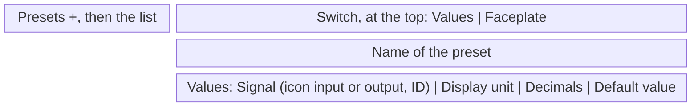

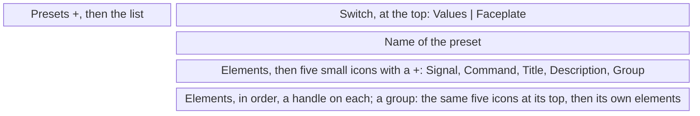

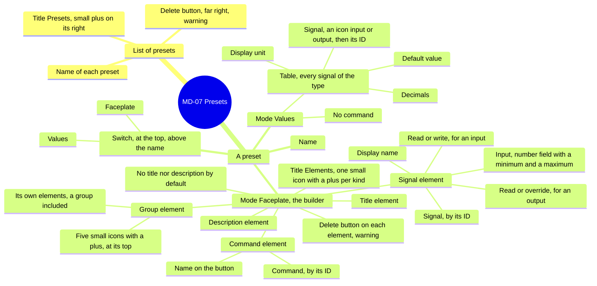

| ID | Element | Kind | Values and behaviour | Status | Source |
| --- | --- | --- | --- | --- | --- |
| MD-07.1 | List of presets | List | At least one is needed to use the type in a symbol; none is created automatically. | Decided | [Presets](../metadata/draft.md#presets-and-their-faceplate) |
| MD-07.2 | Create a preset | Button (+), small icon | On the right of the title "Presets" of the list; the page has no big title (2026-11-16). | Decided | [Layout rules](README.md#a-title-and-a-small--on-its-right) |
| MD-07.2b | Switch of the modes | Switch (two buttons) | At the top of the right side, above the name of the preset: **Values** or **Faceplate** (2026-11-16; labels confirmed at the end of the day). | Decided | [Presets](../metadata/draft.md#two-modes-chosen-by-a-switch) |
| MD-07.3 | Name of the preset | Text field | A preset has a name (2026-11-16). Under the switch, the same in both modes. | Decided | [Presets](../metadata/draft.md#presets-and-their-faceplate) |
| MD-07.4 | Faceplate title | — | Removed (2026-11-16): no title by default; a title element is added if wanted ([MD-07.19](#md-07--presets)). | Decided | [Presets](../metadata/draft.md#only-elements-in-elements) |
| MD-07.5 | Faceplate description | — | Removed (2026-11-16): no description by default; a description element is added if wanted ([MD-07.19](#md-07--presets)). | Decided | [Presets](../metadata/draft.md#only-elements-in-elements) |
| MD-07.6 | Show the faceplate | — | Removed (2026-11-16): the faceplate is seen in the mode Faceplate; the Faceplate part ([MD-06](#md-06--faceplate-removed)) was removed too. | Decided | [Presets](../metadata/draft.md#no-faceplate-part) |
| MD-07.7 | Table of values | Table | Mode Values: every signal of the type, own and inherited, in the order of Signals; one line each; no "add an entry"; no command (2026-11-16). | Decided | [Presets](../metadata/draft.md#mode-values-one-table-of-the-signals) |
| MD-07.8 | Shown | — | Removed (2026-11-16): what is in the builder is shown. | Decided | [Presets](../metadata/draft.md#mode-faceplate-the-faceplate-builder) |
| MD-07.9 | Signal | Column, read only | Mode Values: an icon of the signal's direction, input or output, then its ID (2026-11-17), so that the default value reads right. | Decided | [Presets](../metadata/draft.md#mode-values-one-table-of-the-signals) |
| MD-07.12 | Display unit | Column, select | Mode Values. For every integer and real (each has a quantity, 2026-11-19, decision 0051); starts as the model unit of the quantity. Changing it never changes the default value: only how it is shown. | Decided | [Presets](../metadata/draft.md#mode-values-one-table-of-the-signals) |
| MD-07.13 | Decimals | Column, number field | Mode Values. Integers and reals; starts as the one default number of decimals, the same everywhere (2026-11-19, decision 0050). Display only. Kept by the Product Owner on 2026-11-17. | Decided | [Units](../metadata/draft.md#decimal-places) |
| MD-07.14 | Default value | Column, field of the signal's type | Mode Values. For an input, the first value sent to the model; for an input and an output, the value shown before the model sends anything (2026-11-17). True or false, a number, a text, or an enum item. A number is shown and typed in the display unit, and kept in the default unit of the quantity (2026-11-19, decision 0051). | Decided | [Presets](../metadata/draft.md#mode-values-one-table-of-the-signals) |
| MD-07.18 | Add an element | Buttons (small icons with a +) | Mode Faceplate, on the right of the title "Elements": one icon per kind, a signal, a command, a title, a description, a group, no menu (2026-11-16, the rule of the links, confirmed by the Product Owner the same day). | Decided | [Presets](../metadata/draft.md#mode-faceplate-the-faceplate-builder) |
| MD-07.9b | Signal element | Element of the builder | The signal, picked by its ID; its display name (plain text, never sent to the model; empty: the ID is shown; called "name shown" until 2026-11-21, decision 0055); read or write (input) or read or override (output); its input. | Decided | [Presets](../metadata/draft.md#mode-faceplate-the-faceplate-builder) |
| MD-07.10 | Input | Select, in a signal element | Chosen in the builder (end of 2026-11-17: "on met input number, par exemple"). Enum: radio on one line, radio on several lines, select; its items in the order of the handles of [MD-09.12](#md-09--enums) (end of 2026-11-17). Number: a number field, with its bounds ([MD-07.22](#md-07--presets)). Boolean: a switch (2026-11-21). Shown for write or override only; in read, the faceplate shows the text of the value alone (2026-11-21). | Decided | [Presets](../metadata/draft.md#mode-faceplate-the-faceplate-builder) |
| MD-07.11 | Read or write, read or override | Radio, in a signal element | Input: read or write. Output: read or override (end of 2026-11-17: "c'est read write pour un input et read override pour un output"; corrects the single "read or override" written earlier that day). Write or override: a person types a value; what the model side does with it is up to it. | Decided | [Presets](../metadata/draft.md#typing-a-value) |
| MD-07.22 | Minimum, maximum of a number field | Number field each, with a small icon inside to pick a signal | Each typed by hand, or taken from a signal of the type through the small icon in the field, as Figma's "Apply variable" (end of 2026-11-17). The small icon offers the input signals only, never an output (2026-11-21, decision 0055), and only those of the same quantity as the signal shown (2026-11-21, decision 0056). A typed bound is shown in the display unit of the preset. A value outside them is refused (assistant's reading). | Decided (refusal: Proposed) | [Presets](../metadata/draft.md#bounds-of-a-number-field) |
| MD-07.15 | Command element | Element of the builder | The command, picked by its ID; the name on its button (plain text). | Decided | [Presets](../metadata/draft.md#mode-faceplate-the-faceplate-builder) |
| MD-07.19 | Title element, description element | Text fields | A heading or a paragraph inside the faceplate or a group; the only way to give either a title or a description (2026-11-16). Description: plain text, line breaks kept. | Decided | [Presets](../metadata/draft.md#only-elements-in-elements) |
| MD-07.23 | Fixed text or variable | Small icon, on the right of the text field of a title or description element | As Figma's "Apply variable" (2026-11-18): a fixed text typed by the user, or a variable, an identifier of [MD-13](#md-13--identifiers). Never a signal (2026-11-21, decision 0055): a signal element in read shows a value. An identifier is filled on each placed symbol, in the synoptic. One variable alone in the field, never mixed with text: assistant's reading. | Decided (icon, identifier only), Proposed (one variable, whole) | [Presets](../metadata/draft.md#fixed-text-or-a-variable) |
| MD-07.20 | Group element | Element of the builder | No title nor description of its own (confirmed 2026-11-17). At its top, the five small icons with a + (Signal, Command, Title, Description, Group), then its own elements; a group can hold a group (2026-11-16). The icons confirmed on 2026-11-17, after a doubt the same day: they save time. | Decided | [Presets](../metadata/draft.md#only-elements-in-elements) |
| MD-07.21 | Delete an element, delete a preset | Button (icon), then a warning | At the far right of the element or of the preset's line (2026-11-16). | Decided | [Layout rules](README.md#delete-with-a-button-and-a-warning-in-metadata) |
| MD-07.17 | Order | Rule | Mode Values: the order of Signals, no handle, no sort. Mode Faceplate: the order of the builder, moved with a handle (end of 2026-11-17: "il y a déjà les poignées là"). | Decided | [Presets](../metadata/draft.md#mode-faceplate-the-faceplate-builder) |
| MD-07.16 | Description per signal | — | Removed (2026-11-16): no description per signal or command in the faceplate; the builder has description elements instead. The description a signal and a command got in Metadata on 2026-11-20 ([MD-04.16](#md-04--signals), [MD-05.12](#md-05--commands)) is for the model author and is not shown in the faceplate: assistant's reading. | Decided | [Presets](../metadata/draft.md#presets-and-their-faceplate) |

Gaps:

- Rename and duplicate a preset; what happens to the symbols that use a deleted preset?
- Does a sub-type see the presets of its parent?
- Can an element be added twice? What can a symbol or a synoptic change in the built faceplate (the texts of its title and description elements, at least)?

## MD-08 · Units

Path: Metadata › Units (navigation bar).

The page goes from the list of quantities to a quantity, then to a family. Following the [layout rules](README.md#layout-rules), they sit in columns from left to right: the list, the selected quantity, the selected family.

**The whole page is read only** (Product Owner, 2026-11-16): the catalogue ships with the software, and contributors complete its files; no +, no field that changes the catalogue, no delete. The only field is the converter of a family, which tries a value and keeps nothing (2026-11-17).

Reviewed by the Product Owner on 2026-11-17 on the wireframe of the mass: the name said once, "Default unit" and "Default decimal places", a converter, the formula of each unit in the table, no ratio.

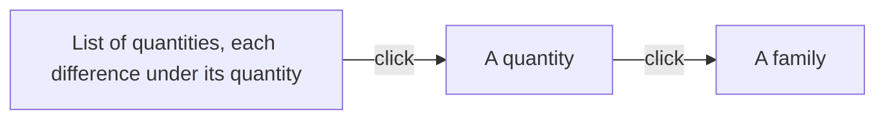

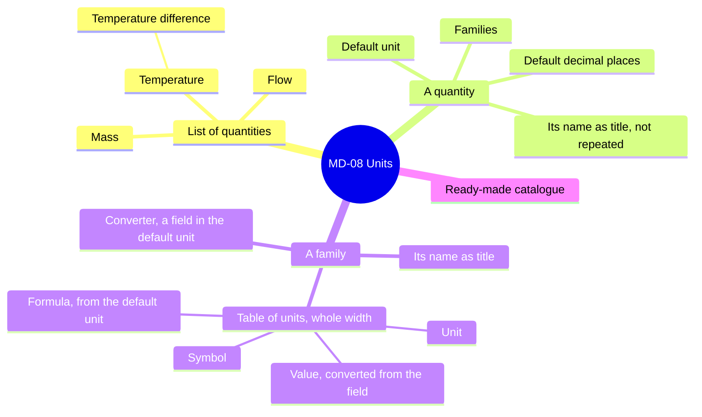

| ID | Element | Kind | Values and behaviour | Status | Source |
| --- | --- | --- | --- | --- | --- |
| MD-08.1 | List of quantities | List | Mass, volume, flow... Each difference is shown under its quantity, and stays a quantity of its own. | Decided | [Units](../metadata/draft.md#units) |
| MD-08.2 | Add a quantity, a family, a unit | — | Removed (Product Owner, 2026-11-16): the page is read only; a missing unit is added by a contributor to the catalogue files. | Decided | [Units](../metadata/draft.md#a-ready-made-catalogue-read-only) |
| MD-08.12 | Name of the quantity | Title | The title of the quantity's column; not written again under it (2026-11-17: "ça sert à rien de remettre le nom juste en dessous"). | Decided | [Units](../metadata/draft.md#the-units-page) |
| MD-08.3 | Default unit | Text, read only | Labelled "Default unit" (2026-11-17, replaces "Model unit"): the model unit of the quantity, the same for every signal (2026-11-16), and the display unit until a preset chooses another. From the catalogue; whether a project can set its own: open. | Decided (label, one per quantity), Open (where set) | [Units](../metadata/draft.md#model-unit-and-display-unit) |
| MD-08.4 | Default decimal places | Text, read only | Labelled "Default decimal places" (2026-11-17). Fixed by the catalogue; a preset can change it for a signal (Product Owner, 2026-11-16). | Decided | [Units](../metadata/draft.md#decimal-places) |
| MD-08.5 | Reference family | — | Not shown any more (2026-11-17): the Product Owner did not see what it was for, and the formulas now go from the default unit. Kept or removed from the catalogue: asked. | Proposed | [Units](../metadata/draft.md#quantities-families-and-conversions) |
| MD-08.6 | Families | List | Named after their system: Metric, Imperial... (2026-11-17). A click opens the family (kept 2026-11-17). | Decided | [Units](../metadata/draft.md#units) |
| MD-08.13 | Converter | Number field | At the top of the family, in the default unit of the quantity, 1 to start with (assistant's reading). Its value is converted on every line of the table; nothing is kept (2026-11-17: "je mets 1 kg et [...] je vois combien de pounds ça fait et combien d'ounces"). | Decided (field), Proposed (starts at 1) | [Units](../metadata/draft.md#the-units-page) |
| MD-08.7 | Table of units | Table, read only, whole width | One line per unit. Columns: Unit (name with its variant: US gallon), Symbol, Value, Formula. Flat units (`m³/h` is one unit). No ratio column (2026-11-17: the ratio "1/16" is "présenté de la pire des manières"). Units from the largest to the smallest: stone, pound, ounce, like kilogram, gram, milligram (2026-11-17: "faut de la cohérence"). The line of the default unit is marked (assistant's reading). | Decided | [Units](../metadata/draft.md#the-units-page) |
| MD-08.14 | Value | Column, read only | The value of the converter in this unit, rounded to 12 significant digits (assistant's reading). | Decided (column), Proposed (rounding) | [Units](../metadata/draft.md#the-units-page) |
| MD-08.8 | Formula | Column, read only | How this unit is computed from the default unit, on its own line, never in a line under the table (2026-11-17): `lb = kg ÷ 0.45359237`, `°F = °C × 9/5 + 32`. It replaces the conversion of the family to the reference family, shown going and back. | Decided | [Units](../metadata/draft.md#the-units-page) |
| MD-08.9 | Parameters of the form | — | Merged into the formula: shown, never typed. | Decided | [Units](../metadata/draft.md#units) |
| MD-08.10 | Round-trip check | — | Done on the catalogue files, not by the user. | Decided | [Units](../metadata/draft.md#units) |
| MD-08.11 | Ready-made catalogue | — | Every unit that can be imagined, in files of the software; source and licence open. | Decided, licence Open | [Units](../metadata/draft.md#source-of-the-catalogue) |

Gaps:

- With every unit imaginable, the list is long: how does the user find a quantity or a unit (a search field)?
- How the catalogue files are checked when a contributor adds a unit (round trip, duplicates): to settle with the architecture.

## MD-09 · Enums

Path: Metadata › Enums (navigation bar).

The list of enums is on the left and the selected enum, with its items, on the right ([layout rules](README.md#layout-rules)).

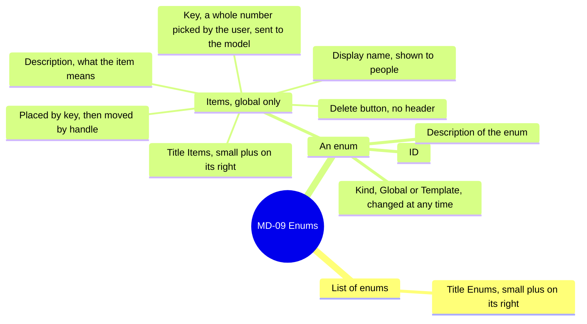

| ID | Element | Kind | Values and behaviour | Status | Source |
| --- | --- | --- | --- | --- | --- |
| MD-09.1 | List of enums | List | A page of its own, not part of the signals. Enums can be made before any signal uses them. | Decided | [Enums](../metadata/draft.md#enums) |
| MD-09.2 | Add an enum | Button (+), small icon | On the right of the title "Enums", above the list (Product Owner, 2026-11-16: "au niveau des enums [...] avec une icône", then "un petit +, une petite icône à côté du titre"). | Decided | [Layout rules](README.md#a-title-and-a-small--on-its-right) |
| MD-09.3 | ID | Text field | The public identifier of the enum, as the ID of a signal (Product Owner, 2026-11-19: "ça devrait être ID"; replaces "Name"). | Decided | [Data model](../metadata/data-model.md) |
| MD-09.10 | Kind: Global or Template | Choice when the enum is made (control not said) | Global: the items are written here, the same everywhere. Template: an ID and a description only, no items here; the items are completed on each placed symbol, in the synoptic, with a small warning until they are (end of 2026-11-17). The difference must be explicit on screen; how is for the design system (2026-11-17). The kind can be changed at any time, signals or not, with no warning; going back to global brings back its items (end of 2026-11-17). | Decided (control: Open) | [Enums](../metadata/draft.md#global-enums-and-templates) |
| MD-09.11 | Description of the enum | Text field (several lines) | What the enum is about as a whole, for a template and for a global enum alike (Product Owner, end of 2026-11-17). Plain text, never sent to the model. | Decided | [Enums](../metadata/draft.md#global-enums-and-templates) |
| MD-09.4 | Kind of key | — | Removed (Product Owner, 2026-11-16): a key is always a number, there are no string keys. | Decided | [Enums](../metadata/draft.md#enums) |
| MD-09.5 | Items | Table | Columns in this order: the handle with no header, Key, Display name, Description, then the delete button with no header (2026-11-17: the short field first, the long one last; replaces Key, Description, Display name of 2026-11-16). A new line takes its place by key, smallest first (end of 2026-11-17: "un tri automatique pour que ça aille dans l'ordre"); then the handle moves it to the order of meaning, without changing its key, and the order is kept (questionnaire, end of 2026-11-17: "Tri par clé, puis poignées"; decision 0038). Once items were moved, a new line goes right after the item with the next smaller key (questionnaire, end of 2026-11-17: "Juste après l'item de clé inférieure"; decision 0039). | Decided | [Enums](../metadata/draft.md#rules-5) |
| MD-09.12 | Handle of an item | Grip, dragged, no header | At the very left of each item: moves it; the key does not change (end of 2026-11-17, decision 0038). Same behaviour as [MD-04.14](#md-04--signals). | Decided | [Layout rules](README.md#handles-to-choose-the-order) |
| MD-09.6 | Key | Whole number field | Typed by the user, any whole number, gaps allowed (0, 2, 4), for a global enum and for the items of a template (end of 2026-11-17). Unique; what the model receives (2026-11-16). It can still be changed once given: breaking for the model, with no warning (decision 0038); the Versions page that showed it was removed on 2026-11-21 (decision 0053), the change is seen in Git. Changing it never moves the line (questionnaire, end of 2026-11-17: "Il reste où il est"; decision 0039). | Decided | [Enums](../metadata/draft.md#rules-5) |
| MD-09.7 | Display name | Text field | After the key. What the faceplate, the symbol texts and the test values show. Not breaking. Called "Display text" until 2026-11-21: renamed for the same word as an identifier and a signal field (decision 0056). | Decided | [Enums](../metadata/draft.md#enums) |
| MD-09.9 | Description | Text field | Last, after the display name (2026-11-17): what the item means, plain text, never sent to the model (2026-11-16). Optional, shown on this page only (2026-11-16). | Decided | [Enums](../metadata/draft.md#enums) |
| MD-09.8 | Add, delete an item | Button (+), delete button (icon) | The small + on the right of the title "Items"; the delete button at the far right of an item, with no header, then a warning (2026-11-16; [layout rules](README.md#delete-with-a-button-and-a-warning-in-metadata)). An enum is deleted the same way. | Decided | [Enums](../metadata/draft.md#enums) |

Gaps:

- Must the display names be unique too?
- Which signals use an enum: is it shown (a usage counter)?

## MD-10 · Libraries: removed

The libraries of types (Type Libs) were removed by the Product Owner on 2026-11-16. The identifier MD-10 is not reused.

## MD-11 · Versions: removed

The Versions page was removed by the Product Owner on 2026-11-21 (decision 0053): the application keeps no versions, the JSON files of the types are versioned with Git by the user (see [Always editable, no versions](../metadata/draft.md#always-editable-no-versions)). The identifier MD-11 is not reused.

## MD-13 · Identifiers

Path: Metadata › Identifiers (navigation bar, [MD-00.6](#md-00--navigation-bar-of-metadata)). Described by the Product Owner on 2026-11-18; "Identifiers" is a working name. The wireframe is the frame "MD-13 · Identifiers" of the page Spec in Figma, after MD-09; the entry "Identifiers" was added to the navigation bar of every Metadata frame, and the icon MD-07.23 to the frame of the faceplate builder, the same day.

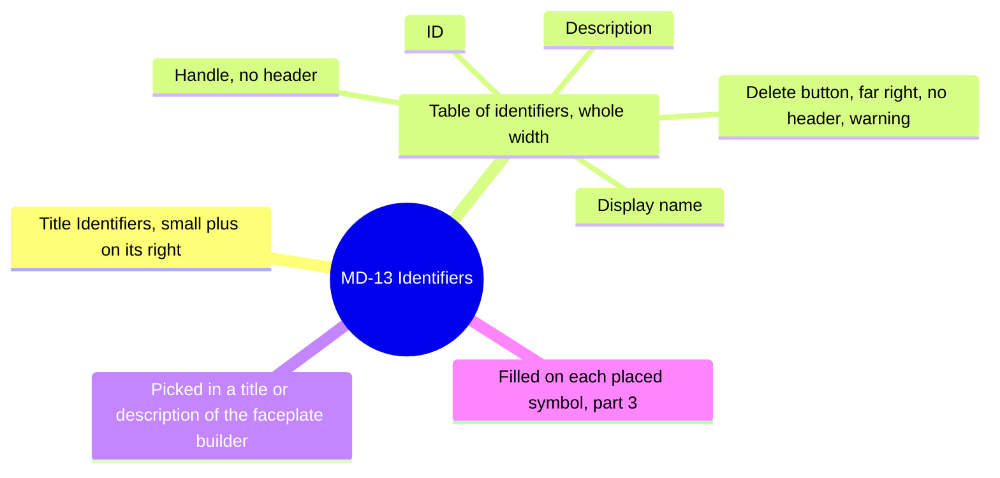

| ID | Element | Kind | Values and behaviour | Status | Source |
| --- | --- | --- | --- | --- | --- |
| MD-13.1 | Table of identifiers | Table, whole width | One line per identifier (2026-11-18: "faire un tableau"). Columns in this order: the handle with no header, ID, Display name, Description, then the delete button with no header (order: assistant's reading). No default value (2026-11-18). | Decided (table, fields), Proposed (column order) | [Identifiers](../metadata/draft.md#identifiers) |
| MD-13.2 | Add an identifier | Button (+), small icon | On the right of the title "Identifiers" ([layout rules](README.md#a-title-and-a-small--on-its-right)). | Implied | [Identifiers](../metadata/draft.md#identifiers) |
| MD-13.3 | Handle of a line | Grip, dragged, no header | The user chooses the order (2026-11-18: "Il faut pouvoir leur donner un ordre"). | Decided | [Layout rules](README.md#handles-to-choose-the-order) |
| MD-13.4 | ID | Text field | The key. Always editable, followed through its internal ID when renamed (assistant's reading of the general rule). Unique on the page: open. | Decided (field), Open (unique) | [Identifiers](../metadata/draft.md#identifiers) |
| MD-13.5 | Display name | Text field | The name people read where the identifier is picked and filled (assistant's reading). | Decided (field) | [Identifiers](../metadata/draft.md#identifiers) |
| MD-13.6 | Description | Text field, takes the room left | What the identifier is (2026-11-18: "expliquer ce que c'est"). Optional: assistant's reading. | Decided (field), Proposed (optional) | [Identifiers](../metadata/draft.md#identifiers) |
| MD-13.7 | Delete an identifier | Button (icon), then a warning | At the far right of the line, with no header (2026-11-18: "et les supprimer"; [layout rules](README.md#delete-with-a-button-and-a-warning-in-metadata)). | Decided | [Identifiers](../metadata/draft.md#identifiers) |

Gaps:

- What a faceplate shows when its title is bound to a deleted identifier.
- The panel of the synoptic where the text of each identifier is filled: described with part 3.
- The open questions of [Identifiers](../metadata/draft.md#open-questions-8).
