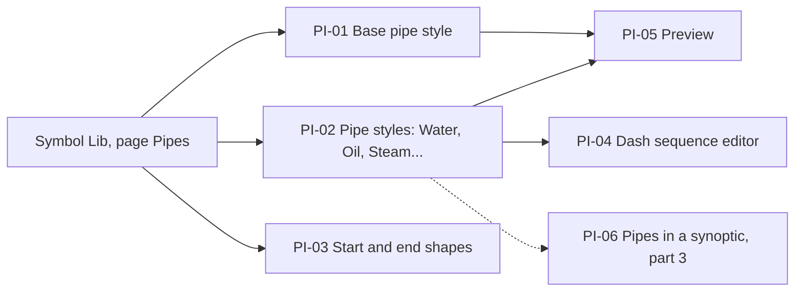
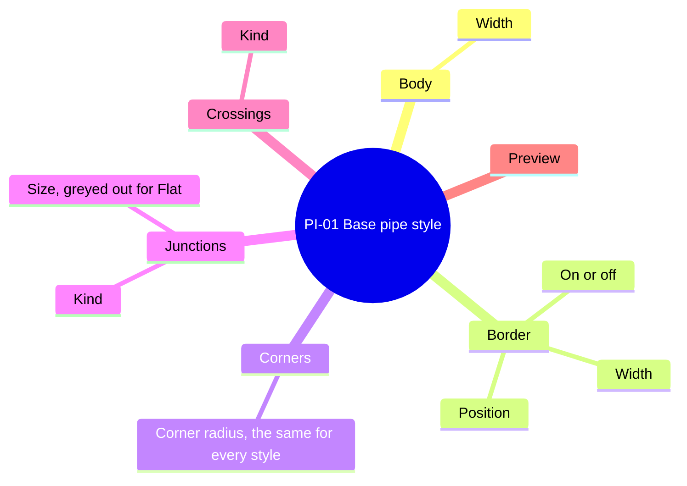
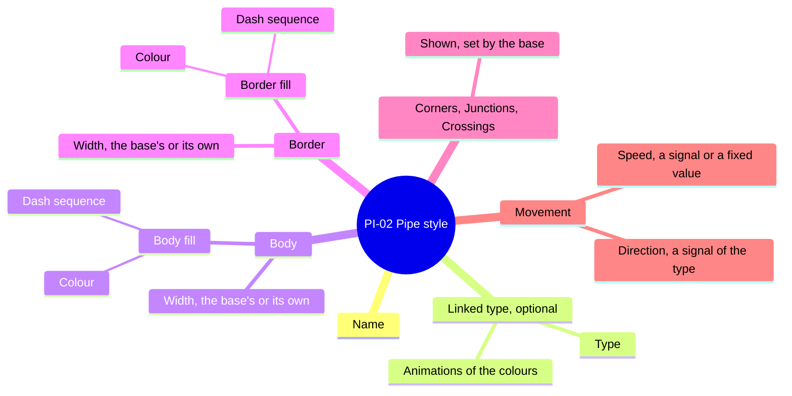
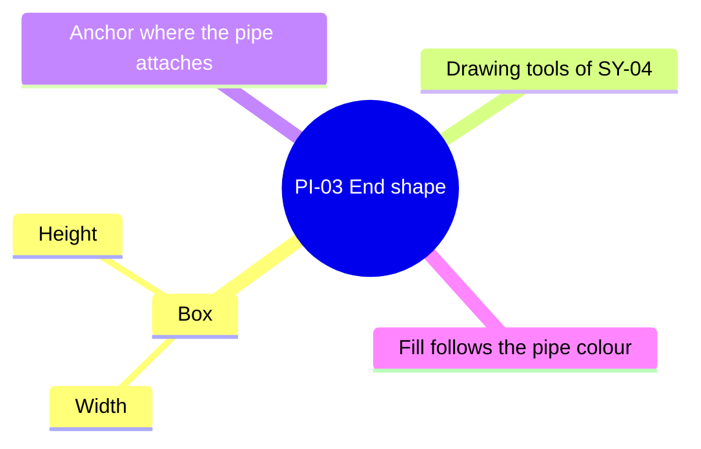
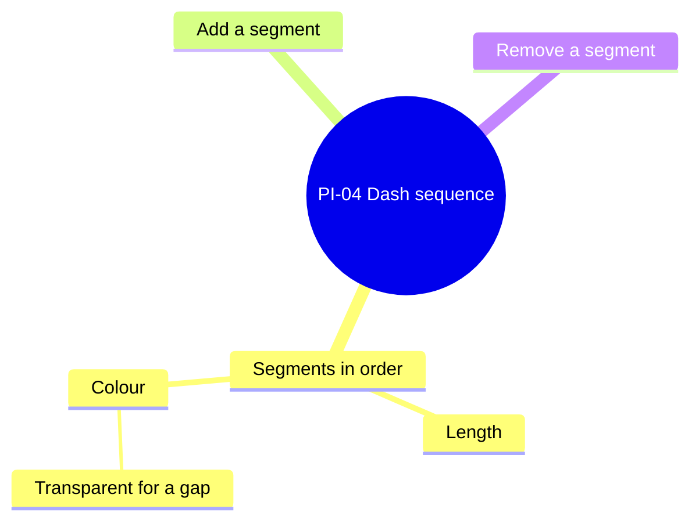
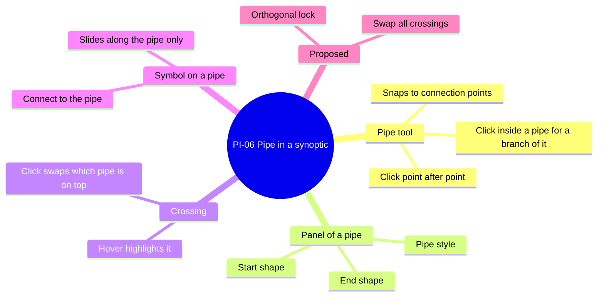

# Screens of the pipes

> [Home](../README.md) › [Screens](README.md) › Pipes

Status: draft, written by the assistant from the [Pipes](../symbols/pipes/README.md) pages, themselves a draft; its add buttons follow the layout rule "a title and a small + on its right". It adds no rule. Kinds and statuses are explained in the [guide of this folder](README.md).

The pipes are made in a Symbol Lib, on its page Pipes ([SY-00.4](symbols.md#sy-00--navigation-bar-of-the-symbol-mode), end of 2026-11-17) and drawn in a synoptic (part 3, not written). One base pipe style gives the shape of every pipe of the library, without colour; each pipe style gives the fills, the movement of its dashes and, when needed, its own body and border widths.

## Layout of the page Pipes

The page Pipes of a Symbol Lib follows the layout rules, as [SY-12](symbols.md#sy-12--enums-of-a-symbol-lib): the list on the left, the selected style on the right. Proposed by the assistant on 2026-11-23, to comment on the test screens.

- The left column holds, from top to bottom: the **base pipe style**, with a tag "Base"; the list of the **pipe styles**, with its small + to add one; the list of the **start and end shapes**, with its small + to add one, each set up in [PI-03](#pi-03--end-shape-editor).
- Proposed: the base pipe style at the very top, above the title of the pipe styles (to confirm).
- The options are grouped in **the same sections, in the same order**, for the base and for a pipe style: Body, Border, Corners, Junctions, Crossings. A pipe style adds Linked type at the top and Movement at the end (decision 0096).
- Every option is changed in place and written at once (see [Files and conflicts](../storage/files-and-conflicts.md#saving)).
- Test screens in Figma, page Spec, section "Symbol mode · test screens (2026-11-23)": "PI-01 · Pipes page of a Symbol Lib · base pipe style" and "PI-02 · Pipes page of a Symbol Lib · pipe style Gas", redrawn on 2026-11-24 with the same sections (decision 0096). Quick tests, no design-system component.

## PI-01 · Base pipe style

Path: Symbols › a Symbol Lib › Base pipe style. One per Symbol Lib.

No colour and no dash in the base: the fills are in [PI-02](#pi-02--pipe-style).

| ID | Element | Kind | Values and behaviour | Status | Source |
| --- | --- | --- | --- | --- | --- |
| PI-01.1 | Width | Number field (px) | Width of the body. | Decided | [Pipe styles](../symbols/pipes/pipe-styles.md) |
| PI-01.2 | Body fill | — | Removed: moved to the pipe styles ([PI-02.2](#pi-02--pipe-style)). | Decided | [Pipe styles](../symbols/pipes/pipe-styles.md) |
| PI-01.3 | Border | Toggle | When on, on both sides, the same. | Decided | [Pipe styles](../symbols/pipes/pipe-styles.md) |
| PI-01.4 | Border width | Number field (px) | — | Decided | [Pipe styles](../symbols/pipes/pipe-styles.md) |
| PI-01.5 | Border position | Radio | Inside, middle, outside the edge of the body. | Decided | [Pipe styles](../symbols/pipes/pipe-styles.md) |
| PI-01.6 | Border fill | — | Removed: moved to the pipe styles ([PI-02.3](#pi-02--pipe-style)). | Decided | [Pipe styles](../symbols/pipes/pipe-styles.md) |
| PI-01.7 | Corner radius | Number field (px) | Section Corners. 0 keeps sharp angles; also shapes the bridges. The same for every pipe style. | Decided | [Pipe styles](../symbols/pipes/pipe-styles.md) |
| PI-01.8 | Moving dashes | — | Removed: the movement comes from signals of the type of each pipe style ([PI-02.15](#pi-02--pipe-style)). | Decided | [Pipe styles](../symbols/pipes/pipe-styles.md#moving-dashes) |
| PI-01.9 | Direction | — | Removed: a signal of the type of each pipe style ([PI-02.15](#pi-02--pipe-style)). | Decided | [Pipe styles](../symbols/pipes/pipe-styles.md) |
| PI-01.10 | Speed | — | Removed: set in each pipe style ([PI-02.11](#pi-02--pipe-style)). | Decided | [Pipe styles](../symbols/pipes/pipe-styles.md#moving-dashes) |
| PI-01.11 | Junction kind | Radio | Flat (the pipes join in one clean outline, no marker), circle, square. | Decided | [Junctions](../symbols/pipes/junctions.md) |
| PI-01.12 | Junction size | Number field (px) | For a circle or a square only: greyed out when the kind is Flat (2026-11-24). Fixed or a multiple of the width: Open. Example: 12 px. | Decided (fixed or multiple: Open) | [Junctions](../symbols/pipes/junctions.md) |
| PI-01.17 | Junction fill | — | Removed: the junction takes the body fill of the pipe style (2026-11-23). | Decided | [Junctions](../symbols/pipes/junctions.md) |
| PI-01.18 | Junction border | — | Removed: the junction has the border of the pipe, with the same width and position. | Decided | [Junctions](../symbols/pipes/junctions.md) |
| PI-01.13 | Crossing kind | Radio | Bridge (an arch), gap (the pipe underneath is cut in two), none (one passes over the other). | Decided | [Crossings](../symbols/pipes/crossings.md) |
| PI-01.14 | Crossing size | — | Removed (2026-11-24): computed from the body width, so that every crossing looks the same; the bridge follows the corner radius. | Decided (formula: Open) | [Crossings](../symbols/pipes/crossings.md) |
| PI-01.15 | End shapes | — | Removed: the end shapes are not in the base pipe style; they have their own list on the Pipes page ([PI-03](#pi-03--end-shape-editor)). | Decided | [Pipe ends](../symbols/pipes/ends.md) |
| PI-01.16 | Preview | — | Always visible next to the style, redrawn at each change ([PI-05](#pi-05--preview)). | Decided | [Preview](../symbols/pipes/preview.md) |

Gaps:

- Can the base pipe style be linked to a type, or only the pipe styles (Open)?
- Usage counter "used by 38 pipes" (proposed).

## PI-02 · Pipe style

Path: Symbols › a Symbol Lib › Pipe styles › a style (Water, Oil, Steam...).

The sections are those of [PI-01](#pi-01--base-pipe-style), in the same order, with Linked type before them and Movement after.

| ID | Element | Kind | Values and behaviour | Status | Source |
| --- | --- | --- | --- | --- | --- |
| PI-02.1 | Name | Text field | Free text: Water, Oil, Steam, Electricity. | Decided | [Pipe styles](../symbols/pipes/pipe-styles.md) |
| PI-02.8 | Linked type | Select | First section. Optional; any type of Metadata (no library of types). Its signals feed Movement and the animations. | Decided | [Pipe styles](../symbols/pipes/pipe-styles.md#a-pipe-style-linked-to-a-type) |
| PI-02.12 | Body width | Number field (px) | Section Body. The base's width, or a width of its own (gas pipes drawn thinner). Proposed: the field shows the base's value until the user types one; emptying it goes back to the base. | Decided (display: Proposed) | [Pipe styles](../symbols/pipes/pipe-styles.md#pipe-styles) |
| PI-02.2 | Body fill | Radio + Colour or dash sequence | Section Body. A plain colour, or a dash sequence that runs from the start of the pipe to its end, edited in place ([PI-04](#pi-04--dash-sequence-editor)); example: black 10, transparent 20, red 2. | Decided | [Pipe styles](../symbols/pipes/pipe-styles.md) |
| PI-02.13 | Border width | Number field (px) | Section Border, shown when the base style has a border. The base's border width, or a width of its own, chosen apart from the body width (2026-11-24). Proposed: shown and emptied like the body width. | Decided (display: Proposed) | [Pipe styles](../symbols/pipes/pipe-styles.md#pipe-styles) |
| PI-02.3 | Border fill | Radio + Colour or dash sequence | Section Border, shown when the base style has a border. Like the body. | Decided | [Pipe styles](../symbols/pipes/pipe-styles.md) |
| PI-02.14 | Corners, Junctions, Crossings; border on or off and position | Read-only values | The base's values, shown in their sections so that the user sees the whole pipe. | Proposed | [Pipe styles](../symbols/pipes/pipe-styles.md#the-same-sections-everywhere) |
| PI-02.15 | Direction | Select (signals of the linked type) | Section Movement. The signal that says whether the dashes move and which way: stopped, start to end, end to start: one enum signal of the built-in enum "pipe direction", no second signal (2026-11-24). No signal, or no type: the dashes do not move. | Decided | [Pipe styles](../symbols/pipes/pipe-styles.md#moving-dashes) |
| PI-02.11 | Speed | Radio (signal, fixed) + Select or Number field (unit: Open) | Section Movement, under Direction. A signal of the linked type, or a fixed value; the fixed value can always be typed, never greyed out. | Decided (unit: Open) | [Pipe styles](../symbols/pipes/pipe-styles.md#moving-dashes) |
| PI-02.9 | Animations | List, like [SY-08](symbols.md#sy-08--animation-mode) | Section Linked type. Output signals drive the colours, and more ("plenty of things"). | Decided (properties beyond these: Open) | [Pipe styles](../symbols/pipes/pipe-styles.md) |
| PI-02.4 | Dashes or not | — | Removed: the body fill and the border fill choose between a colour and a dash sequence. | Decided | [Pipe styles](../symbols/pipes/pipe-styles.md) |
| PI-02.5 | Override another option | — | Removed (2026-11-24): no list of overridden options; only the body width and the border width ([PI-02.12](#pi-02--pipe-style), [PI-02.13](#pi-02--pipe-style)). | Decided | [Pipe styles](../symbols/pipes/pipe-styles.md#pipe-styles) |
| PI-02.6 | Tag "Base" | — | Removed with the list of overridden options. | Decided | [Pipe styles](../symbols/pipes/pipe-styles.md#pipe-styles) |
| PI-02.7 | Reset to the base | — | Removed with the list of overridden options; each own width goes back to the base when emptied (proposed). | Decided | [Pipe styles](../symbols/pipes/pipe-styles.md#pipe-styles) |
| PI-02.10 | Moving dashes | — | Removed (2026-11-24): no on or off; the movement comes from the direction signal ([PI-02.15](#pi-02--pipe-style)). | Decided | [Pipe styles](../symbols/pipes/pipe-styles.md#moving-dashes) |

Gaps:

- Create, duplicate, delete a pipe style; what happens to the pipes that use a deleted style?
- Which properties a signal can drive beyond speed, direction and colours (Open).
- Unit of the speed of the moving dashes (pixels per second?).

## PI-03 · End shape editor

Path: Symbols › a Symbol Lib › Pipes › Start and end shapes › create (small +) or open one. A list of its own, after the pipe styles ([layout](#layout-of-the-page-pipes)).

| ID | Element | Kind | Values and behaviour | Status | Source |
| --- | --- | --- | --- | --- | --- |
| PI-03.1 | Box size | Number fields | The size the user wants. | Decided | [Pipe ends](../symbols/pipes/ends.md) |
| PI-03.2 | Drawing | Editor | With the tools of the drawing mode ([SY-04](symbols.md#sy-04--drawing-mode)). | Decided | [Pipe ends](../symbols/pipes/ends.md) |
| PI-03.3 | Anchor | not said (grid of anchors) | Where the pipe is attached. Nine anchors (specs) or four at the middle of the sides (archived Figma page): Open. | Decided (number: Open) | [Pipe ends](../symbols/pipes/ends.md) |
| PI-03.4 | Fill follows the pipe | — | The fill takes the pipe's colour when the style changes. | Decided | [Pipe ends](../symbols/pipes/ends.md) |
| PI-03.5 | Name of the end shape | not said | Arrow, flange, cap in the examples. | Implied | [Pipe ends](../symbols/pipes/ends.md) |

Gaps:

- Which parts follow the pipe colour (the whole shape, or only marked parts)?
- Does the shape turn with the last segment, and can it be mirrored?

## PI-04 · Dash sequence editor

Path: wherever a fill or a border can take dashes: [PI-02](#pi-02--pipe-style), and the border of a shape ([SY-04](symbols.md#sy-04--drawing-mode)).

| ID | Element | Kind | Values and behaviour | Status | Source |
| --- | --- | --- | --- | --- | --- |
| PI-04.1 | Segments | List | Repeated along the line, in order, as long as wanted: "black 4, transparent 4"; "black 10, transparent 20, red 2", then black, transparent, red again. | Decided | [Pipe styles](../symbols/pipes/pipe-styles.md) |
| PI-04.2 | Length | Number field (px) | Per segment. | Decided | [Pipe styles](../symbols/pipes/pipe-styles.md) |
| PI-04.3 | Colour | Colour, with transparent | A gap is a transparent segment. | Decided | [Pipe styles](../symbols/pipes/pipe-styles.md) |
| PI-04.4 | Add a segment | Button (icon with a small +) | On the right of the title "Segments" ([layout rules](README.md#a-title-and-a-small--on-its-right), 2026-11-16). | Decided | [Layout rules](README.md#a-title-and-a-small--on-its-right) |
| PI-04.5 | Remove a segment | Icon button (trash), on the line of each segment | Removes the segment from the sequence. | Decided | [Pipe styles](../symbols/pipes/pipe-styles.md#dash-sequences) |
| PI-04.6 | Reorder a segment | not said | — | Implied | — |

Gaps:

- A ready-made list of common sequences (dashes, dots, dash and dot)?
- A maximum number of dashes per shape, set by the POC P8 (fill and border page).

## PI-05 · Preview

Path: next to the base pipe style or a pipe style being edited, always visible.

| ID | Case | What it shows | Status | Source |
| --- | --- | --- | --- | --- |
| PI-05.1 | Straight pipe | Body fill, width, border, dash sequences. | Decided | [Preview](../symbols/pipes/preview.md) |
| PI-05.2 | Right angle | Corner radius. | Decided | [Preview](../symbols/pipes/preview.md) |
| PI-05.3 | Other angles | An angle other than 90°, a very short segment. | Decided | [Preview](../symbols/pipes/preview.md) |
| PI-05.4 | Junction, several junctions | A pipe and one of its branches; a 3-way and a 4-way. | Decided | [Preview](../symbols/pipes/preview.md) |
| PI-05.5 | Crossing | Both ways. | Decided | [Preview](../symbols/pipes/preview.md) |
| PI-05.6 | Start and end | End shapes of the list on a pipe of the style. | Decided | [Preview](../symbols/pipes/preview.md) |
| PI-05.7 | Connected to a symbol | A pipe on a connection point. | Decided | [Preview](../symbols/pipes/preview.md) |
| PI-05.8 | Base and style side by side | The fills and the own widths of the style. | Proposed | [Preview](../symbols/pipes/preview.md) |
| PI-05.9 | Symbol connected to a pipe | On a straight segment and in a bend. | Proposed | [Preview](../symbols/pipes/preview.md) |

Gaps:

- Do the dashes move in the preview?

## PI-06 · Pipes in a synoptic (part 3, preview)

Path: a synoptic › pipe tool. Part 3 is not written: this only gathers what the pipes pages already say.

| ID | Element | Kind | Values and behaviour | Status | Source |
| --- | --- | --- | --- | --- | --- |
| PI-06.1 | Pipe tool | Button (tool) | Click point after point, straight segments; snaps to connection points. | Decided | [Pipes in the synoptic](../symbols/pipes/in-the-synoptic.md) |
| PI-06.2 | Branch | — | Click inside a pipe, then draw. The branch belongs to that pipe: one pipe as a tree, one style, one flow. | Decided | [Pipes in the synoptic](../symbols/pipes/in-the-synoptic.md) |
| PI-06.3 | Pipe style | Select | Among the styles of the Symbol Lib. | Decided | [Pipes in the synoptic](../symbols/pipes/in-the-synoptic.md) |
| PI-06.4 | Start shape, end shape | Select each | A shape of the list of start and end shapes, or none. | Decided | [Pipes in the synoptic](../symbols/pipes/in-the-synoptic.md) |
| PI-06.5 | Swap a crossing | Click on the crossing | Highlighted on hover. | Decided | [Pipes in the synoptic](../symbols/pipes/in-the-synoptic.md) |
| PI-06.6 | Connect to the pipe | not said (action on the symbol) | The symbol fits onto the pipe and only slides along it. | Decided | [Pipes in the synoptic](../symbols/pipes/in-the-synoptic.md) |
| PI-06.7 | Free the symbol | not said | Undo "connect to the pipe". | Proposed | [Pipes in the synoptic](../symbols/pipes/in-the-synoptic.md) |
| PI-06.8 | Orthogonal lock | Toggle | While drawing. | Proposed | [Pipes in the synoptic](../symbols/pipes/in-the-synoptic.md) |
| PI-06.9 | Crossings of a pipe, swap all | List + Button | Archived Figma page. | Proposed | [Pipes in the synoptic](../symbols/pipes/in-the-synoptic.md) |

Gaps:

- Everything about part 3: this screen is only a reminder of what was said.
