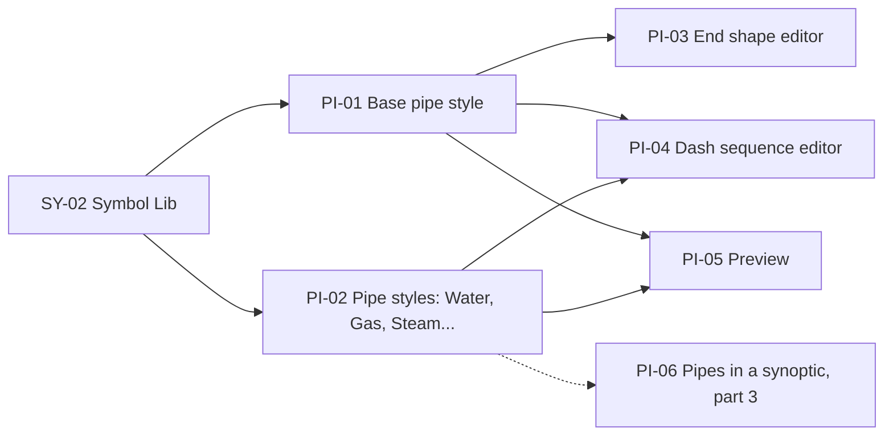
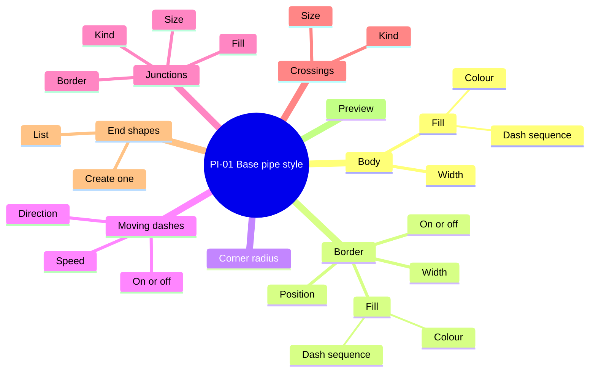
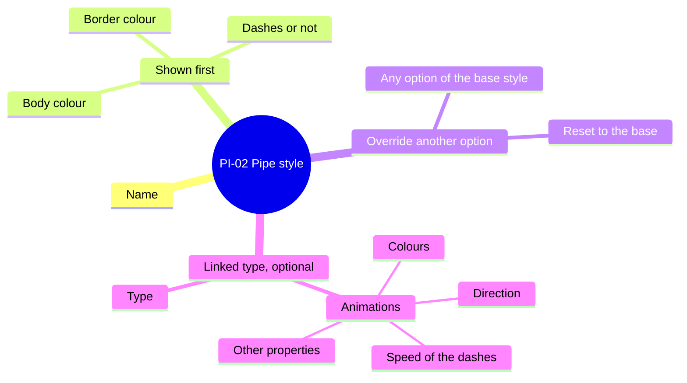
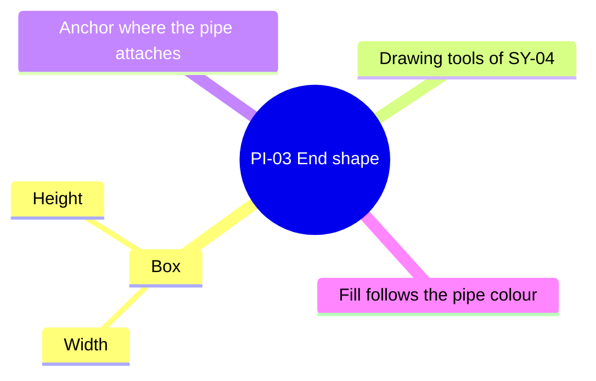
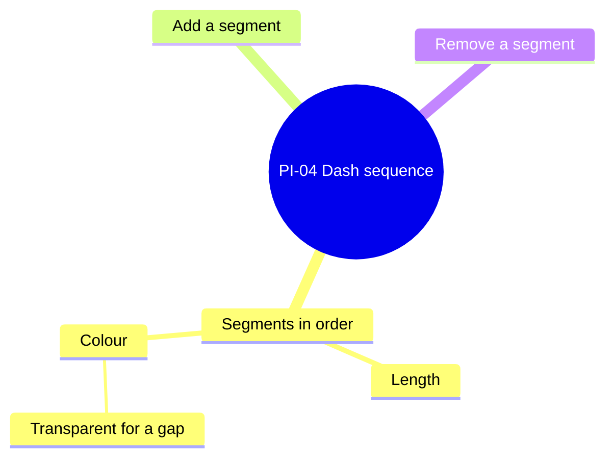
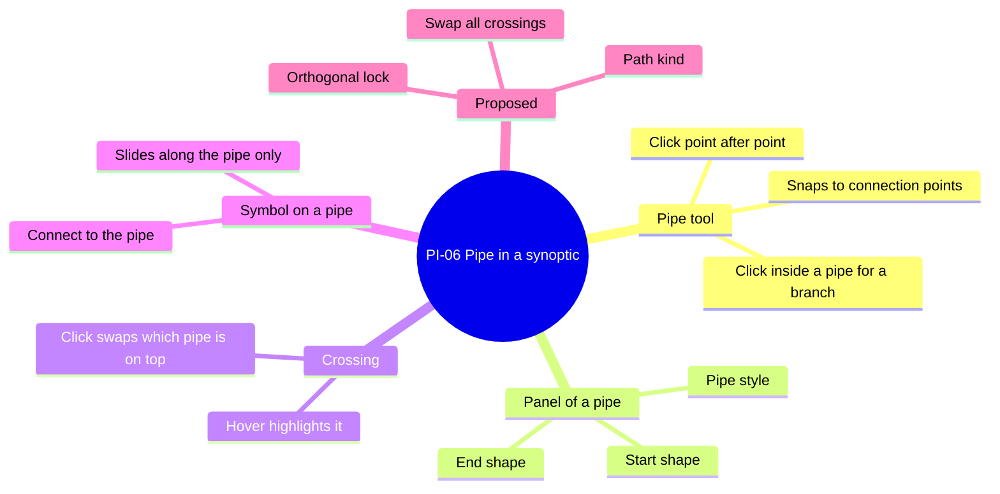

# Screens of the pipes

> [Home](../README.md) › [Screens](README.md) › Pipes

Status: draft, written by the assistant on 2026-11-11 from the [Pipes](../symbols/pipes/README.md) pages, themselves a draft. It adds no rule. Kinds and statuses are explained in the [guide of this folder](README.md).

The pipes are made in a Symbol Lib ([SY-02](symbols.md#sy-02--left-hand-panel-of-a-symbol-lib)) and drawn in a synoptic (part 3, not written). One base pipe style gives the look of every pipe of the library; each pipe style only changes what differs from it.

## PI-01 · Base pipe style

Path: Symbols › a Symbol Lib › Base pipe style. One per Symbol Lib.

| ID | Element | Kind | Values and behaviour | Status | Source |
| --- | --- | --- | --- | --- | --- |
| PI-01.1 | Width | Number field (px) | Width of the body. | Decided | [Pipe styles](../symbols/pipes/pipe-styles.md) |
| PI-01.2 | Body fill | Radio + Colour or dash sequence | A plain colour, or a dash sequence that runs from the start of the pipe to its end. | Decided | [Pipe styles](../symbols/pipes/pipe-styles.md) |
| PI-01.3 | Border | Toggle | When on, on both sides, the same. | Decided | [Pipe styles](../symbols/pipes/pipe-styles.md) |
| PI-01.4 | Border width | Number field (px) | — | Decided | [Pipe styles](../symbols/pipes/pipe-styles.md) |
| PI-01.5 | Border position | Radio | Inside, middle, outside the edge of the body. | Decided | [Pipe styles](../symbols/pipes/pipe-styles.md) |
| PI-01.6 | Border fill | Radio + Colour or dash sequence | Like the body. | Decided | [Pipe styles](../symbols/pipes/pipe-styles.md) |
| PI-01.7 | Corner radius | Number field (px) | 0 keeps sharp angles; also shapes the bridges. | Decided | [Pipe styles](../symbols/pipes/pipe-styles.md) |
| PI-01.8 | Moving dashes | Toggle | The dashes travel along the pipe; the movement goes on into the branches. | Decided | [Pipe styles](../symbols/pipes/pipe-styles.md) |
| PI-01.9 | Direction | Radio | From the start to the end, or the other way. | Decided | [Pipe styles](../symbols/pipes/pipe-styles.md) |
| PI-01.10 | Speed | Number field (not said) | Set in the style when no model drives it. | Proposed | [Pipe styles](../symbols/pipes/pipe-styles.md) |
| PI-01.11 | Junction kind | Radio | Flat, circle, square. | Decided | [Junctions](../symbols/pipes/junctions.md) |
| PI-01.12 | Junction size, fill, border | Number field + Colour + border options | Size fixed or a multiple of the width: Open. Own colour or the pipe's: Open. | Decided (details Open) | [Junctions](../symbols/pipes/junctions.md) |
| PI-01.13 | Crossing kind | Radio | Bridge, gap, none. | Decided | [Crossings](../symbols/pipes/crossings.md) |
| PI-01.14 | Crossing size | Number field | Size of the bridge; for a gap, a clearance on each side. | Proposed | [Crossings](../symbols/pipes/crossings.md) |
| PI-01.15 | End shapes | List + Button | The shapes a pipe of this style can have at its ends; each drawn in [PI-03](#pi-03--end-shape-editor). | Decided | [Pipe ends](../symbols/pipes/ends.md) |
| PI-01.16 | Preview | — | Always visible next to the style, redrawn at each change ([PI-05](#pi-05--preview)). | Decided | [Test display](../symbols/pipes/test-display.md) |

Gaps:

- Speed of the moving dashes: in which unit (pixels per second)?
- Can the base pipe style be linked to a type, or only the pipe styles (Open)?
- Usage counter "used by 38 pipes" (proposed).

## PI-02 · Pipe style

Path: Symbols › a Symbol Lib › Pipe styles › a style (Water, Gas...).

| ID | Element | Kind | Values and behaviour | Status | Source |
| --- | --- | --- | --- | --- | --- |
| PI-02.1 | Name | Text field | Free text: Water, Gas, Steam, Electricity. | Decided | [Pipe styles](../symbols/pipes/pipe-styles.md) |
| PI-02.2 | Body colour | Colour | Shown first: by default, a style only changes the colours. | Decided | [Pipe styles](../symbols/pipes/pipe-styles.md) |
| PI-02.3 | Border colour | Colour | Shown first. | Decided | [Pipe styles](../symbols/pipes/pipe-styles.md) |
| PI-02.4 | Dashes or not | Toggle | Shown first. | Decided | [Pipe styles](../symbols/pipes/pipe-styles.md) |
| PI-02.5 | Override another option | not said (button or list) | Any option of [PI-01](#pi-01--base-pipe-style); example: a smaller width for gas pipes. | Decided (control not said) | [Pipe styles](../symbols/pipes/pipe-styles.md) |
| PI-02.6 | Overridden options shown | — | The panel shows which options differ from the base. | Proposed | [Pipe styles](../symbols/pipes/pipe-styles.md) |
| PI-02.7 | Reset to the base | Button | Per overridden option. | Proposed | [Pipe styles](../symbols/pipes/pipe-styles.md) |
| PI-02.8 | Linked type | Select | Optional; any type of Metadata (no library of types). | Decided | [Pipe styles](../symbols/pipes/pipe-styles.md) |
| PI-02.9 | Animations | List, like [SY-08](symbols.md#sy-08--animation-mode) | Output signals drive the speed and direction of the dashes and the colours, and more ("plenty of things"). | Decided (properties beyond these: Open) | [Pipe styles](../symbols/pipes/pipe-styles.md) |

Gaps:

- When "dashes or not" is on and the base has no dash sequence, which sequence is used?
- Create, duplicate, delete a pipe style; what happens to the pipes that use a deleted style?
- Which properties a signal can drive beyond speed, direction and colours (Open).

## PI-03 · End shape editor

Path: base pipe style (or pipe style) › End shapes › create or open one.

| ID | Element | Kind | Values and behaviour | Status | Source |
| --- | --- | --- | --- | --- | --- |
| PI-03.1 | Box size | Number fields | The size the user wants. | Decided | [Pipe ends](../symbols/pipes/ends.md) |
| PI-03.2 | Drawing | Editor | With the tools of the drawing mode ([SY-04](symbols.md#sy-04--drawing-mode)). | Decided | [Pipe ends](../symbols/pipes/ends.md) |
| PI-03.3 | Anchor | not said (grid of anchors) | Where the pipe is attached. Nine anchors (specs) or four at the middle of the sides (archived Figma page): Open. | Decided (number: Open) | [Pipe ends](../symbols/pipes/ends.md) |
| PI-03.4 | Fill follows the pipe | — | The fill takes the pipe's colour when the style changes. | Decided | [Pipe ends](../symbols/pipes/ends.md) |
| PI-03.5 | Name of the end shape | not said | Arrow, flange, cap in the examples. | Implied | [Pipe ends](../symbols/pipes/ends.md) |

Gaps:

- Which parts follow the pipe colour (the whole shape, or only marked parts)?
- Copy an end shape from another style (archived Figma page).
- Does the shape turn with the last segment, and can it be mirrored?

## PI-04 · Dash sequence editor

Path: wherever a fill or a border can take dashes: [PI-01](#pi-01--base-pipe-style), [PI-02](#pi-02--pipe-style), and the border of a shape ([SY-04](symbols.md#sy-04--drawing-mode)).

| ID | Element | Kind | Values and behaviour | Status | Source |
| --- | --- | --- | --- | --- | --- |
| PI-04.1 | Segments | List | Repeated along the line: "black 4, transparent 4", "red 4, black 4"... as long as wanted. | Decided | [Pipe styles](../symbols/pipes/pipe-styles.md) |
| PI-04.2 | Length | Number field (px) | Per segment. | Decided | [Pipe styles](../symbols/pipes/pipe-styles.md) |
| PI-04.3 | Colour | Colour, with transparent | A gap is a transparent segment. | Decided | [Pipe styles](../symbols/pipes/pipe-styles.md) |
| PI-04.4 | Add, remove, reorder | not said | — | Implied | — |

Gaps:

- A ready-made list of common sequences (dashes, dots, dash and dot)?
- A maximum number of dashes per shape, set by the POC P8 (fill and border page).

## PI-05 · Preview

Path: next to the base pipe style or a pipe style being edited, always visible.

| ID | Case | What it shows | Status | Source |
| --- | --- | --- | --- | --- |
| PI-05.1 | Straight pipe | Body fill, width, border, dash sequences. | Decided | [Test display](../symbols/pipes/test-display.md) |
| PI-05.2 | Right angle | Corner radius. | Decided | [Test display](../symbols/pipes/test-display.md) |
| PI-05.3 | Other angles | An angle other than 90°, a very short segment. | Decided | [Test display](../symbols/pipes/test-display.md) |
| PI-05.4 | Junction, several junctions | One junction; a 3-way and a 4-way. | Decided | [Test display](../symbols/pipes/test-display.md) |
| PI-05.5 | Crossing | Both ways. | Decided | [Test display](../symbols/pipes/test-display.md) |
| PI-05.6 | Start and end | The end shapes of the style. | Decided | [Test display](../symbols/pipes/test-display.md) |
| PI-05.7 | Connected to a symbol | A pipe on a connection point. | Decided | [Test display](../symbols/pipes/test-display.md) |
| PI-05.8 | Base and style side by side | What the style overrides. | Proposed | [Test display](../symbols/pipes/test-display.md) |
| PI-05.9 | Symbol connected to a pipe | On a straight segment and in a bend. | Proposed | [Test display](../symbols/pipes/test-display.md) |

Gaps:

- Do the dashes move in the preview?
- Name: "Preview" proposed instead of "Test display".

## PI-06 · Pipes in a synoptic (part 3, preview)

Path: a synoptic › pipe tool. Part 3 is not written: this only gathers what the pipes pages already say.

| ID | Element | Kind | Values and behaviour | Status | Source |
| --- | --- | --- | --- | --- | --- |
| PI-06.1 | Pipe tool | Button (tool) | Click point after point, straight segments; snaps to connection points. | Decided | [Pipes in the synoptic](../symbols/pipes/in-the-synoptic.md) |
| PI-06.2 | Branch | — | Click inside a pipe, then draw. | Decided | [Pipes in the synoptic](../symbols/pipes/in-the-synoptic.md) |
| PI-06.3 | Pipe style | Select | Among the styles of the Symbol Lib. | Decided | [Pipes in the synoptic](../symbols/pipes/in-the-synoptic.md) |
| PI-06.4 | Start shape, end shape | Select each | Among the end shapes of the style, or none. | Decided | [Pipes in the synoptic](../symbols/pipes/in-the-synoptic.md) |
| PI-06.5 | Swap a crossing | Click on the crossing | Highlighted on hover. | Decided | [Pipes in the synoptic](../symbols/pipes/in-the-synoptic.md) |
| PI-06.6 | Connect to the pipe | not said (action on the symbol) | The symbol fits onto the pipe and only slides along it. | Decided | [Pipes in the synoptic](../symbols/pipes/in-the-synoptic.md) |
| PI-06.7 | Free the symbol | not said | Undo "connect to the pipe". | Proposed | [Pipes in the synoptic](../symbols/pipes/in-the-synoptic.md) |
| PI-06.8 | Orthogonal lock | Toggle | While drawing. | Proposed | [Pipes in the synoptic](../symbols/pipes/in-the-synoptic.md) |
| PI-06.9 | Path kind | Radio | Straight, right angles, rounded (archived Figma page). | Open | [Pipes in the synoptic](../symbols/pipes/in-the-synoptic.md) |
| PI-06.10 | Crossings of a pipe, swap all | List + Button | Archived Figma page. | Proposed | [Pipes in the synoptic](../symbols/pipes/in-the-synoptic.md) |

Gaps:

- Everything about part 3: this screen is only a reminder of what was said.
